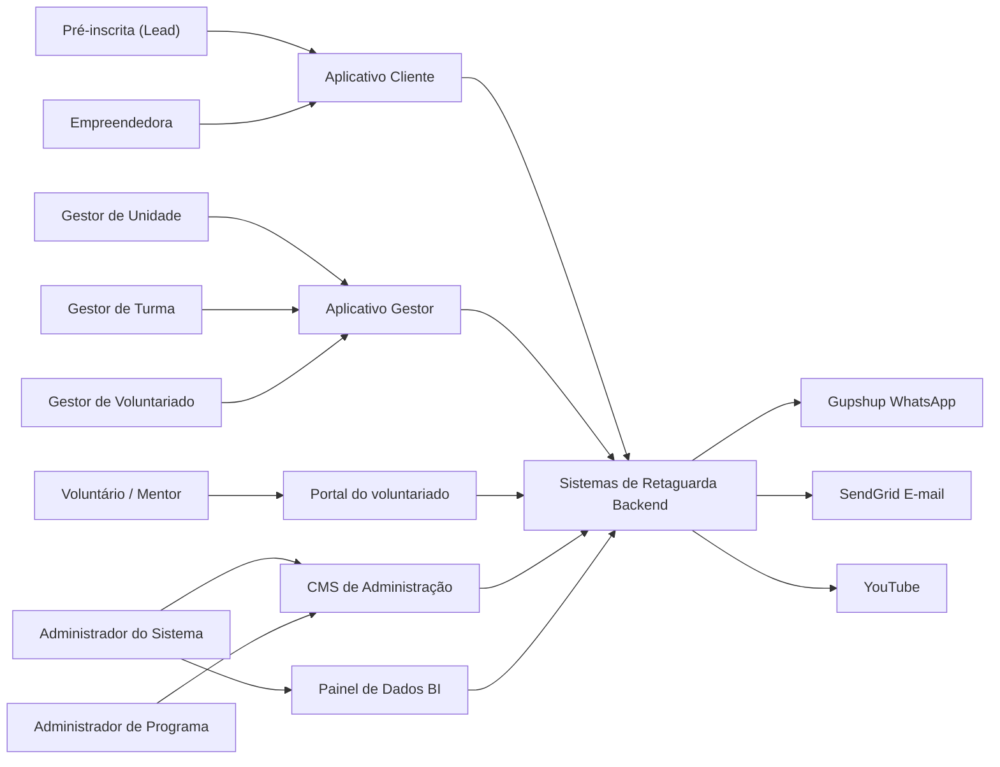

**Casos de Uso — Sistema de Gestão de Programas Sociais (Consulado da Mulher) — v10.2**

Especificação funcional canônica do sistema. Arquitetura em **seis grupos**:

1. **CMS de Administração** — modelagem de programas, edições, módulos, unidades, organizações, colaboradores, pacotes de comunicação (UC88) e o alerta automático de ficha incompleta (UC87); catálogo de áreas de mentoria (duração da sessão **fixa**: 30 min a 2h por encontro, em passos de 30 min, P/H e online — **não** configurada no CMS); **tipos de Ação**, textos e **módulo de treino** do portal do voluntariado. **Não** cadastra tipos de doação nem catálogo de itens de insumo ou equipamento. Biblioteca de mídias no S3.
2. **Aplicativo Gestor** — operação de seleção, turma, doação, Mini CRM (UC26), **mentorias** (Unidade/Turma fazem o match, agendam e registram, com auditoria); Ranking e Engajamento (UC56); perfil **Gestor de Voluntariado** com menu nacional de ações, voluntários e mentorias; autenticação por link mágico.
3. **Aplicativo Cliente** — jornada da empreendedora; autenticação por link mágico; Agente de IA (UC64); pedido/diagnóstico de mentoria (UC70).
4. **Portal do voluntariado** — cadastro, módulo CMS, pool de demandas, ações, aceite e diário (UC73/UC70/UC89/UC90); autenticação por link mágico (e-mail).
5. **Painel de Dados (BI)** — dashboards e relatórios (Looker Studio).
6. **Sistemas de Retaguarda (Backend)** — APIs, regras, fila de jornada (UC33) e fila de alertas (UC87/UC52); integrações Gupshup e SendGrid.

**Documentos relacionados:** [Tipos_de_Atividade.md](Tipos_de_Atividade.md) · [docs/jornadas/comunicacao.md](docs/jornadas/comunicacao.md) (leitura operacional dos slots UC88) · [prototipo/](prototipo/) · atas em [reunioes/](reunioes/)

Stack: Next.js, Node.js, Express, Prisma, MySQL; hospedagem AWS.

---


## Atores

Atores são apenas quem **interage** com o sistema. Cadastros gerenciados pelo sistema (Colaborador, Organização) viraram **entidades de domínio**; **Voluntário / Mentor** é ator (portal do voluntariado). Backend é **camada do sistema** (ver Plataformas do Sistema).

### Atores — Pessoas


| Ator                                                 | Descrição                                                                                                                                                                                                                                                                                                                                                                                                                                                                                                                                                                                                                                                                                                                                           |
| ---------------------------------------------------- | --------------------------------------------------------------------------------------------------------------------------------------------------------------------------------------------------------------------------------------------------------------------------------------------------------------------------------------------------------------------------------------------------------------------------------------------------------------------------------------------------------------------------------------------------------------------------------------------------------------------------------------------------------------------------------------------------------------------------------------------------- |
| **Pré-inscrita (Lead)**                              | Pessoa que iniciou o processo de inscrição mas **ainda não concluiu** a inscrição completa (UC19/UC20/UC21). Objeto do mini CRM (UC26) e dos lembretes de inscrição incompleta (alerta automático UC87 + disparo manual). Torna-se **Empreendedora** ao concluir a inscrição completa (UC21).                                                                                                                                                                                                                                                                                                                                                                                                                                                       |
| **Empreendedora**                                    | Mulher empreendedora em situação de vulnerabilidade social, com **inscrição completa** registrada. Acessa o **Aplicativo Cliente** exclusivamente por **link mágico** (WhatsApp ou e-mail) — **não há senha** de autenticação. **Não solicita doação** no Aplicativo Cliente (sem botão, banner ou formulário de pedido — UC38/UC57). Realiza atualização cadastral, módulos, conteúdos, questionários, uploads, **saúde financeira** mensal (UC45), solicitação de desligamento (UC79) e **mentoria (UC70)** na área **Mentoria** do menu global (Programas · Mentoria · Certificados · Ajuda IA — UC92; `/app/mentorias`: Início = módulo CMS; abas **Em aberto · Minhas · Encerradas**). **Solicitar** bloqueado até concluir o módulo. O pedido também pode ser feito pelo botão **Solicitar mentoria** na home do programa (UC70). Inclusão pelo Gestor **não** exige treino. No **P/H**, o pedido vai a **Em aberto** do portal do voluntariado; Unidade/Turma aloca lote **ou** um voluntário pega; ou **Atendido pelo gestor** sem BI. No **online**, diagnóstico só após entrar no lote de encerramento. Encerramento: texto + NPS da plataforma + NPS do mentor (`atendida_gestor`: sem NPS de mentor, sem certificado). Certificados: filtro **Programa \| Mentoria**. Todo registro operacional vincula-se a **programa**, **edição**, **unidade** e **turma**. A **qualificação** na seleção (UC24) classifica o perfil; a **Comunicar aprovação** (UC25) é o que **inicia a jornada educacional** (online → UC33; P/H → convite ao grupo). Unidade/turma podem vir da inscrição (automático se únicas) ou da distribuição na tela de seleção. |
| **Administrador do Sistema (CMS de Administração)**  | Perfil **master** com controle total: usuários, programas, unidades, associação de gestores e configuração global.                                                                                                                                                                                                                                                                                                                                                                                                                                                                                                                                                                                                                                  |
| **Administrador de Programa (CMS de Administração)** | Usuário do CMS com escopo restrito a programas/edições. Gerencia conteúdos, programas, edições (incluindo módulos associados), organizações, colaboradores e unidades do seu escopo.                                                                                                                                                                                                                                                                                                                                                                                                                                                                                                                                                                |
| **Gestor de Unidade (Aplicativo Gestor)**            | Usa o **mesmo Aplicativo Gestor**, autenticado por **link mágico**. Visão sobre **todas as turmas da unidade** na edição. **Inclui funções do Gestor de Turma** mais: **seleção em etapas** — classificar (UC24), **entrevista de seleção** P/H (UC84), alocar turma (UC17), **comunicar** (UC25); remanejar (UC18); doação sugerir/aprovar (UC57); inscrever (UC21/UC69); **gerenciar** os empreendimentos cadastrados pelas empreendedoras — agrupar (UC31) e mover (UC32) —, **sem cadastrar empreendimento**; **dispara** WhatsApp e/ou e-mail do Ranking e Engajamento (UC56) e pode cadastrar **Download extra** no módulo online (UC35); **mentorias (UC70)** — faz o **match** (aloca mentores; 1º = líder; cadastro UC73), **agenda** e registra sessões, com **controle completo** do caso e **auditoria** de quem fez cada atividade, ou **Atendido pelo gestor** (sem BI); recorte de voluntários da edição só para **escolher mentor**; **não** opera ações (UC90). Pode **alterar a mensagem padrão** do grupo WhatsApp (UC50). **Acesso de gestor** à conta da empreendedora, com auditoria (UC69). |
| **Gestor de Turma (Aplicativo Gestor)**              | Usa o **mesmo Aplicativo Gestor**, autenticado por **link mágico**. **Age apenas sobre a própria turma** na edição selecionada. Responsabilidades: **visão por módulo** e **liberação de atividades** escolhidas pelo gestor (UC34), data/local de presenciais, **aprova saúde financeira e entregas** (UC44), analisa questionários, cria conteúdo extra **só em edições presenciais/híbridas** (UC35), consulta o Ranking e Engajamento **sem disparar** (UC56), relato de oficina (UC80), uploads, cancelamento/desistência (UC30) e **sugere doação** (aprovação Unidade — UC57). Comunicação de grupo WhatsApp manual (UC50), podendo **alterar a mensagem padrão** do template; edita e-mail/telefone. **Não** move entre turmas/unidades e **não altera** temporizadores online (UC33). Pode inserir dados em nome da empreendedora ou **acessar a conta dela com acesso de gestor** (UC69), com auditoria de quem, quando e o quê. Em **mentorias (UC70)** faz o **match** (aloca mentores; cadastro UC73; 1º = líder), **agenda** e registra sessões com controle completo e auditoria, comunica via `wa.me`, **Atendido pelo gestor** (sem BI) ou recusa. Consulta voluntários da edição para alocar. **Não** opera ações (UC90). Parceiro **Multiplica por Elas** usa as **mesmas telas de Turma**. Horas de educador interno **não** entram na métrica de voluntários. |
| **Gestor de Voluntariado (Aplicativo Gestor)**       | Perfil **CMS** (UC1/UC5) no **mesmo Aplicativo Gestor** (link mágico). **Não tem** Dashboard de edições: o login abre **direto** `/gestor/voluntariado` com o **menu contextual** (Home, Gestão de ações, Gestão de voluntários, Gestão de mentorias). Opera ações (criar, ativas, convites, inscrições, resultados — UC90) em **todas as edições** (ação pode existir sem edição). Aprova cadastros da rede (UC73). Consulta mentorias (abertas / em andamento / finalizadas e as abertas há muito tempo); **não** aloca lote (isso fica na Unidade/Turma). Pode acumular papéis com Unidade/Turma (cada perfil tem o próprio shell). |
| **Voluntário / Mentor (portal do voluntariado)**     | Pessoa da **rede de voluntariado** (cerne; mentoria é uma ação). Cadastro **único** e **individual** mesmo em grupo (UC73): modalidades **individual**, **coletiva** e/ou **Ações**; áreas de interesse e expertise; dados sensíveis no padrão das empreendedoras. Auth **link mágico no e-mail** (UC89). **P/H:** abas **Em aberto · Minhas · Encerradas**; pega demanda (vira líder — match automático pelo portal) ou entra em lote alocado; entre os voluntários, só o líder agenda/registra/encerra (o gestor também pode — UC70); registra cada sessão de 30 min a 2h, em intervalos de 30 min; todos preenchem texto+NPS; horas e certificado herdados. Treino = **módulo CMS** (bloqueia Pegar). **Online:** pool com `vagas` N e diário por pessoa. Inscreve-se em **ações** (UC90; confirmação do Gestor de Voluntariado). “Em atividade numa edição” é derivado. |

> **Regra geral:** em regra, o **gestor** pode realizar, no Aplicativo Gestor, **tudo o que a empreendedora realiza** no Aplicativo Cliente (em nome dela — ver UC69), inclusive **acessando a conta dela com acesso de gestor**. **Todas as alterações** feitas pelo gestor ficam registradas para **auditoria** (quem, quando, o quê). **Exceção:** o gestor **não cria empreendimento** — quem cadastra é a empreendedora, no cadastro inicial (UC21) ou na área dela no Aplicativo Cliente (UC31); o gestor só gerencia e corrige dados, com auditoria. Se o gestor pode cadastrar o empreendimento em nome dela pela UC69: **[A CONFIRMAR] (vii)** (padrão até decisão: não). Na doação de insumo ou equipamento, quem **cadastra a NF de cada item** é o gestor; a foto da nota pode vir da empreendedora (UC57/UC86).

> **Menu global da empreendedora:** **Programas · Mentoria · Certificados · Ajuda IA** (UC92). O calendário (UC68) permanece sem item próprio no menu; o pedido de mentoria pode ser feito pelo hub Mentoria ou pela home do programa (UC70).


### Atores — Sistemas Externos


| Ator                                | Descrição                                                                                                                                                                                                |
| ----------------------------------- | -------------------------------------------------------------------------------------------------------------------------------------------------------------------------------------------------------- |
| **Gupshup (WhatsApp Business API)** | Provedor de envio de mensagens WhatsApp: texto, links com login mágico, solicitações e envio de videoaulas. Acionado **somente pelo Backend**.                                                           |
| **SendGrid (E-mail)**               | Provedor de envio de e-mails transacionais: links mágicos da **empreendedora** (UC4/UC54), do **gestor** (UC3) e do **voluntário** (UC89), lembretes/alertas (UC26/UC87) e comunicações gerais. Acionado **somente pelo Backend**. |
| **YouTube**                         | Ator secundário para videoaulas gravadas e transmissões ao vivo (lives maiores com **StreamYard** — UC38).                                                                                               |
| **Google Meet**                     | Ator secundário para encontros ao vivo **pequenos**, com perfil de reunião (aula ao vivo e workshop/live de encerramento, quando o **Gestor de Unidade ou de Turma** escolhe esse canal ao aplicar a atividade ou configurar o workshop — UC34/UC38). Fora da plataforma; no workshop, a presença é registrada pela palavra-chave. |


### Entidades de domínio (não são atores)

Cadastros **gerenciados pelo sistema**, sem interação própria (sem login/interface):

- **Colaborador** — funcionário do Consulado cadastrado no CMS (UC1); é o **cadastro** que recebe **um único tipo** de perfil: **Administrador de Programa**, **Gestor de Unidade**, **Gestor de Turma** ou **Gestor de Voluntariado**. Gestor de Unidade e Gestor de Turma são associados a unidades e turmas **dentro de cada edição** (UC75). Quem atua nos UCs é sempre o **papel** atribuído, não o colaborador em si.
- **Organização (Patrocinador / Parceiro)** — pessoa jurídica (CNPJ) associável a uma edição como patrocinador ou parceiro (UC10/UC11). Caso se confirme visão restrita no BI para financiadores (UC59), retorna como ator secundário.

> **Convenção:** **Sistemas de Retaguarda (Backend)** são **camadas do sistema em construção** (ver Plataformas do Sistema), não atores externos. Quando citados em casos de uso, indicam **execução automática** pelo sistema, não um usuário. **Mautic não faz parte do projeto.**


### Plataformas do Sistema

O sistema é organizado em **seis grupos** (plataformas/camadas):

1. **CMS de Administração** — modelagem de programas, edições, módulos, unidades, organizações e colaboradores (implementado com Strapi); **cria/configura** pesquisa pós-programa (UC82), **pacotes de comunicação** (UC88) e o alerta automático de **ficha incompleta** (UC87 — mesma área Comunicação); catálogo de **áreas de mentoria**, **tipos de Ação** (palestra, gravação, oficina pontual — **sem** doação de sangue), textos das modalidades, **módulo de treino** (mesmos tipos de atividade), materiais, `prazo_match_horas` e limiares de inatividade / mentoria aberta há muito tempo. Biblioteca de mídias no S3. **Não** cadastra tipos de doação nem um catálogo de itens de insumo ou equipamento.
2. **Aplicativo Gestor** — app **único** para **Gestor de Unidade**, **Gestor de Turma** e **Gestor de Voluntariado**; autenticação por **link mágico**. Unidade/Turma: home = **Dashboard de edições**. Gestor de Voluntariado: **não tem** página de edições — login abre direto `/gestor/voluntariado` com o menu contextual. Inclui **Mini CRM** (UC26). Unidade **dispara** recados do Ranking (UC56) e pode cadastrar **Download extra** no online (UC35). **Não dispara** a pesquisa após a formação (UC82 — backend).
3. **Aplicativo Cliente** — interface da empreendedora (inscrição, atividades, uploads, dados financeiros); autenticação exclusiva por **link mágico**; inclui **Agente de IA** / chat de dúvidas (UC64); diagnóstico/pedido de mentoria (UC70).
4. **Portal do voluntariado** — portal da rede: cadastro único, módulo CMS, pool, ações, aceite, card, diário, certificados; auth **link mágico por e-mail** (UC89).
5. **Painel de Dados (BI)** — dashboards, indicadores e relatórios em **Looker Studio / Data Studio** ligado ao banco (fora do app operacional); acessos Google geridos pelo Consulado; **visualiza** resultados da pesquisa pós-programa (UC82). **Orçamento não entra** no dashboard operacional.
6. **Sistemas de Retaguarda (Backend)** — APIs, regras de negócio, **duas filas de comunicação**: (a) **jornada WhatsApp** liberar / OK / lote — UC33; (b) **alertas de engajamento** — UC87/UC52; integrações (Gupshup, SendGrid), autenticação, persistência. Sem motor externo de marketing.


| Camada                   | Responsabilidade principal                                                                                                 |
| ------------------------ | -------------------------------------------------------------------------------------------------------------------------- |
| **CMS de Administração** | Configuração, cadastros, critérios, conteúdo; pesquisa pós-programa; **pacotes de comunicação** (UC88); alerta de ficha incompleta (UC87); áreas/módulo treino; perfil Gestor de Voluntariado; biblioteca de mídias (S3). **Sem** cadastro de tipos de doação nem catálogo de itens |
| **Aplicativo Gestor**    | Operação de seleção/turma/doação; Mini CRM; Unidade/Turma **alocam mentorias**; Unidade dispara o Ranking (UC56); Gestor de Voluntariado opera ações/rede |
| **Aplicativo Cliente**   | Jornada da empreendedora; Agente de IA (UC64); diagnóstico/pedido UC70                                                     |
| **Portal do voluntariado**| Cadastro, módulo CMS, pool, ações, aceite, diário, certificados (UC73/UC70/UC89/UC90)                                                 |
| **Painel de Dados (BI)** | Indicadores; UC82; sessões/área; **pessoas voluntárias únicas**/ano; horas voluntário ≠ equipe                         |
| **Backend**              | APIs, regras, persistência, tokens, UUID (UC67), Gupshup/SendGrid, **fila jornada** (UC33) e **fila alertas** (UC87)       |


Stack contratual: Next.js, Node.js, Express, Prisma, MySQL; hospedagem AWS.

### Conceitos de Domínio

**Programa** — metodologia principal: **modalidade** (**online**, **presencial** ou **híbrido**), **descrição** e classificação de **duração** (**Longa / Média / Curta**) no Admin para agrupamento no **BI** e alinhamento de metas/risco. Não contém módulos diretamente; é lançado em **edições**. **Presencial e híbrido são idênticos em comportamento** no sistema; a modalidade separa os dados no **Painel de Dados (BI)** e na prestação de contas (ex.: BNDES). **Online** tem jornada e disparos pagos contínuos via API.

**Edição** — instância operacional do programa. Define: programa vinculado, **unidades participantes**, ano de competência, nome da edição, datas de **inscrição**, **seleção** e **aplicação**, meta de beneficiados, **meta numérica e valor de doação** (quando a edição concede doação), **módulos** e sequência, **percentuais de beneficiamento e certificação** (UC13), **pacote de comunicação** (UC88 — relação evento × mensagem na Gupshup; tabela default), e no **online** o checkbox de videoaula WhatsApp + limiares de maratona/risco + **prazo pós-live** (KW/quiz). O **número WhatsApp da organização** (canal que a usuária deve contatar) é cadastrado no **CMS (Strapi)** — global ou por edição.

**Canal WhatsApp da organização (Strapi)** — número Business (Gupshup) exibido no Aplicativo Cliente ao fim do cadastro. A empreendedora **deve enviar uma mensagem** a esse número; o **webhook inbound** do backend reconhece o contato e dispara o **template Meta de confirmação de inscrição** configurado na edição. Isso **abre a janela de 24h** / opt-in operacional e **não** inicia a jornada educacional.

**WhatsApp pago (API / Gupshup) × modalidade**


| Modalidade               | Uso da API paga                                                                                                                                                                                                                     |
| ------------------------ | ----------------------------------------------------------------------------------------------------------------------------------------------------------------------------------------------------------------------------------- |
| **Online**               | (1) Resposta ao **primeiro contato** da usuária (template inscrição); (2) **Comunicar aprovação** (UC25) = 1º gatilho do módulo + jornada; (3) temporizadores / OK / lote (UC33); (4) **documentos de Download** e vídeos (UC51); (5) mensagens do gestor (UC53) |
| **Presencial e híbrido** | (1) Opcional: mesmo padrão de 1º contato pós-cadastro se a edição usar; (2) **Comunicar aprovação** (UC25): **único** envio operacional pago — boas-vindas + **link do grupo da turma**. Depois: só grupo (UC50).                   |


**Classificar ≠ Comunicar ≠ Liberar atividades**


| Ação                                 | O que faz                                               | O que **não** faz                                                                                |
| ------------------------------------ | ------------------------------------------------------- | ------------------------------------------------------------------------------------------------ |
| **Classificar** (UC24)               | Status **qualificado** / em análise / não qualificado   | **Não** envia WhatsApp; **não** inicia automação; **não** aloca turma                            |
| **Entrevista de seleção P/H** (UC84) | Presença + **aprovada** / não aprovada                  | Só presencial/híbrido                                                                            |
| **Alocar turma** (UC17)              | Etapa 3; turma única = automático                       | **Não** inicia jornada                                                                           |
| **Comunicar** (UC25)                 | Disparo **manual** do gestor                            | **Online:** 1º gatilho UC33. **P/H:** convite grupo (aprovada+turma). Também avisa não aprovadas |
| **Liberação de atividades (online)** | Após UC25, **automática** por temporizador (backend)    | Gestor **não** marca checkbox para liberar no online; acompanha e dispara UC53 se preciso        |
| **Liberação (presencial/híbrido)**   | Gestor libera encontro a encontro (UC34) + grupo (UC50) | Sem temporizador / sem lote Gupshup                                                              |


**Participação efetivada (presencial/híbrido)** — após UC25, a empreendedora recebe o convite ao grupo. **Quem não entra no grupo da turma não tem a participação efetivada**. O gestor confirma o ingresso na lista da turma.

**Unidade** — agrupa pelo menos **uma turma**; colaboradores e gestores são vinculados à unidade. Na inscrição, a empreendedora seleciona a unidade (exceto unidade única — alocação automática).

**Turma** — operacionalizada pelo **Gestor de Turma**. **Toda edição** tem **pelo menos uma unidade e uma turma**. Vínculo automático se turma única; se várias turmas (P/H), alocação na **etapa 3** após entrevista de seleção/aprovação (UC17). **Não** inicia a jornada. Link/código do **grupo WhatsApp** da turma é propriedade da turma (UC16) e é exigido para liberar jornada via UC25 (P/H). Capacidade é **soft** (alerta se desbalanceada; **sem** trava rígida).

**Seleção em etapas (Aplicativo Gestor — só Unidade)** —


| Etapa                               | O quê                                                    | Modalidade                                           |
| ----------------------------------- | -------------------------------------------------------- | ---------------------------------------------------- |
| **1. Classificar** (UC24)           | Qualificado / em análise / não qualificado; score X/Y    | Todas                                                |
| **2. Entrevista de seleção** (UC84) | Agendar, presença, aprovar / não aprovar quem compareceu | **Só presencial/híbrido**                            |
| **3. Alocar em turma** (UC17)       | Aprovadas → turma(s) da unidade; painel de ocupação      | P/H com **várias** turmas (turma única = automático) |
| **Comunicar** (UC25)                | Informa resultado; **libera jornada** das aptas          | Todas                                                |


**Online:** tipicamente unidade+turma únicas → após classificar, segue a **UC25** (sem entrevista de seleção). **P/H:** qualificadas passam pela entrevista de seleção antes de alocar/comunicar. Pode haver **rodadas** de qualificação + entrevista até a meta da edição (meta pode ultrapassar um pouco antevendo desistências).

**Localização nas listagens (seleção / entrevista de seleção / turmas):** as listas exibem **Cidade/UF** e **Bairro** da empreendedora (do cadastro), **não** a unidade operacional. O mesmo vale para o **CSV de presença da entrevista** (UC84). A unidade **não** aparece como filtro nem como coluna nessas listas (o escopo do gestor já restringe a unidade).

**Elegibilidade — bloqueio de cadastro × régua pontuável (UC12)** — não confundir:

- **Bloqueio (não pontuam; nem se cadastram):** idade **< 18** (todas as modalidades); **indisponibilidade** para encontros presenciais (**presencial/híbrido**). **Formalização** (informal / MEI / ME) permanece no cadastro como filtro — **não pontua**.
- **Régua pontuável (Admin, por edição):** catálogo de **6** critérios ativáveis — tempo de negócio; renda familiar per capita; não ter carteira assinada; não ser funcionário público; ter internet; ter WhatsApp. Cada ativo atendido = **1 ponto** → score **X/Y** (Y = nº de critérios ativos). Internet e WhatsApp **não bloqueiam** a inscrição: respondem no cadastro e entram no score/qualificação (UC23/UC24). Distinto da elegibilidade à **doação** (UC14/UC85 A–D).

**Alocação automática (unidade/turma única)** — quando a **edição** possui **apenas uma unidade**, a empreendedora é **alocada automaticamente** nessa unidade na inscrição. Quando a unidade (ou edição) tem **apenas uma turma**, as **qualificadas/aprovadas** já ficam vinculadas a essa turma (sem tela de escolha). Típico **online**; também vale em P/H com turma única.

**Identificador automático (ID)** — o sistema **gera automaticamente um ID único** para cada empreendedora/registro, eliminando o controle manual por planilhas.

**Doação** — benefício concedido à empreendedora participante, com **tipo**: **dinheiro (capital semente)**, **insumo** (ex.: farinha, açúcar) ou **equipamento** (ex.: forno, geladeira). Os três tipos são **fixos** no sistema: o **CMS de Administração não cadastra** tipos de doação nem um catálogo de itens. Cada item é uma linha **digitada** na doação, no Aplicativo Gestor (descrição, quantidade e valor); farinha, açúcar, forno e geladeira são **exemplos**, não lista administrável. Cada doação tem **N itens**, e uma empreendedora pode receber **N doações** — no mesmo programa, em programas diferentes e ao longo do histórico. Titularidade **pessoa × empreendimento**: **[A CONFIRMAR] (iii)**, ligada à [DECISÃO PENDENTE – reunião com Daniele] (UC86). Valor: **real** no dinheiro; **estimado** em insumo e equipamento até a nota fiscal do item ser cadastrada (UC57). **A empreendedora nunca inicia doação no Aplicativo Cliente** — sem botão, banner ou formulário de pedido. **Dois caminhos por modalidade**:


| Modalidade               | Gatilho de liberação para doação                                                                                                                                                                                                                                                                                  | Quando                           |
| ------------------------ | ----------------------------------------------------------------------------------------------------------------------------------------------------------------------------------------------------------------------------------------------------------------------------------------------------------------- | -------------------------------- |
| **Presencial / híbrido** | Análise **manual**: o **Gestor de Turma sugere** e o **Gestor de Unidade aprova** (o Unidade pode fazer os dois passos — UC57), individual ou em **lote**. Não depende de live, palavra-chave nem questionário 100%.                                                                                                                                                                       | **Qualquer momento** do programa |
| **Online**               | Resultado da jornada: participar → responder corretamente as atividades → procedimentos de encerramento (**workshop**, **palavra-chave**, **questionário** — UC38) → status **liberada para doação** (elegível à **seleção**, não ganhou). Funil: **100% das atividades** (ou **exceção permitida e registrada**) → **live / workshop** (Google Meet ou YouTube + StreamYard, canal escolhido pelo Gestor de Unidade ou de Turma; **fora** da plataforma) → **presença** com **palavra-chave** → **questionário final 100% certo**. O funil **não** abre formulário de pedido. A concessão é a **seleção** no Gestor (UC57). | Só ao **fim** do funil + seleção |


**Ranking / desempate pós-elegibilidade** (quando o orçamento não cobre todas as liberadas): nº de dependentes, qualidade das respostas do questionário final, e análise subjetiva excepcional do Consulado. **Distinto** da régua de inscrição (UC12) e dos filtros A–D (UC14).

**Pós-liberação (comum às duas jornadas):** indicar **conta corrente ou PIX**, **assinar recibo** (conta **725**; dinheiro: assinatura **antes** do pagamento; insumo/equipamento: **após** a entrega e só depois que o gestor cadastrar as notas fiscais de **todos os itens** — o recibo nunca mostra valor estimado) e **aceites** (UC86), **por doação**. Endereço de entrega: número, complemento e **ponto de referência**. Em tela unificada no Aplicativo Gestor: o **Gestor de Turma sugere**; o **Gestor de Unidade aprova** — e o Unidade **também pode sugerir e, em seguida, aprovar** (dois passos rastreáveis — UC57), inclusive em **doação em massa**. Filtros A–D + lote (UC14/UC85) são **auxiliares** (ex. destaque de já contemplada em edições anteriores — "Já contemplada na edição X", sem bloqueio) e **não** substituem o funil online nem a análise manual P/H. Dentro da edição, N doações sem carência. Filtro **recebeu doação**. O termo **"premiação"/"premiado"** foi substituído por **"doação"**; status/relatórios podem refletir **"recebeu doação"** nos sócios vinculados.

**Grupos WhatsApp (dois níveis)** — a aplicação prevê **dois níveis** de grupo WhatsApp: (1) grupo entre **gestores de unidade e gestores de turma** (coordenação interna — o Gestor de Unidade administra o grupo dos gestores de turma); (2) grupo entre **gestores de turma e empreendedoras** (comunicação operacional da turma). O grupo da turma é criado **somente após a aprovação** (UC25) — não antes, para evitar remoções manuais. A gestora cria o grupo no WhatsApp, adiciona o **número corporativo/sistema como administrador** (redundância se a gestora sair) e cadastra o **link de convite** na turma (UC16). O sistema **não** cria grupos via API (limitação Meta). Ambos os gestores enviam mensagens por **ferramenta de facilitação** (copiar mensagem pré-formatada para a área de transferência + link de acesso direto ao grupo — UC50); o envio efetivo é manual, no WhatsApp (celulares corporativos — WhatsApp Web bloqueado em PCs). **Comunidade** WhatsApp (relacionamento de longo prazo, distinta dos grupos de turma) é evolução — ver Observações de Escopo.

**Módulo** — conjunto ordenado de **N atividades** da edição (UC15). A lista e o progresso (**N de M**, %) são **por atividade**. **Aula (agrupador)** só organiza: título + quais atividades pertencem a ela, na ordem do CMS. Sem regra própria de liberação; **não** é item da lista nem unidade de progresso. O backend pode gravar a aula de origem da atividade; isso **não** muda o cálculo. Agrupamento: **Edição → Módulo → Aula (agrupador) → Atividade**. Distinto de **Aula (tipo)** — encontro presencial ou online (P/H). Módulos antigos: atividades numa aula só, **"Aula 1"**. Temas de referência (CMS): Encontros de Chegada, Planejamento Estratégico, Finanças, Marketing, Pessoas, Formalização, Sustentabilidade. No **presencial/híbrido**, o gestor libera por checkbox (UC34). No **online**, a sequência/temporizadores das **atividades** rodam **após UC25**; o gestor **acompanha** (não libera manualmente cada atividade).

**Encerramento (marcador)** — atividade que a empreendedora **não vê**. Tudo **depois** dele no módulo é **pós-curso** e aparece em bloco separado no App Gestor e no App Cliente (UC82).

**Empreendimento (Negócio)** — entidade central da **operacionalização**, em **tabela distinta** da empreendedora. Cada inscrição completa (UC21) cria **1 empreendedora** e **1 empreendimento** vinculados. O empreendimento é **cadastrado pela empreendedora** — na inscrição (UC21) ou na área dela no Aplicativo Cliente (UC31) — e **não** pelo gestor, que só o gerencia. Informal **não** tem CNPJ; o sistema **não** une automaticamente pelo nome fantasia (homônimos). Duas sócias do mesmo negócio informal ficam em **dois** estabelecimentos até o gestor **agrupar** (UC31). Relação canônica: **N empreendedoras → 1 empreendimento**. A **qualificação na seleção é do empreendimento como um todo**. **Doação:** N doações por empreendedora, de qualquer tipo; titularidade pessoa × empreendimento **[A CONFIRMAR] (iii)**.

**Propriedade operacional — Empreendimento × Empreendedora** (regra canônica — ago/2026):


| Escopo                                              | O que                                                                                                                                                                                                                                                                                                                                              |
| --------------------------------------------------- | -------------------------------------------------------------------------------------------------------------------------------------------------------------------------------------------------------------------------------------------------------------------------------------------------------------------------------------------------- |
| **Empreendimento** (registro único / compartilhado) | Presença em eventos (1 sócio presente = presença do empreendimento naquele evento); cumprimento de atividades para **beneficiamento** e **certificação** conforme **% da edição** (em geral **50% / 75%** — UC13); sócios podem **alternar** quem realiza; **saúde financeira** (1 registro por competência — UC45); planos; **plano de ação**; desistência; **doação** (titularidade **[A CONFIRMAR] (iii)** — v10) |
| **Empreendedora** (por pessoa)                      | Canal WhatsApp / login mágico; **questionários** (inicial/final/NPS e demais respostas individuais — entendimento diferente por pessoa); perfil BI (gênero, raça, idade); observações de acompanhamento                                                                                                                                            |
| **Efeito em cascata**                               | Quando o **empreendimento** atinge critérios de beneficiamento/certificação, **todos os sócios** da edição recebem o **certificado** e entram na contagem de **beneficiadas**                                                                                                                                                                      |
| **BI (dupla contagem)**                             | N sócias de um negócio = **N pessoas** (N beneficiadas, N certificadas, N ativas) **e** **1 empreendimento**; **doação = 1** por negócio (não N)                                                                                                                                                                                                   |


**Jornada WhatsApp (programas online)** — templates do **pacote UC88**. (1) pós-cadastro: usuária escreve no número da org → template inscrição; (2) gestor **comunica aprovação** (UC25) → **1º gatilho** do módulo → backend agenda temporizadores; (3) OK da empreendedora → envio em lote (template por **tipo** de atividade). No tipo **Download**, o lote leva o template **e os arquivos** no WhatsApp da usuária; os mesmos documentos permanecem no Aplicativo Cliente. Progresso compartilhado no **empreendimento**; questionários por pessoa. Links com login mágico.

**Maratona (online)** — comportamento esperado: a empreendedora **não** acompanha o calendário de liberação dia a dia. Espera um dia com mais tempo e **conclui de uma vez** o lote já liberado/enviado e ainda pendente (“maratonar”). **Represamento** (atividades liberadas e não feitas) **não** é atraso pedagógico nem sinal isolado de evasão — é o desenho da jornada intercalada (UC33).

**Risco de evasão — dois níveis** (por duração típica do programa; limiares na edição — UC9):


| Perfil            | Modalidade típica    | Duração        | Regra de risco                                                                                                                                                                                                |
| ----------------- | -------------------- | -------------- | ------------------------------------------------------------------------------------------------------------------------------------------------------------------------------------------------------------- |
| **Longa duração** | Presencial / híbrido | **6–12 meses** | Silêncio ≥ **15 dias** sem feedback/participação relevante **e** represamento alto (faltas a encontros / atividades liberadas pendentes). Acompanhamento no Gestor; sem a mesma automação WhatsApp do online. |
| **Curta duração** | Online               | **~1 mês**     | (a) atividades liberadas **não realizadas há mais de 10 dias**; **ou** (b) a **5 dias do término** da edição ainda há atividades pendentes → mensagens de alerta/incentivo (UC53).                            |


**Sinais de acompanhamento online** (calculados sobre atividades que contam para UC13; consumo oficial na **plataforma**, não no OK do WhatsApp):


| Indicador                 | Fórmula                                                                                                                            | Uso                                                                                     |
| ------------------------- | ---------------------------------------------------------------------------------------------------------------------------------- | --------------------------------------------------------------------------------------- |
| **Cobertura da edição**   | concluídas / total da edição                                                                                                       | Beneficiamento/certificação (% da edição)                                               |
| **Aderência ao liberado** | concluídas / já liberadas                                                                                                          | Está em dia com o que já podia fazer?                                                   |
| **Represamento**          | liberadas − concluídas (qtd e %)                                                                                                   | Tamanho da fila para maratonar                                                          |
| **Silêncio**              | dias desde o **último acesso autenticado** ao Aplicativo Cliente (player, questionário, upload etc.) — **não** o OK de recebimento | Apoia estados; no online curto o risco usa **dias sem realização** / proximidade do fim |
| **Burst de maratona**     | dia (ou janela curta) com **N ≥ k** conclusões (`k` na edição, padrão **3**)                                                       | Confirma hábito saudável                                                                |


**Estados operacionais (edição online — curta duração)** — limiares na edição (UC9); defaults de risco: **10 dias** sem realização de atividade liberada **ou** **5 dias** antes do término com pendências:

1. **Em dia / maratonando** — aderência alta **ou** burst recente; o represamento pode ser alto.
2. **Represada ativa** — represamento alto + acesso recente (vai maratonar; **não** entra no público de risco UC53).
3. **Risco de evasão (curto)** — liberadas sem realização há **> 10 dias** **ou** a **≤ 5 dias do fim** com atividades pendentes.
4. **Inativa sem lote** — quase nada liberado / não aderiu ao primeiro OK / não abriu o app.

**Risco em edição P/H (longa duração)** — silêncio ≥ **15 dias** sem participação relevante **e** represamento alto (ex.: faltas consecutivas a Eventos / tarefas liberadas). Distinto do limiar online.

**Janela comercial de envio WhatsApp (API)** — disparos automatizados (UC33, UC49, UC53, **UC87**) somente: **segunda a sexta, 8h–20h**; **sábado, 8h–16h**; **domingos e feriados nacionais sem disparo** (calendário BR). Fora da janela, a mensagem permanece na fila até o próximo horário permitido. **Falha de entrega:** permanece na fila; **retry após 48h** (anti-spam Meta).

Regra: **hábito de maratona é saudável** (online); **risco online ≠ silêncio 15 dias** (esse limiar é do perfil **longo P/H**).

**Comunicação (templates)** — textos oficiais da jornada moram na **Gupshup**. O CMS (UC88) só liga **evento → mensagem** (tabela default obrigatória). **PacoteComunicacao:** troca o ponteiro por tipo + momentos (inscrição, UC25, **convite ao grupo**, UC33…). A edição seleciona o pacote (UC9). **Mesmo corpo** vai no e-mail (SendGrid) e na API (online). No **módulo (UC15)** a atividade pode ter **texto próprio** (apoio ao vídeo, recado customizado) **ou** apontar um modelo da Gupshup. No P/H, Unidade e Turma **editam o template sugerido na hora** do envio (UC50). Recado = **nome social**; certificado e recibo = **nome completo**.

**Alerta (engajamento / resgate)** — dois modos. Não confundir com a **fila de jornada** (UC33). Sem workflow builder livre. Sem motor externo (Mautic removido).

1. **Automático — só ficha incompleta** (`inscription_incomplete`). O CMS (UC88 — aba Alertas) liga o evento ao modelo na Gupshup. O backend (UC87/UC52) dispara sozinho e **para** ao concluir a inscrição (UC21). Mini CRM (UC26) é fallback.
2. **Manual — Ranking e Engajamento (UC56).** O backend **só classifica** a audiência. O **Gestor de Unidade** filtra, seleciona e envia WhatsApp e/ou e-mail. O template é escolhido **na hora**, entre **todos os modelos aprovados na Gupshup**. O CMS **não** liga esses eventos a template. Recado **sem anexo**. Turma vê a lista e **não** dispara.

| triggerKind              | Modo       | Quando                                        | Sai da lista quando               |
| ------------------------ | ---------- | --------------------------------------------- | --------------------------------- |
| `inscription_incomplete` | Automático | Lead parou sem inscrição completa (UC19→UC21) | Inscrição completa                |
| `activity_deadline_soon` | Ranking    | Atividade liberada com prazo; ainda não feita | Concluída / prazo sem reenvio     |
| `backlog_liberated`      | Ranking    | N conteúdos liberados e não feitos (online)   | Pendências abaixo do limiar       |
| `edition_ending_pending` | Ranking    | Perto do fim + pendências                     | Sem pendências / edição encerrada |
| `risk_short_online`      | Ranking    | Estado risco curto (UC9/UC56)                 | Sai do estado risco               |
| `checkpoint_midcourse`   | Ranking    | ~15º dia do curso online; janela 3–5 dias     | Janela fechou                     |

**Check-point** é incentivo no meio do curso, não risco. WhatsApp só manda o recado. Bônus opcional: **Download extra** no módulo (UC35), arquivo da biblioteca CMS (S3), sem contar % e sem entrar no lote da jornada. O card fica visível à turma; o Ranking só avisa quem a Unidade selecionar (link mágico, se houver extra). Pode disparar o check-point sem ter criado o Download.

| Entidade              | O quê                                                                                          |
| --------------------- | ---------------------------------------------------------------------------------------------- |
| **PacoteComunicacao** | Ponteiros evento → modelo Gupshup da **jornada** e da ficha incompleta; e-mail = mesmo corpo   |
| **AlertDispatchLog**  | Log de cada envio (automático ou do Ranking): quem, quando, canal, template                    |

**Vínculo obrigatório** — toda inscrição associa-se a **programa**, **edição**, **unidade**, **turma** (turma pode ser automática se única) e, após agrupamento, a um **empreendimento**. No lead/pré-inscrição (UC19) vinculam-se **programa** e **edição**; **unidade** na inscrição (ou automática); **turma** automática se única, ou via **UC17** após aprovação na entrevista de seleção (P/H). A jornada educacional só começa com **Comunicar resultado (UC25)** das aptas.

**Status no Aplicativo Cliente:** preferir **inscrita**, **aguardando seleção** / **aguardando entrevista de seleção** (P/H), **aprovada**, **ativa**, **concluída**, **desistente**. Evitar termos como "matriculada". Frases curtas e dinâmicas por programa; WhatsApp permanece o canal principal de notificação — o app é consulta de progresso.

### Segurança de Dados Sensíveis

- **CPF**: armazenado com técnica **HMAC-SHA256 + pepper** ([referência](https://ogeradordecpf.com.br/armazenar-cpf/)); usado como chave de identificação sem armazenamento em texto claro. A busca por participantes passados ou não aprovados é feita pelo **hash do CPF** (UC62).
- **Autenticação empreendedora**: somente **link mágico** — sem senha (UC4).
- **Autenticação Aplicativo Gestor**: somente **link mágico** por e-mail — sem senha (UC3). Unidade/Turma: primeira tela = Dashboard de edições. **Gestor de Voluntariado:** primeira tela = `/gestor/voluntariado` (sem página de edições).
- **Autenticação CMS de Administração**: e-mail e senha segundo a política **fixa** da UC6 (16–40 caracteres; sem reutilizar as 24 anteriores; 1º caractere letra; número + maiúscula + minúscula + especial do conjunto; expiração máxima **90 dias**). **2FA**: previsto no Anexo LGPD do contrato — implementação conforme exigência contratual.
- **UUID de dispositivo (UC67)**: emitido após inscrição completa; localStorage; deep links com `turma_id`, `atividade_id`, `acao` — presença automática (UC40).
- **Base de consentimentos (LGPD)**: o sistema mantém **registro dos aceites** (LGPD geral, dados sensíveis, cookies/armazenamento local, comunicação/WhatsApp, uso de imagem, regulamento), com **versão do termo, data/hora e dispositivo**, além do **controle de datas de anonimização**. Essa base é a referência para o processo automático de anonimização e revalidação (UC20, UC76).
- **Anonimização automática LGPD (5 anos após o aceite)**: os dados pessoais são **anonimizados automaticamente 5 anos após a data em que a empreendedora deu o aceite** (não a partir do fim da edição). Se, após esse prazo, a empreendedora **acessar ou continuar utilizando** o sistema, é solicitado **novo aceite**, que **revalida** o consentimento e reinicia o prazo. A anonimização de **CPF, e-mail e telefone** usa técnica de **consulta reversível** por hash — preserva **histórico de participação** e aceites, sem perda analítica (UC76).
- **Anonimização de não aprovadas (1 dia após a seleção)**: o **CPF** capturado de empreendedoras **não aprovadas** é anonimizado **1 dia após o encerramento da fase de seleção**. Permanecem os **registros de participação** (transformados em hash), que podem ser **recuperados quando houver nova inscrição com aquele CPF** (UC23/UC24/UC76).
- Funcionalidades **não previstas no contrato** podem ser simplificadas ou postergadas para reduzir complexidade; reuniões de levantamento orientam priorização de necessidades dos usuários.


### Diagrama de Contexto — Frontends e Atores




### Hierarquia de Dados

**Programa → Edição → Unidade → Turma**

O **Programa** define a metodologia (tipo online/presencial). A **Edição** instancia o programa com cronograma, unidades e módulos. Cada **Unidade** possui ao menos uma **Turma**. Colaboradores vinculam-se a unidades; acesso segregado conforme LGPD.

### Base Legada (Consulta)

Os **dados legados serão carregados já anonimizados**. Servem para verificar participação em programas passados e compor totalizadores (participantes, beneficiados, certificados, quem recebeu doação), mas **não preenchem automaticamente** formulários de nova inscrição. A consulta é feita pelo **hash do CPF** dos novos participantes: informa-se um CPF e o sistema devolve as **participações em anos anteriores e em quais programas** (UC62). Dados pessoais respeitam a retenção LGPD (**anonimização 5 anos após o aceite** — UC76); aceites e histórico de participação são preservados; registros legados podem permanecer apenas como contagens consolidadas quando aplicável.

---


## Casos de Uso

Organização do fluxo operacional:

**Pré-inscrição → Inscrição → Seleção → Aprovação e Aplicação da Edição → Conclusão (Beneficiamento, Certificação, Doação/Contemplação, Mentoria)**

Com ramificações paralelas: **Cancelamento / Desistência**

Casos de uso agrupados por **plataforma/camada** (cinco grupos) e, quando aplicável, pela **fase do fluxo operacional**. Ownership de UI = grupo listado; envio/persistência podem envolver o Backend.

### Índice numérico

UC1 — Cadastrar Colaborador (CMS de Administração)  
UC2 — Login Administrador (CMS de Administração)  
UC3 — Login Gestor (Link Mágico) e Dashboard de Edições  
UC4 — Login da Empreendedora (Link Mágico)  
UC5 — Gerenciar Roles e Permissões (CMS de Administração)  
UC6 — Configurar Autenticação e Segurança  
UC7 — Cadastrar Programa (Metodologia)  
UC9 — Criar e Configurar Edição de Programa  
UC10 — Cadastrar Organização  
UC11 — Associar Organização à Edição (Patrocinador / Parceiro)  
UC12 — Configurar Regulamento e Critérios de Seleção  
UC13 — Configurar Critérios de Beneficiamento e Certificação por Edição  
UC14 — Configurar Critérios de Doação / Elegibilidade (A–D) por Edição (carência como destaque entre edições)  
UC15 — Criar Módulo Educacional (Tipos de Atividade)  
UC16 — Criar e Gerenciar Turma  
UC17 — Alocar Empreendedora em Turma  
UC18 — Remanejar entre Unidades e Turmas  
UC19 — Realizar Pré-Cadastro (Captura Inicial de Lead)  
UC20 — Aceitar Termos LGPD, Comunicação, Cookies e Armazenamento Local  
UC21 — Realizar Inscrição Completa  
UC22 — Consultar Histórico Legado e Reutilizar Cadastro Recorrente  
UC23 — Validar Elegibilidade da Inscrição (Automático)  
UC24 — Classificar Inscrições da Edição (Etapa 1)  
UC25 — Comunicar Resultado da Seleção  
UC26 — Gerenciar Leads com Inscrição Incompleta (Mini CRM)  
UC27 — Cadastrar e Atualizar Dados da Empreendedora  
UC28 — Consultar Histórico de Participação  
UC29 — Classificar Status da Participante  
UC30 — Registrar Cancelamento ou Desistência  
UC31 — Gerenciar Empreendimento (Negócio) e Associar Empreendedoras  
UC32 — Mover Empreendedora entre Empreendimentos  
UC33 — Orquestrar Jornada Online (fila no backend)  
UC34 — Visão por Módulo e Liberação de Atividades  
UC35 — Adicionar Conteúdo Extra  
UC36 — Consumir Conteúdo Educacional  
UC37 — Registrar Progresso em Videoaula  
UC38 — Assistir Aula ao Vivo / Live de Encerramento (YouTube / Google Meet)  
UC39 — Responder Questionário  
UC40 — Registrar Presença via QR Code ou Deep Link  
UC41 — Registrar Presença Manualmente  
UC42 — Consultar Frequência da Participante  
UC43 — Enviar Tarefa de Casa (Upload)  
UC44 — Avaliar e Aprovar Entrega (Tarefa de Casa / Dados Financeiros)  
UC45 — Enviar Registro de Saúde Financeira Mensal  
UC46 — Validar Dados Financeiros  
UC49 — Disparar Mensagem Individual via WhatsApp  
UC50 — Comunicar para Grupo WhatsApp (Facilitador Manual)  
UC51 — Enviar Vídeo ou Conteúdo via WhatsApp  
UC52 — Orquestrar Alertas / Nurturing (fila de alertas — Backend)  
UC53 — Enviar recado a partir do Ranking (edição online)  
UC54 — Enviar Link Mágico Personalizado  
UC55 — Classificar Beneficiamento e Emitir Certificado Automaticamente  
UC56 — Consultar Ranking e Engajamento  
UC57 — Sugerir e Aprovar Doação (Contemplação — Manual; múltiplas doações por tipo)  
UC58 — Analisar Elegibilidade para Capital Semente  
UC59 — Consultar Dashboard de Impacto (Painel de Dados)  
UC60 — Gerar Relatórios Quantitativos  
UC61 — Gerar Relatórios Qualitativos  
UC62 — Consultar Base Legada de Participação  
UC63 — Consultar e Solicitar Certificado (Autoatendimento)  
UC64 — Utilizar Chat de Dúvidas (Agente de IA)  
UC65 — Consultar Consumo de Mensagens WhatsApp  
UC66 — Cadastrar Unidade  
UC67 — Resgatar Sessão do Dispositivo (UUID e localStorage)  
UC68 — Visualizar Calendário de Atividades (Aplicativo Cliente)  
UC69 — Inserir Dados em Nome da Empreendedora (Gestor de Turma)  
UC70 — Gestão de Mentorias  
UC71 — Consolidar Totalizadores com Dados Pregressos  
UC72 — Exibir Alerta de Compatibilidade de Navegador  
UC73 — Cadastrar Voluntário ou Mentor  
UC74 — Ativar ou Inativar Colaborador/Parceiro  
UC75 — Associar Gestor a Unidade ou Turma na Edição (Administrador)  
UC76 — Anonimizar Dados e Revalidar Consentimento (LGPD)  
UC77 — Registrar Observação de Acompanhamento  
UC78 — Agendar Visita Técnica (presencial ou online)  
UC79 — Solicitar Desligamento do Programa (Empreendedora)  
UC80 — Registrar Relato de Atividade/Oficina e Exportar Presença  
UC81 — Encerrar Edição (Freeze Operacional)  
UC82 — Pesquisa Pós-Programa (Edições Finalizadas)  
UC83 — Visão Multi-Unidade no Aplicativo Gestor (Terceiro Nível)  
UC84 — Entrevista de Seleção (Etapa 2 — P/H)  
UC85 — Selecionar Elegíveis à Doação (Filtros auxiliares A–D + Lote)  
UC86 — Coletar Dados, Comprovação, Recibo e Aceites da Doação (por tipo — comum)  
UC87 — Orquestrar alerta automático de ficha incompleta  
 
UC88 — Gerenciar relação evento × mensagem (Gupshup = repo; tabela default)  
UC89 — Login Voluntário (Link Mágico)  
UC90 — Ações de Voluntariado  
UC91 — Visualizar Home de Programas (Aplicativo Cliente)  
UC92 — Navegar pelo Menu Global e Perfil (Aplicativo Cliente)  
UC93 — Receber Doação de Equipamento ou Insumo (absorvido pelo UC57/UC86/UC94 na v10)  
UC94 — Receber Doação pelo Aviso de Benefício na Home (qualquer tipo)  
UC95 — Falar com a Mentora via WhatsApp a partir da Atividade

---


### CMS de Administração

UC1 — Cadastrar Colaborador  
UC2 — Login Administrador  
UC5 — Gerenciar Roles e Permissões  
UC6 — Configurar Autenticação e Segurança  
UC7 — Cadastrar Programa (Metodologia)  
UC9 — Criar e Configurar Edição de Programa  
UC10 — Cadastrar Organização  
UC11 — Associar Organização à Edição (Patrocinador / Parceiro)  
UC12 — Configurar Regulamento e Critérios de Seleção *(bloqueio cadastro × régua pontuável, até 6)*  
UC13 — Configurar Critérios de Beneficiamento e Certificação por Edição  
UC14 — Configurar Critérios de Doação / Elegibilidade (A–D) por Edição (carência como destaque entre edições)  
UC15 — Criar Módulo Educacional (Tipos de Atividade)  
UC66 — Cadastrar Unidade  
UC73 — Cadastrar Voluntário ou Mentor  
UC74 — Ativar ou Inativar Colaborador/Parceiro  
UC75 — Associar Gestor a Unidade ou Turma na Edição  
UC76 — Anonimizar Dados e Revalidar Consentimento (LGPD)  
UC81 — Encerrar Edição (Freeze Operacional)  
UC82 — Criar / configurar Pesquisa Pós-Programa *(dias no CMS; disparo = Backend; visualização = BI)*  
UC87 — Alerta automático de ficha incompleta *(aba Alertas em UC88)*  
 
UC88 — Gerenciar relação evento × mensagem *(Gupshup = repo; tabela default)*  
UC90 — Catálogo de tipos de Ação *(ações de voluntariado; sem doação de sangue)*

### Aplicativo Gestor — Gestor de Unidade

> Acumula todas as atividades do Gestor de Turma e detém as ações exclusivas de unidade abaixo.

UC3 — Login Gestor (Link Mágico) + Dashboard de Edições  
UC17 — Alocar em Turma *(etapa 3 pós-entrevista de seleção / turma única automática; não dispara jornada)*  
UC18 — Remanejar entre Unidades e Turmas *(exclusivo do Gestor de Unidade)*  
UC24 — Classificar Inscrições *(etapa 1; score ↓; sem alocar turma)*  
UC25 — Comunicar Resultado da Seleção *(libera jornada das aptas; avisa não aprovadas)*  
UC26 — Gerenciar Leads com Inscrição Incompleta *(Mini CRM; alerta auto + disparo manual)*  
UC28 — Consultar Histórico de Participação  
UC50 — Comunicar para Grupo WhatsApp *(facilitador manual — UC16/UC66)*  
UC56 — Consultar Ranking e Engajamento *(Unidade dispara; Turma consulta)*  
UC57 — Aprovar Doação (Contemplação) *(também pode sugerir; pós lote UC85; N doações por tipo; cadastra a NF por item)*  
UC58 — Analisar Elegibilidade para Capital Semente  
UC70 — Gestão de Mentorias *(online: lote + pool; P/H: agenda gestor **ou** pool; vagas N; card visual)*  
UC73 — Rede de Voluntários *(recorte da edição para alocar mentoria)*  
UC77 — Registrar Observação de Acompanhamento  
UC82 — Acompanhar Pesquisa Pós-Programa *(dias no CMS; Backend dispara)*  
UC83 — Visão Multi-Unidade no Aplicativo Gestor *(terceiro nível)*  
UC84 — Entrevista de Seleção *(etapa 2 — só P/H)*  
UC85 — Selecionar Elegíveis à Doação *(filtros A–D + seleção em lote)*  
UC86 — Coletar Dados, Comprovação e Recibo da Doação *(por tipo; recibo só com valores reais)*  
UC87 — Orquestrar alerta automático de ficha incompleta

### Aplicativo Gestor — Gestor de Voluntariado

> Perfil CMS; menu nacional no mesmo Aplicativo Gestor (sem `edicaoId` obrigatório).

UC3 — Login Gestor (Link Mágico) → home `/gestor/voluntariado`  
UC73 — Rede de Voluntários *(aprovar, filtrar, inativos, em mentoria)*  
UC70 — Gestão de Mentorias *(consulta nacional: abertas / em andamento / finalizadas)*  
UC90 — Ações de Voluntariado *(criar, editar, slug, convites, inscrições, resultados)*

### Aplicativo Gestor — Gestor de Turma

UC16 — Criar e Gerenciar Turma *(inclui link do grupo WhatsApp)*  
UC26 — Gerenciar Leads com Inscrição Incompleta *(Mini CRM)*  
UC27 — Cadastrar e Atualizar Dados da Empreendedora *(e-mail, telefone)*  
UC30 — Registrar Cancelamento ou Desistência  
UC31 — Gerenciar Empreendimento (Negócio) e Associar Empreendedoras  
UC32 — Mover Empreendedora entre Empreendimentos  
UC34 — Visão por Módulo e Liberação de Atividades *(gestor escolhe o que liberar; prazo 48h ou definido)*  
UC35 — Adicionar Conteúdo Extra *(P/H: Turma; online: Download extra pela Unidade)*  
 
UC41 — Registrar Presença Manualmente  
UC42 — Consultar Frequência da Participante  
UC44 — Avaliar e Aprovar Entrega (Tarefa de Casa / Dados Financeiros)  
UC46 — Validar Dados Financeiros  
UC50 — Comunicar para Grupo WhatsApp *(facilitador manual — presencial/híbrido)*  
UC53 — Envio a partir do Ranking *(passo da UC56; só Unidade)*  
 
UC56 — Consultar Ranking e Engajamento *(Unidade dispara; Turma consulta)*  
UC57 — Sugerir e Aprovar Doação (Contemplação) *(Turma sugere; Unidade aprova; Unidade também pode sugerir; N doações por tipo)*  
UC69 — Inserir Dados em Nome da Empreendedora  
UC77 — Registrar Observação de Acompanhamento  
UC78 — Agendar Visita Técnica (ao local da empreendedora) *(calendário + logística)*  
UC80 — Registrar Relato de Atividade/Oficina e Exportar Presença

### Aplicativo Cliente — Empreendedora

**Fase 1 — Pré-inscrição**  
UC19 — Realizar Pré-Cadastro  
UC20 — Aceitar Termos LGPD, Comunicação, Cookies e Armazenamento Local  
UC67 — Resgatar Sessão do Dispositivo (UUID e localStorage)

**Fase 2 — Inscrição**  
UC21 — Realizar Inscrição Completa *(seleção de unidade)*  
UC22 — Consultar Histórico Legado e Reutilizar Cadastro Recorrente

**Fase 4 — Aplicação**  
UC36 — Consumir Conteúdo Educacional  
UC37 — Registrar Progresso em Videoaula  
UC38 — Assistir Aula ao Vivo (YouTube / Google Meet)  
UC39 — Responder Questionário *(inicial / final / NPS — questões objetivas ou abertas)*  
UC40 — Registrar Presença via QR Code ou Deep Link *(ação automática com UUID — UC67; presença no empreendimento)*  
UC43 — Enviar Tarefa de Casa (Upload)  
UC45 — Enviar Registro de Saúde Financeira Mensal  
UC64 — Utilizar Chat de Dúvidas *(Agente de IA)*  
UC68 — Visualizar Calendário de Atividades  
UC72 — Exibir Alerta de Compatibilidade de Navegador  
UC91 — Visualizar Home de Programas   
UC92 — Navegar pelo Menu Global e Perfil *(v9 — Programas · Mentoria · Certificados · Ajuda IA)*  
UC95 — Falar com a Mentora via WhatsApp a partir da Atividade *(v9 — destinatário [A CONFIRMAR])*

**Fase 5 — Conclusão**  
UC63 — Consultar e Solicitar Certificado (Autoatendimento) *(inclui certificado por sessão de mentoria individual)*  
UC70 — Mentoria *(P/H: hub `/app/mentorias` ou botão na home do programa + módulo CMS; online: diagnóstico só no lote de encerramento)*  
UC79 — Solicitar Desligamento do Programa *(questionário + motivo)*  
UC82 — Responder Pesquisa Pós-Programa *(quando disparada)*  
UC93 — Receber Doação de Equipamento ou Insumo *(absorvido na v10 — ver UC94)*  
UC94 — Receber Doação pelo Aviso de Benefício na Home *(qualquer tipo; um aviso por doação aprovada — UC57; dados conforme UC86)*

### Aplicativo Voluntário (portal do voluntariado)

UC73 — Cadastrar Voluntário ou Mentor *(autoinscrição: individual/coletiva/ações, interesse/expertise, dados sensíveis, módulo CMS)*  
UC70 — Gestão de Mentorias *(Em aberto / Minhas / Encerradas; Pegar após módulo CMS)*  
UC89 — Login Voluntário (Link Mágico)  
UC90 — Ações de Voluntariado *(slug, landing, inscrição; GV confirma)*

### Sistemas de Retaguarda (Backend)

UC4 — Login da Empreendedora (Link Mágico) *(tokens, UUID — UC67, deep links)*  
UC23 — Validar Elegibilidade da Inscrição (Automático)  
UC29 — Classificar Status da Participante  
UC33 — Orquestrar Jornada Online *(fila jornada; inicia em UC25)*  
UC49 — Disparar Mensagem Individual via WhatsApp  
UC51 — Enviar Vídeo ou Conteúdo via WhatsApp  
UC52 — Fila de alertas *(ficha incompleta automática; Ranking quando a Unidade confirma)*  

UC54 — Enviar Link Mágico Personalizado  
UC55 — Classificar Beneficiamento e Emitir Certificado Automaticamente  
UC87 — Avaliar e enfileirar ficha incompleta *(Backend)*  
UC89 — Login Voluntário (Link Mágico) *(token e-mail)*

### Painel de Dados (BI)

UC59 — Consultar Dashboard de Impacto  
UC60 — Gerar Relatórios Quantitativos  
UC61 — Gerar Relatórios Qualitativos  
UC62 — Consultar Base Legada de Participação  
UC65 — Consultar Consumo de Mensagens WhatsApp  
UC71 — Consolidar Totalizadores com Dados Pregressos  
UC82 — Visualizar resultados da Pesquisa Pós-Programa

---


## Detalhamento dos Casos de Uso


### UC1 – Cadastrar Colaborador (CMS de Administração)

**Descrição**

Permite que o **Administrador do Sistema** ou **Administrador de Programa** cadastre **colaboradores** (funcionários do Consulado) utilizando o **sistema nativo de usuários do CMS de Administração**, atribuindo **um único tipo** de perfil (Administrador de Programa, Gestor de Unidade, Gestor de Turma ou **Gestor de Voluntariado**). O cadastro **não** vincula unidades nem turmas: o Gestor de Unidade é associado a N unidades e o Gestor de Turma a N turmas **dentro de cada edição** (UC75). **Gestor de Voluntariado** é nacional (não exige unidade/turma).

**Atores**

- **Administrador do Sistema (CMS de Administração)**: cadastro global e associação de gestores a unidades e turmas (UC75).
- **Administrador de Programa (CMS de Administração)**: cadastro restrito ao escopo do seu programa.

> O **colaborador** é a **entidade cadastrada** (não um ator): recebe **um único tipo**: Administrador de Programa, Gestor de Unidade, Gestor de Turma ou Gestor de Voluntariado.

**Pré-condições**

- Administrador autenticado no CMS de Administração.
- Roles configuradas no CMS de Administração (UC5).

**Fluxo Principal**

- O **Administrador** acessa **Configurações → Painel de Administração → Usuários** no CMS de Administração.
- Seleciona **Convidar usuário** ou **Criar novo usuário**.
- Informa nome, e-mail, **tipo** (um só: Administrador de Programa, Gestor de Unidade, Gestor de Turma ou **Gestor de Voluntariado**) e status ativo/inativo (UC74).
- Para Administrador de Programa, associa os programas do seu escopo. Gestor de Unidade e Gestor de Turma **não** recebem unidade ou turma no cadastro: a associação é feita dentro da edição (UC75).
- O CMS de Administração envia e-mail de convite para definição de **senha do CMS** (quando o perfil inclui acesso administrativo).
- O colaborador define senha do **CMS**. A senha **só grava** se cumprir a política da UC6. O acesso ao **Aplicativo Gestor** é por **link mágico** no e-mail cadastrado (UC3) — sem senha no app operacional.
- Passa a operar CMS e/ou Aplicativo Gestor conforme perfil.

**Fluxos Alternativos**

- **E-mail já cadastrado**: CMS de Administração informa duplicidade.
- **Convite pendente**: administrador reenvia convite pelo painel CMS de Administração.
- **Senha fora da política (UC6)**: não grava; o colaborador corrige até cumprir.

**Pós-condições**

- Colaborador cadastrado no CMS de Administração, apto a operar Aplicativo Gestor conforme perfil.

**Exceções**

- **EC1**: Falha no envio de e-mail — reenvio manual pelo CMS de Administração.

---


### UC2 – Login Administrador (CMS de Administração)

**Descrição**

Acesso ao backoffice **CMS de Administração** para modelagem de programas, edições, módulos (catálogo reutilizável), organizações, conteúdos e gestão de usuários.

**Atores**

- **Administrador (CMS de Administração)**.

**Pré-condições**

- Conta CMS de Administração ativa com role Administrador.
- Navegador compatível; conexão à internet.

**Fluxo Principal**

- Usuário acessa URL do CMS de Administração Admin (`/admin`).
- Informa e-mail e senha na tela nativa de login.
- CMS valida credenciais **e** a política de senha (UC6). Sem senha válida, **não entra**.
- Abre o painel administrativo.

**Fluxos Alternativos**

- **Credenciais inválidas**: mensagem nativa do CMS; retry ou recuperação de senha. A nova senha **só grava** se cumprir a UC6.
- **Senha expirada** (máximo **90 dias** — UC6): troca obrigatória. Sem troca, não entra.
- **Senha fora da política (UC6)**: recusa; não autentica.

**Pós-condições**

- Sessão autenticada no CMS de Administração.

**Exceções**

- **EC1**: CMS de Administração indisponível — tentar mais tarde.

---


### UC3 – Login Gestor (Link Mágico) e Dashboard de Edições

**Descrição**

Acesso ao **Aplicativo Gestor** (app **único** para Gestor de Unidade, Gestor de Turma e **Gestor de Voluntariado**) exclusivamente por **link mágico** enviado por **e-mail** — **não há senha** neste aplicativo.

- **Unidade / Turma:** a **primeira tela** é o **Dashboard de edições**. Ao **selecionar uma edição**, o sistema carrega o shell operacional com as **ferramentas do papel naquela edição**.
- **Gestor de Voluntariado:** **não tem** Dashboard de edições. Após o login, entra **direto** em `/gestor/voluntariado` com o **menu contextual** (Home, Gestão de ações, Gestão de voluntários, Gestão de mentorias). Sem `edicaoId`, sem Trocar edição.

**Atores**

- **Gestor de Unidade**, **Gestor de Turma**, **Gestor de Voluntariado**.
- **Sistemas de Retaguarda (Backend)** — geração e validação do token; resolução de vínculos edição/unidade/turma e do perfil nacional de voluntariado.
- **SendGrid** — entrega do e-mail com link (ator secundário).

**Pré-condições**

- Colaborador cadastrado no CMS (UC1), ativo, com perfil Gestor de Unidade ou Gestor de Turma associado a ao menos uma unidade ou turma de uma edição (UC75) **ou** perfil **Gestor de Voluntariado**.

**Fluxo Principal**

1. Gestor acessa a URL do Aplicativo Gestor.
2. Informa **apenas o e-mail** cadastrado e solicita o link de acesso.
3. Sistema envia e-mail com **link mágico** (token de uso único / curta validade).
4. Gestor abre o link; backend valida o token e inicia a sessão.
5. **Gestor de Voluntariado:** home `/gestor/voluntariado` + menu contextual (não lista edições). **Unidade/Turma:** **Dashboard de edições**.
6. Unidade/Turma **abre/seleciona uma edição**.
7. Sistema carrega a **home operacional da edição** e o **menu de ferramentas** conforme o papel nessa edição (Unidade = menu completo **sem Campanhas**; Turma = operação da turma). Pode trocar de edição retornando ao Dashboard. **Gestor de Voluntariado** permanece no shell nacional — não há Trocar edição.

**Fluxos Alternativos**

- **Sem edições associadas** (e sem perfil de Voluntariado): mensagem orientando contato com administrador.
- **Gestor de Voluntariado**: não exige edição; **nunca** abre o Dashboard de edições.
- **Link expirado ou já usado**: solicita novo envio pelo mesmo e-mail.
- **E-mail não cadastrado / inativo**: mensagem genérica (não enumera existência do usuário); sem envio efetivo ou envio sem efeito operacional.
- **Deep link com** `edicao_id`: só Unidade/Turma, se autorizada; Gestor de Voluntariado ignora e permanece em `/gestor/voluntariado`.
- **Edição encerrada (freeze)**: acesso em modo consulta/BI conforme UC81, se permitido (Unidade/Turma).

**Pós-condições**

- Gestor autenticado; sessão ativa com timeout configurável. Unidade/Turma: contexto de edição selecionado para operação. Gestor de Voluntariado: sessão nacional em `/gestor/voluntariado`, **sem** contexto de edição.

**Exceções**

- **EC1**: Servidor ou provedor de e-mail indisponível.

---


### UC4 – Login da Empreendedora (Link Mágico)

**Descrição**

Permite que a **Empreendedora** acesse o **Aplicativo Cliente** exclusivamente por **link mágico** — enviado via **WhatsApp (Gupshup)** ou **e-mail**. **Não existe senha** de autenticação. O link contém **token de sessão**; o **CPF** (HMAC-SHA256 + pepper) é a chave de identificação no backend. Sessão ativa por até **30 dias** no dispositivo. Após autenticação bem-sucedida, o sistema **persiste ou atualiza o UUID de dispositivo** no localStorage (UC67).

Links podem incluir **destino contextual** na URL: `programa`, `edição`, **turma**, **atividade** e **ação** (ex.: `presenca`, `videoaula`). Com UUID e sessão válidos, o Aplicativo Cliente **executa a ação automaticamente** (ex.: UC40 — registro de presença sem passos adicionais).

**Atores**

- **Empreendedora (Beneficiada)**.
- **Sistemas de Retaguarda (Backend)** — geração e validação de tokens; resolução de UUID; execução de ações por deep link.
- **Gupshup** / **SendGrid** — entrega do link (ator secundário).

**Pré-condições**

- Cadastro ou link vinculado ao telefone e/ou e-mail.

**Fluxo Principal**

- **Via WhatsApp**: recebe mensagem com link mágico; ao clicar, sistema identifica participante e abre Aplicativo Cliente autenticado.
- **Via E-mail**: recebe e-mail com link mágico; ao clicar, abre Aplicativo Cliente autenticado.
- Links de atividades do módulo online também contêm login mágico embutido e parâmetros de destino (UC54).
- Backend valida token; emite/atualiza **UUID de dispositivo** no localStorage (UC67).
- Se a URL indicar **turma**, **atividade** e **ação** (ex.: presença), e a participante estiver vinculada e autorizada, o sistema **executa a ação** (ex.: registra presença — UC40) e exibe confirmação.
- Sistema exibe alerta de compatibilidade de navegador quando necessário (UC72).

**Fluxos Alternativos**

- **Não cadastrada**: direciona a UC19 ou UC21; após conclusão, redireciona ao destino original da URL quando aplicável.
- **UUID presente, sessão expirada**: valida token do link ou solicita novo link mágico (UC54).
- **Link expirado**: novo envio via Gupshup ou e-mail.
- **Primeiro acesso pós-cadastro manual**: solicita aceites pendentes (UC20).
- **Ação não permitida** (ex.: presença em turma diferente): exibe mensagem e direciona à home da edição.

**Pós-condições**

- Empreendedora autenticada no Aplicativo Cliente; UUID persistido (UC67); ação de deep link executada quando aplicável.

**Exceções**

- **EC1**: Falha API Gupshup — reenvio de link por e-mail.

---


### UC5 – Gerenciar Roles e Permissões (CMS de Administração)

**Descrição**

Configura roles nativas do **CMS de Administração** e permissões por entidade, em conformidade com LGPD.

**Atores**

- **Administrador (CMS de Administração)**.

**Pré-condições**

- Administrador autenticado no CMS de Administração.

**Fluxo Principal**

- Acessa **Configurações → Painel de Administração → Funções (Roles)**.
- Edita permissões CRUD por entidade para cada role (inclui role **Gestor de Voluntariado**: ações, rede, consulta de mentorias; sem seleção/doação/turma).
- Restringe escopo (programas/edições/turmas) — Gestor de Voluntariado é **nacional**.
- Salva configuração.

**Pós-condições**

- Roles alinhadas às funções operacionais do Consulado.

---


### UC6 – Configurar Autenticação e Segurança

**Descrição**

Configura parâmetros de **link mágico** do **Aplicativo Gestor**, do **Aplicativo Cliente** e do **Aplicativo Voluntário** (validade do token, timeout de sessão) e o armazenamento seguro de CPF (**HMAC-SHA256 + pepper**). **2FA** no CMS previsto no Anexo LGPD — implementação conforme exigência contratual. Empreendedora (UC4), gestores no Aplicativo Gestor (UC3) e voluntários (UC89) **não utilizam senha** — apenas link mágico.

A **política de senha do CMS** é **fixa** (não relaxável no admin). Vale na definição (convite — UC1), no login, na recuperação e na troca (UC2). Senha que não cumprir **não grava** e **não autentica**.

**Política de senha do CMS (regra vigente)**

- Comprimento: **mínimo 16** e **máximo 40** caracteres.
- Histórico: **não** reutilizar as **24** senhas anteriores.
- Primeiro caractere: **letra** (A–Z ou a–z).
- Obrigatório pelo menos: **1 número** (0–9); **1 maiúscula** (A–Z); **1 minúscula** (a–z); **1 caractere especial** do conjunto `~ @ $ % ^ & * _ - + = ( ) { } [ ] : ; < > , . / | ' " \``
- Caractere especial **fora** desse conjunto: **recusar**.
- Expiração máxima: **90 dias**. Senha expirada exige troca obrigatória (UC2).

**Atores**

- **Administrador do Sistema (CMS de Administração)**.

**Pré-condições**

- Permissão de configuração global.

**Fluxo Principal**

- Aplica a política de senha do CMS na definição e na troca (não altera tamanho, histórico nem composição).
- Define validade/uso único dos tokens de link mágico (Cliente, Gestor e Voluntário) e timeout de sessão.
- Configura pepper e política de hash para CPF.
- Registra configuração de 2FA para fase contratual posterior, se aplicável.

**Pós-condições**

- Políticas de segurança ativas para CMS (senha fixa) e apps Cliente/Gestor/Voluntário (link mágico).

---


### UC7 – Cadastrar Programa (Metodologia)

**Descrição**

Cadastra a **metodologia** do programa social no CMS de Administração: **modalidade** (**online**, **presencial** ou **híbrido**), **descrição** e classificação de **duração** (**Longa / Média / Curta**) para o **BI** e alinhamento de metas/risco. O programa não contém módulos nem cronograma — estes são definidos na **edição** (UC9).

**Atores**

- **Administrador (CMS de Administração)**.

**Pré-condições**

- Autenticado no CMS com permissão de gestão de programas.

**Fluxo Principal**

- Acessa **Programas → Criar**.
- Informa nome, slug, **modalidade** (online / presencial / híbrido), **duração** (Longa / Média / Curta) e descrição da metodologia.
- Salva programa.

**Pós-condições**

- Programa disponível para criação de edições (UC9); duração disponível para filtros/agrupamentos no BI.

**Exceções**

- **EC1**: Slug duplicado — solicita alteração.

---


### UC9 – Criar e Configurar Edição de Programa

**Descrição**

Cria **edição** do programa: instância operacional com cronograma completo. Pode haver **mais de uma edição por ano de competência**. Herda a **modalidade** do programa. **Presencial e híbrido** operam igual; a modalidade só diferencia o agrupamento no BI. Na edição ficam registrados os **percentuais de beneficiamento e de certificação** (UC13 — valores gerais **50%** e **75%**, podendo variar por edição). No **online**, inclui o checkbox de **disparo automático de videoaula via WhatsApp** e os **parâmetros de maratona / risco de evasão de curta duração**. No **P/H**, registra limiares de **risco de longa duração** (silêncio 15 dias + represamento).

**Atores**

- **Administrador (CMS de Administração)**, **Gestor de Unidade** (consulta).

**Pré-condições**

- Programa cadastrado (UC7); módulos criados (UC15); regulamento aprovado.

**Fluxo Principal**

- Seleciona **programa** vinculado.
- Seleciona **unidades participantes** (UC66).
- Informa **ano de competência**, **nome da edição** (ex.: 1º semestre 2027), **meta de beneficiados**.
- Quando a edição concede doação: informa **meta numérica** de contempladas (auxiliar — se conta **pessoas** ou **doações**: **[A CONFIRMAR]**, v10) e o **orçamento (R$) por unidade** participante da edição — valores definidos **somente no CMS**; fonte da faixa disponível / consumido / em análise / saldo consultada no Gestor (UC57). O consumo do orçamento **soma o valor real e o valor estimado** das doações; à medida que as notas fiscais dos itens são cadastradas, o estimado é substituído pelo valor da nota e o consumo é recalculado. Valor unitário de referência (ou faixa) permanece opcional para apoio operacional.
- Define datas/horas de início e fim: **inscrição**, **seleção** e **aplicação** da edição.
- Associa um ou mais **módulos** (cada módulo lista **N atividades**, agrupadas em aulas — UC15) e define a sequência das **atividades** (com temporizadores no online).
- Informa **% de beneficiamento** e **% de certificação** (padrão **50 / 75**; editáveis — UC13).
- Seleciona **pacote de comunicação** (UC88) — templates Meta/Gupshup da jornada (inscrição, seleção UC25, tipos de atividade, momentos UC33). **Não** configura textos inline neste fluxo.
- Garante **número WhatsApp da organização** cadastrado no CMS (Strapi) — global ou herdado pela edição — para o CTA do Cliente.
- Se modalidade **online**: checkbox **"Disparo automático de WhatsApp para videoaula"** (ON/OFF — UC51; **não** governa o envio de documentos do tipo Download); limiares de maratona (`k` de burst, padrão **3**) e de **risco curto** — dias sem realização de liberada (padrão **10**) e dias antes do término com pendências (padrão **5**); **prazo pós-live** para KW + questionário final (UC38).
- Se modalidade **presencial/híbrido**: limiar de **risco longo** — silêncio sem participação (padrão **15** dias) + critério de represamento (faltas / atividades liberadas pendentes).
- Anexa regulamento; publica URL de inscrição (slug).

**Pós-condições**

- Edição apta às fases de inscrição, seleção e aplicação por módulos.

---


### UC10 – Cadastrar Organização

**Descrição**

Cadastra **organização** (pessoa jurídica): patrocinadores, parceiros institucionais, unidades executoras.

**Atores**

- **Administrador (CMS de Administração)**.

**Pré-condições**

- Permissão de cadastro institucional.

**Fluxo Principal**

- Acessa **Organizações → Criar**.
- Informa razão social, CNPJ, tipo, localização e responsável.
- Registra papel no tratamento de dados (controlador/operador) quando aplicável.
- Salva organização.

**Pós-condições**

- Organização disponível para associação a edições (UC11).

---


### UC11 – Associar Organização à Edição (Patrocinador / Parceiro)

**Descrição**

Vincula organização a uma **edição** como **patrocinador** ou **parceiro** executor.

**Atores**

- **Administrador (CMS de Administração)**.

**Pré-condições**

- Organização (UC10) e edição (UC9) existentes.

**Fluxo Principal**

- Seleciona edição → **Organizações vinculadas**.
- Adiciona organização e define papel (patrocinador / parceiro executor).
- Salva vínculo.

**Pós-condições**

- Organização associada à edição com papel definido.

---


### UC12 – Configurar Regulamento e Critérios de Seleção

**Descrição**

No **Admin (Strapi)**, por **edição**, o administrador configura elegibilidade em **dois conjuntos distintos** — não misturar com a elegibilidade à **doação** (UC14/UC85 A–D).

### A) Bloqueio de cadastro (**não pontuam**; a pessoa **não se cadastra**)


| Critério                                       | Onde vale                | Comportamento                                                                 |
| ---------------------------------------------- | ------------------------ | ----------------------------------------------------------------------------- |
| **Idade ≥ 18 anos**                            | Todas as modalidades     | Menor de 18 **não conclui** inscrição                                         |
| **Disponibilidade** para encontros presenciais | **Presencial e híbrido** | Indisponível **não conclui** cadastro (pergunta obrigatória no início — UC21) |


**Formalização** (informal / MEI / ME) permanece no cadastro como dado/filtro — **não pontua** e **não** entra na régua B.

### B) Régua pontuável (apoio à **qualificação** — UC23/UC24)

Catálogo **canônico** de **6** critérios. O Admin **ativa ou desativa** cada um **por edição**. Cada critério **ativo** e **atendido** soma **1 ponto**. Score = **X/Y**, onde **Y** = quantidade de critérios ativos (1 ≤ Y ≤ 6; edição com 3 ativos → máximo 3/3).


| #   | Critério                                  | Atende (1 ponto) quando                                                                                          |
| --- | ----------------------------------------- | ---------------------------------------------------------------------------------------------------------------- |
| 1   | **Tempo de negócio**                      | Tempo informado atende o corte configurado na edição (ex.: ≥ 6 meses)                                            |
| 2   | **Renda familiar per capita**             | Per capita (renda familiar ÷ dependentes/pessoas na casa) na faixa elegível da edição (faixas em salário mínimo) |
| 3   | **Não ter carteira de trabalho assinada** | Resposta = não possui CLT                                                                                        |
| 4   | **Não ser funcionário público**           | Resposta = não é funcionária pública                                                                             |
| 5   | **Ter acesso à internet**                 | Resposta = possui acesso (incl. internet móvel no celular). **Não bloqueia** inscrição se negativo               |
| 6   | **Ter WhatsApp**                          | Resposta = possui WhatsApp. **Não bloqueia** inscrição se negativo                                               |


Internet e WhatsApp, quando ativos, **pontuam após a inscrição** e aparecem no detalhe da seleção (UC24) como critério de **qualificação**. O aceite de comunicação WhatsApp (UC20) continua obrigatório para o canal; é **distinto** do critério 6 da régua.

Quanto **maior X**, mais alinhada ao perfil prioritário para a **decisão humana**. O score **não** aprova automaticamente. Renda usa faixas do **salário mínimo nacional** × composição familiar. Exceções regionais: análise manual do Gestor de Unidade.

**Atores**

- **Administrador (CMS de Administração / Strapi)**.

**Pré-condições**

- Edição criada (UC9).

**Fluxo Principal**

- Confirma bloqueios da modalidade (idade; disponibilidade se P/H).
- Na edição, **ativa/desativa** cada um dos 6 critérios; informa cortes (tempo de negócio, faixa de renda per capita).
- Persiste **Y** e regras de atendimento para UC23/UC24.

**Fluxos Alternativos**

- Edição com Y < 6 — score máximo é Y/Y.
- Critério inativo: pergunta pode ser omitida no cadastro (UC21) e **não** entra no X/Y.

**Pós-condições**

- Bloqueios de cadastro e régua pontuável disponíveis para UC21, UC23 e UC24.

---


### UC13 – Configurar Critérios de Beneficiamento e Certificação por Edição

**Descrição**

Os percentuais de **beneficiamento** e **certificação** são **atributos da edição** (UC9) e **podem variar de uma edição para outra**. Em geral usa-se **50%** para beneficiamento e **75%** para certificação, mas o CMS permite outros valores por edição.

O cálculo incide sobre o **empreendimento**. **Todas as atividades** da edição **contam**, respeitando empreendimento × empreendedora (UC31): questionários e acesso a vídeo/live por pessoa; demais obrigações no negócio. Sócios podem **alternar** quem realiza. Conclusão integral (100%) permanece configurável.

**Atores**

- **Administrador (CMS de Administração)**, **Gestor de Turma**.

**Pré-condições**

- Edição ativa com módulos e sequência definidos (UC9).

**Fluxo Principal**

- Na edição, informa ou ajusta **% beneficiamento** e **% certificação** (padrão sugerido 50 / 75).
- Confirma que **todas as atividades** da matriz da edição entram no cálculo (padrão metodológico).
- Define como consolidar atividades **individuais** (questionários, acesso a vídeo/live) vs **empreendimento** no percentual do negócio.
- Define aplicação automática vs. validação manual de exceções.
- Sistema usa regras em UC29 e UC55.

**Pós-condições**

- Regras de beneficiamento e certificação parametrizadas **por empreendimento**, com emissão em cascata aos sócios (UC55); todas as atividades contabilizadas.

---


### UC14 – Configurar Critérios de Doação / Elegibilidade (A–D) por Edição (carência como destaque entre edições)

**Descrição**

Define **filtros auxiliares** de elegibilidade à **doação** por edição (ex. destaque de já contempladas, desempate, cortes operacionais). O termo em uso é **"doação"** (não "premiação"). A carência é **destaque**, não bloqueio, com **duas regras distintas**:

1. **Dentro da edição — N doações, sem carência.** A empreendedora participante pode receber **N doações** (de qualquer tipo — UC57), **ao mesmo tempo** ou **ao longo da edição**. Nenhum critério desta UC bloqueia uma nova doação na mesma edição.
2. **Entre edições — carência como destaque.** Depois que a edição **encerra** (UC81), quem já foi **contemplada** com doação continua **elegível** nas próximas edições. Nos processos de seleção à doação seguintes (UC57, UC85), ela aparece **em destaque** — indicador visível só para a **equipe**, ex.: **"Já contemplada na edição X"**, com o **histórico de doações** — para que a equipe dê oportunidade a quem ainda não recebeu. **Sai a regra da v9 "já recebeu doação nos últimos 3 anos → inelegível"** (bloqueio automático).

**[A CONFIRMAR] (v)** se o destaque é **só informativo** (a equipe decide — **padrão**) ou se o sistema também **reordena / rebaixa automaticamente** as já contempladas na lista. **[A CONFIRMAR] (vi)** se o destaque vale para **todas as edições seguintes** ou só por um **período** (a v9 falava em carência de **3 anos**; alternativa: número de edições).

**Importante — não confundir com o gatilho de liberação:**

| Modalidade | O que libera para doação | Papel de A–D / UC14 |
| --- | --- | --- |
| **P/H** | Análise **manual** do gestor a qualquer momento (UC57) | Filtros opcionais de apoio (ex. destaque de já contemplada — D) |
| **Online** | Funil **100% atividades (ou exceção registrada) → live → presença/KW → questionário 100% certo** (UC38) | Filtros **após** o funil (ex. destaque D, lote operacional UC85); **não** substituem o funil. Liberada no funil da edição, pode receber N doações na mesma edição sem refazer o funil |

A **concessão** da doação permanece nos passos sugerir/aprovar (UC57). Não há doação automática. O **orçamento da unidade** (UC9) continua somando **valor real e valor estimado**; a carência **não usa valores**.

**Parâmetros típicos (por edição) — auxiliares:**

| Critério | Conteúdo | Execução |
| --- | --- | --- |
| **A** | (legado / opcional) Nota ou ordenação da avaliação — no funil **online** o questionário final exige **100% certo** (UC38), não corte 0–100 | Ordena / consulta |
| **B** | (legado / opcional) Palavra-chave + prazo — no **online** a KW é etapa **obrigatória** do funil (UC38), não só pontuação | Valida |
| **C** | Desempenho histórico na formação (média / corte configurável) — apoio a desempate / mentoria | Calcula e aplica corte |
| **D** | **Carência entre edições — destaque de já contemplada:** tem doação **aprovada** (UC57), de **qualquer tipo**, em edição **já encerrada** (UC81) de qualquer programa do Consulado, ou status "recebeu doação" na base legada (UC62) → continua **elegível** e aparece **em destaque** ("Já contemplada na edição X", com o histórico). Doações da **edição atual** não contam. Período do destaque: **[A CONFIRMAR] (vi)** | Indicador para a equipe (UC57/UC85; histórico UC28/UC62). **Não bloqueia.** Reordenar / rebaixar automaticamente: **[A CONFIRMAR] (v)** |
| Texto livre | Observações / desempate / top N | Consulta pelo gestor |

**Atores**

- **Administrador (CMS de Administração)**, **Gestor de Unidade**.

**Pré-condições**

- Edição configurada; regulamento de doação aprovado.

**Fluxo Principal**

- Acessa edição → **Critérios de Doação / Elegibilidade**.
- Configura filtros auxiliares (A–C e texto livre) e confere o critério **D** (destaque de já contemplada); se confirmado **(vi)**, define o período do destaque.
- Publica para consulta em UC57 e, quando houver lote operacional, UC85.
- Na seleção à doação das edições seguintes (UC57 / UC85), o sistema mostra o **destaque** nas empreendedoras já contempladas em edições encerradas, com o histórico de doações (programa, edição, tipo, data); a **equipe decide** quem contemplar.

**Fluxos Alternativos**

- **Nova doação na mesma edição:** permitida; o critério D não se aplica (regra 1).
- **Contemplada em edição ainda não encerrada** (ex.: outra edição em andamento): a doação aparece no histórico (UC57), mas o destaque só passa a valer depois do encerramento daquela edição (UC81).
- **Sem histórico de doação:** sem destaque.
- **Doação só na base legada** (sem edição detalhada): destaque "Já contemplada (base legada)", com o ano/programa disponível (UC62).

**Pós-condições**

- Filtros auxiliares disponíveis; **nenhuma empreendedora fica inelegível por já ter recebido doação**; já contempladas em edições encerradas aparecem em destaque para a equipe; gatilho de liberação continua sendo **manual (P/H)** ou **funil online (UC38)** + UC57.

---


### UC15 – Criar Módulo Educacional (Tipos de Atividade)

**Descrição**

Cria **módulo** como conjunto ordenado de **N atividades**, com **tema** (referência: Encontros de Chegada, Planejamento Estratégico, Finanças, Marketing, Pessoas, Formalização, Sustentabilidade — lista parametrizável no CMS). O módulo **lista atividades**, não aulas. **Aula (agrupador)** só organiza (título + quais atividades; ordem = CMS). Sem regra própria de liberação. Distinto de **Aula (tipo)** na tabela abaixo. Herda a modalidade do programa quando associado à edição. Uma **edição** associa **vários módulos** (UC9). Módulos antigos: atividades numa aula só, **"Aula 1"**.

**Catálogo canônico — 11 tipos** (`TipoAtividade`, alinhado a `Tipos_de_Atividade.md` e à UI do Aplicativo Gestor). **Certificado** (UC55/UC63) e **conteúdo extra** (UC35) ficam fora da enum. No online, **gatilho** (temporizador) e **mensagem** (WhatsApp) podem entrar **dentro do agrupador**, em geral **escondidos** — montar **à mão**, aula por aula (UC33). **Encerramento** é **marcador** invisível à empreendedora (não é questionário); o que vem depois é pós-curso (UC82).

| Tipo (UI / CMS)             | Descrição                                                                                                                                                  | Progresso medido por                                                                                                                                                                                                                                                                                                                               |
| --------------------------- | ---------------------------------------------------------------------------------------------------------------------------------------------------------- | -------------------------------------------------------------------------------------------------------------------------------------------------------------------------------------------------------------------------------------------------------------------------------------------------------------------------------------------------- |
| **Aula (tipo)**             | Encontro síncrono **presencial** ou **online**. Distinto da **Aula (agrupador)**. **CMS:** natureza (`presencial` ou `online`), título e descrição — **sem** data/hora/local/link. **Gestor (UC34):** data, hora e **local** (presencial) ou **canal** (Google Meet ou YouTube + StreamYard) e **link** (online). **Presencial:** QR + presença manual; relato (UC80). **Online:** comparecimento; replay opcional **não** conta nova presença. Só P/H | Presentes ou compareceram / total |
| **Vídeo Aula**              | Conteúdo gravado; data-prazo (padrão D+2); conclusão com **80%** assistido; YouTube e/ou arquivo WhatsApp online (UC37/UC51)                               | Assistiram / não assistiram                                                                                                                                                                                                                                                                                                                        |
| **Questionário**            | Questionário **genérico** configurável no Admin (simples, múltipla e/ou aberta); distinto de Inicial/Final/NPS; consolidado + abertas no Gestor            | Fizeram / não fizeram                                                                                                                                                                                                                                                                                                                              |
| **Tarefa de Casa**          | Conteúdo pré-carregado do CMS; gestor define **só** data-prazo + comunicação; entrega do empreendimento; aprovar ou **revisar** — sem reprovar (UC43/UC44) | Aprovadas ou em revisão / total                                                                                                                                                                                                                                                                                                                    |
| **Saúde financeira**        | Mês de referência; layout em colunas do v5 (Entradas · Saídas · Retirada) + **Saldo do período**; seletor de **dificuldade**; anexo **obrigatório**; **1 por competência/empreendimento**; só **aprovados** contam (UC45/UC44) | Registros aprovados / total                                                                                                                                                                                                                                                                                                                        |
| **Download de Conteúdo**    | Material de apoio; template UC88; **online:** arquivos enviados no WhatsApp após OK **e** disponíveis no Cliente; lista baixaram / não baixaram; sem entrega | Baixaram / não baixaram                                                                                                                                                                                                                                                                                                                            |
| **Plano de Ação**           | Metas do empreendimento; gestor pode criar/alterar status das metas (UC31)                                                                                 | Fizeram / não fizeram                                                                                                                                                                                                                                                                                                                              |
| **Visita Técnica**          | Agenda 1 a 1 (UC78); logística ~2 km; conflitos de horário; **inexistente no online**; em P/H presencial ou online                                         | Visitas realizadas / participantes                                                                                                                                                                                                                                                                                                                 |
| **Questionário Inicial**    | Diagnóstico de entrada (T0); por empreendedora; pizza no Gestor (UC39)                                                                                     | Responderam / não responderam                                                                                                                                                                                                                                                                                                                      |
| **Questionário Final**      | Avaliação de saída (T1); insumo de encerramento/beneficiamento (UC13/UC39)                                                                                 | Responderam / não responderam                                                                                                                                                                                                                                                                                                                      |
| **NPS**                     | Satisfação (promotoras / neutras / detratoras); máscara global (UC39)                                                                                      | Responderam / não responderam                                                                                                                                                                                                                                                                                                                      |

> Temas do módulo são **parametrizáveis no CMS**; a lista de temas acima é a referência metodológica do Consulado. Toda atividade liberada da matriz conta para **beneficiamento** (UC13); **conteúdo extra** (UC35) **não** conta %/carga.

**Matriz por modalidade (Aplicativo Gestor):**


| Tipo                                                                                                                                   | Presencial / híbrido                  | Online                        |
| -------------------------------------------------------------------------------------------------------------------------------------- | ------------------------------------- | ----------------------------- |
| Aula (tipo), Visita Técnica                                                                                                            | Permitidos                            | **Não** exibir / não associar |
| Vídeo Aula, Atividade, Tarefa de Casa, Saúde financeira, Download, Plano de Ação, Questionário Inicial, Questionário Final, NPS | Permitidos                            | Permitidos                    |
| Conteúdo extra (UC35)                                                                                                                  | Permitido (fora da enum; não conta %) | **Download extra** (Unidade; opcional; não conta %) |


**Nota:** no online, **gatilho** e **mensagem** WhatsApp entram como atividades do agrupador (em geral escondidas; montar à mão). **Eventos oficiais da jornada** vêm da tabela default / pacote UC88. A atividade pode: (a) texto direto; (b) apontar um modelo da Gupshup. **Encerramento** = marcador de pós-curso (UC82), não 12º tipo de questionário.

A matriz da edição no Gestor é filtrada por `modalidade` (UC34). Em online: config sem data/hora/local de encontro; sem facilitador de grupo WhatsApp (UC50); gestor **não** libera manualmente (UC33).

**Rótulos de tipo no Aplicativo Cliente:** os cards exibem o tipo como badge — Aula Presencial, Aula ao Vivo Online, Videoaula, Teste de Conhecimento, Plano de Ação, Tarefa de Casa, Saúde Financeira, Download de Conteúdo, Visita Técnica, Pesquisa NPS — e o estado da atividade ("Liberado • 15 min", "Bloqueado • Requer progresso", "Indisponível").

- **Saúde financeira única:** não existem "Fluxo de Caixa Mensal" nem "Fechamento Financeiro do Mês" separados (nem o badge "Registro de Dados Financeiros"): o tipo é **Saúde financeira** (UC45).
- **[A CONFIRMAR]** "Teste de Conhecimento" (UC39) corresponde ao tipo **Questionário** genérico ou é tipo novo.

**Atores**

- **Administrador (CMS de Administração)**.

**Pré-condições**

- Autenticado no CMS de Administração.

**Fluxo Principal**

- Acessa **Módulos → Criar**.
- Informa nome, **tema** e descrição.
- Adiciona **atividades** na sequência desejada (o módulo lista N atividades). Agrupa-as em **Aula (agrupador)** (só título; ordem = CMS). No online, o agrupador do exemplo começa com duas atividades **escondidas** — gatilho de X dias e mensagem WhatsApp — montadas **à mão**.
- Para **Aula (tipo)**: informa **título**, **descrição** e natureza (`presencial` ou `online`) — **sem** data, hora, local ou link (UC34).
- Em cada atividade, pode escrever **texto próprio** **ou** apontar um modelo da **Gupshup**.
- Se houver **Encerramento** (marcador), o que vier depois é pós-curso (UC82).
- Salva módulo reutilizável em edições (UC9).

**Pós-condições**

- Módulo disponível para associação a edições (UC9); visível na **visão por módulo** do Aplicativo Gestor (UC34). Eventos oficiais da jornada vêm da tabela default (UC88). A atividade no módulo pode ter texto próprio ou um modelo da Gupshup escolhido ali.

---


### UC16 – Criar e Gerenciar Turma

**Descrição**

Cria turmas vinculadas a **edição** e **unidade** (UC66). Cada unidade possui **ao menos uma turma**. Vincula **gestores de turma** responsáveis pela operacionalização. Permite registrar o **link de convite do grupo WhatsApp** da turma (propriedade institucional) para uso no facilitador manual de comunicação (UC50). O link e os demais dados da turma alimentam **dinamicamente** a mensagem do facilitador.

**Atores**

- **Gestor de Turma (Aplicativo Gestor)**, **Administrador (CMS de Administração)**.

**Pré-condições**

- Edição configurada; módulos e sequência associados (UC9).

**Fluxo Principal**

- Cria turma com nome, região, gestor, vagas (capacidade **orientativa** — soft alert se desbalanceada; **sem** hard lock), datas.
- Informa **link do grupo WhatsApp** da turma (URL de convite). Em presencial/híbrido o link é **obrigatório** para efetivar participação (convite no aceite — UC25). O grupo é criado **somente após a aprovação** das participantes (não antes).
- A gestora cria o grupo no WhatsApp, adiciona o **número corporativo/sistema como administrador** e cadastra o link na turma. O sistema **não** cria grupos via API.
- Opcionalmente registra **link de convite do grupo WhatsApp** da turma (UC16). Textos de comunicação vêm do **pacote UC88** da edição — **não** há “modelo de mensagem” local na turma. A mensagem padrão do template é preenchida **dinamicamente** com os dados dos cadastros de **edição, unidade e turma** (link do grupo, nome da turma, local etc.), quando necessário; **Gestor de Unidade** e **Gestor de Turma** podem alterar o texto na prévia antes de enviar (UC50).
- Associa participantes após seleção (UC17).
- Na listagem de participantes da turma, a localização é **Cidade/UF** e **Bairro** da empreendedora (não a unidade).

**Fluxos Alternativos**

- **Grupo ainda não criado**: turma pode ser salva sem link; gestor atualiza quando o grupo estiver disponível no WhatsApp.
- **Grupo criado manualmente**: gestor cria o grupo no WhatsApp (número institucional), adiciona o **número corporativo/sistema como admin**, e registra o link de convite no Aplicativo Gestor. Participantes entram pelo link enviado em UC25 — a gestora **não** adiciona cada uma manualmente.

**Pós-condições**

- Turma pronta para aplicação da edição (Fase 4); link do grupo disponível para UC50 quando informado.

---


### UC17 – Alocar Empreendedora em Turma

**Descrição**

**Etapa 3** do fluxo de seleção (após classificação UC24 e, no presencial/híbrido, após aprovação na entrevista de seleção UC84). O **Gestor de Unidade** aloca **aprovadas** (P/H) ou **qualificadas** aptas (quando aplicável) nas **turmas da respectiva unidade**.

**Não altera** o status da candidata (já está **aprovada** / apta) e **não dispara** a jornada — quem libera a jornada é **UC25**.


| Contexto                          | Comportamento                                                          |
| --------------------------------- | ---------------------------------------------------------------------- |
| **Turma única** na unidade/edição | Alocação **automática**; tela de escolha omitida ou somente leitura    |
| **Várias turmas** (típico P/H)    | Lista de **aprovadas sem turma**; alocação em lote; painel de ocupação |
| **Online** (unidade+turma únicas) | Já vinculada na inscrição; gestor segue para UC25                      |


**Atores**

- **Gestor de Unidade (Aplicativo Gestor)**.

**Pré-condições**

- P/H: status **aprovada** na entrevista de seleção (UC84); unidade da candidata definida.
- Online / turma única: vínculo já existente ou automático.
- Turmas da unidade cadastradas (UC16); edição com ≥ 1 unidade e ≥ 1 turma.

**Fluxo Principal**

- Exibe **painel de ocupação por turma** (alocados / vagas / saldo) e alerta de **desbalanceamento**.
- Lista **aprovadas sem turma** e **já alocadas** (agrupadas por turma) com coluna **Cidade/UF** e **Bairro** da empreendedora (não a unidade).
- Aloca em lote somente em turmas **compatíveis com a unidade** da candidata; **distribuir automaticamente** equilibra vagas (prioridade de período quando o nome da turma indicar) e informa sobrantes.
- Barra de seleção em massa (todas / limpar / inverter / Shift; “sem turma”; “por unidade”; remover lote).
- Permite **mover** ou **remover** alocação (sem mudar status); remanejamento entre unidades permanece em UC18.

**Fluxos Alternativos**

- **Sem vaga**: alerta; força só com justificativa.
- **Turma única**: confirma vínculo automático das aprovadas/qualificadas.
- **Ainda não aprovada na entrevista de seleção**: não aparece na lista de alocação.

**Pós-condições**

- Vínculo de turma atualizado; candidata apta a **UC25** (P/H exige turma + código/link de grupo na turma para WhatsApp de liberação).

---


### UC18 – Remanejar entre Unidades e Turmas

**Descrição**

O **Gestor de Unidade** **remaneja** empreendedoras/empreendimentos entre **unidades** e entre **turmas**, para equilibrar ocupação ou corrigir alocação. Pode ocorrer **a qualquer momento** — inclusive **antes da qualificação** / durante a seleção — e também na etapa 3 ou depois, na operação. Exige **confirmação** explícita. Preserva o **histórico do programa oficial**. O Gestor de Turma **não pode** remanejar. **Atenção:** ao mover após o início da aplicação, **atividades fora do programa oficial** (extras da turma de origem) **são perdidas**.

**Atores**

- **Gestor de Unidade (Aplicativo Gestor)**.

**Pré-condições**

- Participante com vínculo de unidade (e turma, se já alocada); destino compatível com a edição.

**Fluxo Principal**

- Escolhe **remanejar unidade** e/ou **remanejar turma**.
- Consulta **ocupação** origem × destino antes de confirmar (soft alerts de capacidade).
- Informa motivo; sistema alerta perda de extras se a jornada já tiver começado.
- Confirma o remanejamento.
- Notifica gestores das unidades/turmas envolvidas.
- Atualiza contadores de distribuição.

**Pós-condições**

- Vínculo atualizado; histórico oficial preservado; extras da origem descartadas se aplicável.

---


### UC19 – Realizar Pré-Cadastro (Captura Inicial de Lead)

**Descrição**

Primeira etapa (mini CRM): captura nome, telefone, e-mail e os **aceites obrigatórios** (LGPD, cookies/armazenamento e **autorização de contato via WhatsApp**) antes do formulário completo. O **aceite de contato via WhatsApp é obrigatório** nesta etapa, permitindo que a equipe **resgate** empreendedoras que não concluíram o processo (UC26). Durante o fluxo incompleto, o sistema pode persistir **progresso temporário** no dispositivo; o **UUID definitivo** de identificação do dispositivo é emitido somente após **inscrição completa** (UC21) — ver UC67.

> Observação: a página de captura é controlada apenas na **ficha de inscrição** (não no site institucional), o que limita a fragmentação da coleta nesta etapa.

**Atores**

- **Pré-inscrita (Lead)**.

**Pré-condições**

- Edição com inscrições abertas; URL acessível (slug da edição).

**Fluxo Principal**

- Acessa link da edição (slug).
- Visualiza indicador de progresso (etapa 1 de N).
- Aceita, de forma **obrigatória**, os termos de **LGPD**, **cookies/armazenamento local** e **contato via WhatsApp** (UC20).
- Informa nome, telefone e e-mail.
- Sistema registra lead "pré-cadastro concluído" e, se consentido, persiste **progresso da inscrição** no **localStorage** (etapa pendente — UC67).
- Direciona para inscrição completa (UC21).

**Fluxos Alternativos**

- **Retorno pelo mesmo slug (UC67)**: se UUID válido já existir (inscrição concluída), reconhece participante e direciona conforme status; se apenas progresso incompleto, retoma UC21 na etapa pendente.
- **Aceite obrigatório não marcado** (LGPD, cookies ou WhatsApp): bloqueia continuidade.
- **Abandono**: lead disponível em UC26; **lembrete de inscrição incompleta** pode ser disparado (e-mail e/ou WhatsApp após 24h — UC26), de forma **manual** para controle de custo.

**Pós-condições**

- Lead capturado conforme consentimentos registrados; progresso disponível para retomada (UC67).
- A confirmação WhatsApp de inscrição ocorre **após a inscrição completa** (UC21), quando a usuária **escreve** no número da organização — não neste passo.

---


### UC20 – Aceitar Termos LGPD, Comunicação, Cookies e Armazenamento Local

**Descrição**

Registra aceites em uma **base de consentimentos** dedicada. São **obrigatórios** para avançar/enviar a inscrição: **LGPD (global)**, **armazenamento de cookies/localStorage** no dispositivo e **autorização de contato via WhatsApp** — o não preenchimento de qualquer um **impede a continuidade** . Há ainda aceites específicos: **tratamento de dados sensíveis** (raça/cor, religião, deficiência), **uso de imagem e autorização de divulgação**, **regulamento da edição** e **recebimento de comunicados gerais** (estes com granularidade própria).

O **regulamento completo** é disponibilizado por **hiperlink/PDF** (não no corpo da página), com **aceite específico ao final** do formulário. A base de consentimentos guarda **versão do termo, data/hora, dispositivo e finalidade**, servindo de referência para **anonimização e revalidação** (UC76).

**Atores**

- **Pré-inscrita (Lead)**, **Empreendedora**, **Gestor** (cadastro manual).

**Pré-condições**

- Fluxo de inscrição ou cadastro manual no Aplicativo Cliente.

**Fluxo Principal**

- Apresenta termos integrados ao fluxo, incluindo uso de cookies e localStorage para **UUID de dispositivo** (UC67), retomada de inscrição e sessão persistente.
- Exige os aceites obrigatórios (LGPD, cookies/armazenamento, WhatsApp) antes de avançar.
- Coleta o **aceite de dados sensíveis**; se recusado, os dados sensíveis são registrados como **"Prefiro não responder"**, **não exibidos** em perfis nem usados no BI (UC21). A coleta de dados sensíveis ocorre **no meio** da ficha (não no início), para reduzir desistência.
- Apresenta o **aceite de regulamento** ao final (link/PDF) e aceites de uso de imagem/divulgação e comunicados gerais.
- Registra cada aceite com **data/hora, versão do termo, finalidade e dispositivo** na base de consentimentos.

**Fluxos Alternativos**

- **Cadastro manual**: envia link de aceite via WhatsApp.
- **Cookies/localStorage recusados**: permite fluxo mínimo, mas sem retomada automática via dispositivo (UC67).
- **Revalidação (UC76)**: se o consentimento já expirou (5 anos após o aceite), solicita novo aceite antes de prosseguir.

**Pós-condições**

- Aceites registrados na base de consentimentos conforme LGPD e política de privacidade.

---


### UC21 – Realizar Inscrição Completa

**Descrição**

Conclui inscrição **via Aplicativo Cliente** com indicador visual de progresso. A **ficha é unificada** (padrão do programa **Empreender**), organizada em **4 blocos**:

1. **Instruções** — bloco inicial de texto **editável no CMS** por edição. Em edições **presenciais/híbridas**, inclui **no início** (antes dos dados pessoais extensos) a pergunta obrigatória de **disponibilidade** para encontros (**bloqueio de cadastro** — UC12; não pontua): se a pessoa indicar que **não** tem disponibilidade, o sistema exibe aviso de obrigatoriedade e pede confirmação; se não confirmar, **encerra o cadastro** . Também coleta **preferência de período** (**manhã** ou **tarde** — sem noturno neste escopo) com aviso de que a preferência é **informativa** e a alocação prioriza geografia/vagas. **Internet** e **WhatsApp** **não** encerram o cadastro: quando os critérios 5 e 6 da régua estiverem ativos, as perguntas aparecem nos blocos 3–4 e **pontuam** depois (UC23).
2. **Dados pessoais** — **nome de registro** (para documentos) e **nome social** (para comunicação), CPF, nascimento (**bloqueio ≥ 18 anos** — UC12; não pontua), sexo, escolaridade, **raça/cor** e demais dados sensíveis, endereço com **busca automática por CEP**. Campos de **dados sensíveis** (raça/cor, religião, deficiência, orientação sexual) ficam **no meio** da ficha e trazem obrigatoriamente a opção **"Prefiro não responder"** (nomenclatura única); sem consentimento (UC20), o dado é gravado assim e **não** aparece em perfis nem no BI.
3. **Dados do empreendimento** (preenchidos pela **empreendedora**; o gestor não cadastra empreendimento) — **nome do empreendimento**, ramo/segmento de atividade, **tempo de negócio** (critério 1 da régua, se ativo; inclui opção **menos de 6 meses**), formalização (**informal / MEI / ME** — **não pontua**; filtro UC12), faturamento médio (categorias editáveis no CMS); **CNPJ obrigatório** quando formalização = MEI ou ME; **acesso à internet** e **WhatsApp** (critérios 5 e 6, se ativos — respostas **não** bloqueiam inscrição); redes sociais (Instagram/Facebook/TikTok) para uso futuro em catálogo/marketplace. Demais campos da régua B visíveis **somente se o critério estiver ativo** na edição.
4. **Dados econômicos/socioeconômicos** — **renda familiar por faixas de salário mínimo** + **valor exato da renda** (para desempate e análise; valor real visível aos coordenadores), número de **dependentes** para **renda per capita** (critério 2, se ativo); **CLT** e **cargo público** (critérios 3 e 4, se ativos); **disclaimers** de apoio ao preenchimento de renda/faturamento.

Ao final, apresenta os **aceites** (regulamento por link/PDF, uso de imagem/divulgação, comunicados gerais — UC20). Pode existir um **formulário variável** e um **"Guia do Participante"** por edição, com perguntas específicas que aparecem apenas quando configuradas — **não** contabilizadas no BI (para não afetar a comparabilidade). Valida **CEP** para elegibilidade geográfica; aceita **CPF** ou **RNE/outro documento** para estrangeiras. O sistema **gera um ID automático** para a empreendedora.

**Atores**

- **Pré-inscrita (Lead)** — ao concluir, torna-se **Empreendedora**; **Empreendedora** (inscrição recorrente — UC22).

**Pré-condições**

- Pré-cadastro (UC19); aceites (UC20).

**Fluxo Principal**

- Acessa formulário **via Aplicativo Cliente** com barra de progresso (4 blocos).
- Em edições presenciais/híbridas: responde **disponibilidade** e **preferência de período** (manhã/tarde) no início, com avisos de expectativa.
- Responde as perguntas da **régua pontuável** da edição (UC12 B) **quando o critério estiver ativo**: tempo de negócio, renda + dependentes (per capita), CLT, cargo público, internet, WhatsApp. Internet/WhatsApp **não** encerram o cadastro.
- **Seleciona a unidade** de participação entre as unidades da edição — **exceto** quando a edição possui **unidade única**, caso em que a alocação de unidade é **automática**.
- Preenche dados pessoais (nome de registro + **nome social**, dados sensíveis com **"Prefiro não responder"**, CEP com autopreenchimento), empreendimento (**nome do empreendimento**, formalização + CNPJ se MEI/ME) e dados econômicos (faixa de salário mínimo + valor exato + dependentes).
- Valida CPF (HMAC-SHA256 + pepper), idade ≥ 18 (**bloqueio**), endereço (CEP); campo CPF ou RNE/outro documento para estrangeiras. Internet/WhatsApp **não** bloqueiam.
- Sistema exibe **consulta somente leitura** de participação em programas passados por **hash de CPF** (UC62), sem pré-preencher cadastro.
- Aceites finais (regulamento por link/PDF, uso de imagem, comunicados gerais — UC20).
- Registra inscrição vinculada a **programa**, **edição** e **unidade** (selecionada ou automática) — status "finalizada — aguardando seleção"; **gera ID automático** da empreendedora **e** um registro de **empreendimento** (tabelas distintas). **Não** mescla com outro cadastro pelo nome do estabelecimento (agrupamento = UC31).
- Backend emite **UUID de dispositivo** vinculado à participante e ao par **programa + edição**; Aplicativo Cliente persiste o UUID no **localStorage** (UC67).
- Exibe confirmação com status **"em seleção"** e **prazo estimado** calculado pelas datas da edição.
- Exibe o **número WhatsApp da organização** (CMS/Strapi) e CTA **imperativo** (ex.: **"Enviar mensagem no WhatsApp agora"** / wa.me), para a usuária iniciar o contato e validar o canal. Texto sugerido pré-preenchido (ex.: "Quero confirmar minha inscrição no [nome da edição]").
- Quando a usuária envia a mensagem, o **webhook inbound** (Gupshup → backend) identifica o telefone, associa à inscrição e dispara o **template Meta de confirmação de inscrição** da edição (ex.: Empreende no Zap — "recebemos sua pré-inscrição…"). **Não** inicia UC33.

**Fluxos Alternativos**

- **Sem disponibilidade (presencial/híbrido)**: aviso + confirmação; se recusar, encerra inscrição.
- **Menor de 18 anos**: bloqueio na inscrição (filtro UC12).
- **Recorrente (UC22)**: pré-preenche dados já validados e solicita atualização dos demais campos; ao concluir, atualiza ou reemite UUID (UC67).
- **Programa Pílulas**: fluxo simplificado com aprovação imediata quando configurado na edição.
- **Turma única**: alocação automática em turma (típico online). O vínculo **não** inicia a jornada — só **Comunicar aprovação** (UC25).
- **Incompleta**: retomada via UUID/progresso no localStorage (UC67) ou link personalizado (UC54); lembrete manual em UC26 (após 24h).
- **Não escreveu no WhatsApp**: permanece inscrita em seleção; mini CRM pode lembrar (UC26); template de inscrição só após inbound.

**Pós-condições**

- Inscrição elegível a UC23/UC24; UUID persistido; registro de **empreendimento** criado (sem merge por nome); CTA WhatsApp exibido; após inbound, template de inscrição enviado e canal aberto.

**Exceções**

- **EC1**: Edição encerrada durante preenchimento.

---


### UC22 – Consultar Histórico Legado e Reutilizar Cadastro Recorrente

**Descrição**

Participante já cadastrada valida/atualiza dados ao se inscrever novamente. O sistema consulta a **base legada** por **hash de CPF** (UC62) e o histórico unificado para **exibir** participação em programas passados, mas **não pré-preenche** automaticamente o formulário de nova inscrição com dados legados. Como a base histórica já supre a verificação de participação anterior, a **pergunta de "já participou" tende a ser dispensada** na ficha (em avaliação).

**Atores**

- **Empreendedora**.

**Pré-condições**

- CPF/telefone na base unificada ou legada.

**Fluxo Principal**

- Sistema identifica recorrência pelo CPF.
- Exibe alerta informativo de programas anteriores (somente leitura).
- Pré-preenche apenas dados já validados na base ativa do sistema.
- Solicita confirmação/atualização dos demais campos.
- Registra nova inscrição vinculada ao histórico (UC28).

**Pós-condições**

- Cadastro atualizado na base ativa; histórico preservado; dados legados não importados automaticamente.

---


### UC23 – Validar Elegibilidade da Inscrição (Automático)

**Descrição**

Aplica as regras da edição (UC12) sobre inscrições finalizadas:

1. Aplica **bloqueio de cadastro** (idade; disponibilidade se P/H) — **sem** gerar pontos. Internet e WhatsApp **não** bloqueiam.
2. Calcula o **score da régua pontuável** no formato **X/Y** (somente critérios B ativos; cada atendido = 1 ponto; Y ≤ 6). Inclui internet e WhatsApp **se** estiverem ativos na edição.

O score **ordena e filtra** a lista na seleção (UC24) e apoia a **qualificação**. Processamento pelo **backend**. Modelo **híbrido**: sinaliza dados e pontos; **não** aprova automaticamente .

**Atores**

- **Sistemas de Retaguarda (Backend)**; **Gestor de Unidade** (consulta).

**Pré-condições**

- Inscrição finalizada (UC21); critérios da edição configurados no Strapi (UC12).

**Fluxo Principal**

- Valida CPF (por hash), duplicidade, região, recorrência (UC62) e **bloqueios** da modalidade (idade; disponibilidade P/H).
- Avalia cada **critério pontuável ativo** da edição (catálogo UC12 B) — **1 ponto** se atendido.
- Persiste **score = X/Y** (Y = nº de critérios B ativos) + detalhe de quais bateram (tempo, renda, CLT, cargo, internet, WhatsApp).

**Pós-condições**

- Inscrições com **score X/Y** (régua pontuável) disponíveis para ordenação, filtro e qualificação (UC24).

---


### UC24 – Classificar Inscrições da Edição (Etapa 1)

**Descrição**

**Etapa 1** da seleção no Aplicativo Gestor. Tela acessível **apenas ao Gestor de Unidade**, já filtrada pela(s) **unidade(s)** do gestor na edição.

O gestor **classifica** empreendimentos/empreendedoras em **qualificado**, **em análise** ou **não qualificado**. O score da régua pontuável (UC23) **apoia**; a decisão é **humana**.

**Classificar não libera jornada** e **não envia WhatsApp**. Comunicação = UC25. **Alocação em turma não ocorre nesta tela** — etapa 3 (UC17), após a entrevista de seleção no P/H.

**Próximo passo por modalidade:**


| Modalidade                          | Após qualificar                                                                                    |
| ----------------------------------- | -------------------------------------------------------------------------------------------------- |
| **Presencial / híbrido**            | Etapa 2 — **entrevista de seleção** (UC84); depois alocar (UC17) e comunicar (UC25)                |
| **Online** (unidade + turma únicas) | Já vinculada à turma; pode ir a **UC25** (sem entrevista de seleção)                               |
| **P/H com turma única** na unidade  | Qualificada/aprovada na entrevista entra **automaticamente** na turma única (sem escolha de turma) |


**UI obrigatória:**

- Lista com colunas **empreendedora** e **nome do empreendimento**; ordenação padrão **score ↓**; também ordenável por **nome do empreendimento**. Acordeão com os **6 nomes** da régua (✓/✗ **só dos critérios ativos**; Y = ativos da edição). Ex.: `4/6` com detalhe `tempo✓ renda✓ CLT✓ cargo✗ internet✓ WhatsApp✓`. Score apoia **qualificar**; decisão humana.
- Após **agrupar** (UC31), a linha representa **1 empreendimento** e **N empreendedoras** (ex.: `Doces da Maria — Maria, Ana`). Qualificar aplica-se ao **empreendimento**.
- Coluna de localização: **Cidade/UF** e **Bairro** da empreendedora (endereço do cadastro) — **não** exibe a unidade operacional na listagem nem como filtro (o escopo do gestor já restringe a unidade).
- Filtros: **status**, **busca por nome**, **faixa de pontos**, **elegibilidade**, **período** (manhã/tarde).
- Ações em lote: **Qualificar**, **Em análise**, **Não qualificar**, **Agrupar empreendimento** (selecionar N empreendedoras → modal UC31).
- **Barra de seleção em massa:** selecionar todas / limpar / inverter / Shift+intervalo / “fila filtrada” / “só elegíveis”; toast com aplicadas vs ignoradas.
- **Duplo clique** (ou equivalente) abre a **ficha completa**; decisão também na ficha.

A **qualificação é do empreendimento** quando houver sócias (UC31).

**Atores**

- **Gestor de Unidade (Aplicativo Gestor)**.

**Pré-condições**

- Inscrições com score (UC23); gestor autenticado com escopo de unidade na edição.

**Fluxo Principal**

1. Abre a seleção (etapa 1): totais (qualif. / análise / não qualif.) e meta da edição.
2. Filtra e ordena (padrão score ↓; opção por nome do empreendimento).
3. Se duas sócias do mesmo negócio informal aparecerem como negócios distintos: seleciona N linhas → **Agrupar empreendimento** (UC31).
4. Classifica em lote ou na ficha.
5. **P/H:** encaminha qualificadas à etapa 2 (UC84). **Online:** quando aptas, segue a UC25.
6. Pode **qualificar novas** candidatas em rodadas posteriores (até a meta / folga da meta).

**Fluxos Alternativos**

- **Meta:** pode qualificar um pouco **acima** da meta (antecipando desistências), visando ao final do programa o número de ativas / beneficiadas / certificadas alinhado à meta.
- **Repescagem:** novas qualificações para entrevistas seguintes (UC84).

**Pós-condições**

- Status de classificação atualizado; **jornada não iniciada**; P/H aguarda entrevista de seleção; online apta a UC25.

---


### UC25 – Comunicar Resultado da Seleção

**Descrição**

Disparo **manual** pelo **Gestor de Unidade**. Informa o resultado da seleção e, quando aplicável, **libera a jornada educacional**.

**Canais:** WhatsApp (templates Meta aprovados no Gupshup) e/ou **e-mail** (SendGrid).

**Três faixas canônicas:**


| Faixa                                  | Público                                                                                                                                     | Mensagem                                            | Libera jornada?                      | Trava                                                                           |
| -------------------------------------- | ------------------------------------------------------------------------------------------------------------------------------------------- | --------------------------------------------------- | ------------------------------------ | ------------------------------------------------------------------------------- |
| **1 — Convite à entrevista**           | Qualificadas **já alocadas em uma sessão** de entrevista (UC84 etapa 2)                                                                     | Convite para a entrevista (data/hora/local)         | **Não**                              | **Bloqueia** se a candidata **não** estiver alocada em sessão criada            |
| **2 — Liberação / início**             | **Aprovadas** na entrevista **e já alocadas em turma** (UC17; turma única = automático) + turma com **código/link de grupo WhatsApp** (P/H) | **Você foi aprovada** (celebração). No **P/H**, o mesmo envio pago inclui o evento **Convite ao grupo da turma** (link). No **online**, o próximo passo é o pedido de OK — sem link de grupo | **Sim** (P/H → grupo; online → UC33) | **Bloqueia** liberação sem alocação em **turma** (e, no P/H, sem link de grupo) |
| **3 — Não qualificada / não aprovada** | Demais: não qualificadas, não aprovadas, **ausentes** (auto não aprovadas), em análise sem alocação de entrevista, etc.                     | Mensagem de não qualificação / não aprovação        | **Não**                              | —                                                                               |


**Online (sem entrevista):** a faixa 1 **não** se aplica; liberação (faixa 2) exige **qualificada** + unidade/turma (únicas / já vinculadas) → template de aprovação + **1º gatilho** do módulo (UC33). Faixa 3 cobre quem não segue.

**WhatsApp sem API no envio pontual:** se a candidata não puder receber template via API, o gestor usa **link** `wa.me` **individual** (facilitador). Para a comunicação de **liberação** no P/H via API, a turma precisa ter o **grupo cadastrado** (UC16) — grupo criado **após aprovação**, com número corporativo como admin.

Exibe **histórico de envios** e **contador de jornadas liberadas**. Envios API respeitam **janela comercial**; falha → **retry 48h** ou `wa.me`.

**Atores**

- **Gestor de Unidade**; **Backend**; **Gupshup** / **SendGrid**.

**Pré-condições**

- Templates da edição; público-alvo na faixa escolhida. P/H liberação: aprovada + turma (+ link grupo). Online liberação: qualificada + vínculos. Convite entrevista: alocada em sessão.

**Fluxo Principal**

1. Seleciona **uma das três faixas** (UI não oferece outros grupos soltos).
2. Sistema lista só quem atende a trava da faixa; bloqueia envio se a lista estiver vazia por falta de alocação.
3. Escolhe canal e template; envia individual ou em lote.
4. **Faixa 2:** backend registra disparo e **liga** a jornada. Resolve os eventos da tabela default (UC88): **Você foi aprovada**; no P/H, no **mesmo** envio pago, **Convite ao grupo da turma** (link da UC16). Online → UC33 (pedido de OK). P/H → participação efetivável ao entrar no grupo.
5. **Faixas 1 e 3:** registra envio **sem** ligar jornada.

**Fluxos Alternativos**

- Tentativa de convite sem alocação em entrevista → erro / botão desabilitado.
- Tentativa de liberação sem turma (ou sem link de grupo no P/H) → erro / botão desabilitado.
- Falha de API → retry 48h ou `wa.me`.

**Pós-condições**

- Envios registrados; jornadas liberadas apenas na faixa 2; demais avisadas conforme template. Histórico e contador atualizados.

**Exceções**

- **EC1**: Falha no envio — retry ou disparo manual / `wa.me`.
- Comunicação parcial enquanto a seleção ainda corre (várias rodadas).
- **1 dia após o fim da seleção**, CPF das **não qualificadas / não aprovadas** é anonimizado (UC76).

---


### UC26 – Gerenciar Leads com Inscrição Incompleta (Mini CRM)

**Descrição**

**Mini CRM** no **Aplicativo Gestor** (Unidade e Turma): **visualiza pré-inscrições abandonadas**, **exporta listas de contatos** e permite o **reengajamento** de leads que **autorizaram comunicação** (WhatsApp obrigatório na pré-inscrição — UC19).

O lembrete de inscrição incompleta é o alerta automático `inscription_incomplete` (UC87): atraso e reforço no CMS; **para** ao concluir a inscrição (UC21). O gestor mantém **disparo manual** (botão) como fallback. Prioriza-se **e-mail** (SendGrid); **WhatsApp** opcional. Envios via Backend. Os cinco critérios do Ranking **não** passam por este Mini CRM (UC56).

**Atores**

- **Gestor de Unidade**, **Gestor de Turma (Aplicativo Gestor)**; **Backend** (fila de alertas).

**Pré-condições**

- Aceite de comunicação/WhatsApp (UC19); inscrição incompleta.

**Fluxo Principal**

- Filtra por programa, edição, etapa de abandono.
- Consulta se há alerta `inscription_incomplete` ativo na edição (UC87) e o histórico de disparos automáticos.
- **Exporta** lista ou **dispara manualmente** o lembrete (e-mail e/ou WhatsApp) com link personalizado (UC54).
- Registra conversões.

**Pós-condições**

- Leads reengajados; ao concluir inscrição, alertas pendentes da regra são **cancelados** (UC87).

---


### UC27 – Cadastrar e Atualizar Dados da Empreendedora

**Descrição**

Autoatualização pela empreendedora **via Aplicativo Cliente** ou edição pelo **Gestor de Turma** no Aplicativo Gestor. O **CPF** (hash), uma vez validado, **não pode ser alterado** pela empreendedora. O **gestor de turma** pode alterar **e-mail** e **DDD + telefone**. O gestor também pode alterar os dados **acessando a conta da empreendedora com acesso de gestor** (UC69); **toda alteração** feita pelo gestor fica registrada para **auditoria** (quem, quando, o quê). A **mudança de unidade/turma** é **exclusiva do Gestor de Unidade** (UC18). Todo registro vincula-se a **programa**, **edição**, **unidade** e **turma**.

**Tela "Meus dados" no Cliente:** acesso pelo Perfil (UC92). **Identificação:** nome completo* (certificado, recibo e documentos); **nome social** (é assim que **chamamos** a pessoa em recados e no app; se vazio, o sistema preenche o **mesmo** campo com o tratamento do cadastro — ainda é nome social, não “primeiro nome”), e-mail*, telefone*. **Endereço:** CEP*, rua*, número*, complemento, bairro*, cidade*, UF* (2 letras, maiúsculas). O **CPF não aparece** na tela (coerente com a regra acima). (* obrigatório)

- **[A CONFIRMAR]** a alteração de telefone/e-mail pela empreendedora exige verificação? (são os canais do link mágico — UC4); o protótipo salva sem verificação.
- **[A CONFIRMAR]** o autopreenchimento do endereço pelo CEP (UC21) não aparece nesta tela do protótipo; confirmar se vale também na atualização.

**Atores**

- **Empreendedora**, **Gestor de Turma** (e **Gestor de Unidade**, pela regra geral dos Atores).

**Pré-condições**

- Vinculada a programa/edição/unidade/turma.

**Fluxo Principal**

- **Empreendedora**: edita dados cadastrais via Aplicativo Cliente, exceto CPF validado.
- **Gestor de Turma**: edita e-mail e telefone no Aplicativo Gestor; demais campos exigem justificativa. Toda alteração feita pelo gestor — no Aplicativo Gestor ou pelo acesso de gestor à conta (UC69) — fica registrada para auditoria (quem, quando, o quê). Mudança de unidade/turma somente pelo Gestor de Unidade (UC18).

- **Empreendedora — tela Meus dados (v9):** Perfil → **Meus dados** → altera identificação e endereço → **Salvar**; campo obrigatório vazio impede salvar; o nome social passa a ser usado nas saudações (UC91).

**Fluxos Alternativos**

- **Inserção em nome da empreendedora ou acesso de gestor à conta (UC69)**: gestor registra dados quando a participante não consegue acessar o Aplicativo Cliente; alterações auditadas.

- **Nome social vazio:** o campo **nome social** é preenchido pelo tratamento do cadastro (hoje: primeiro pedaço do nome completo). Recados e o app continuam usando **nome social**. Documentos usam **nome completo**.

**Pós-condições**

- Dados atualizados conforme permissões; vínculos programa/edição/unidade/turma preservados.

---


### UC28 – Consultar Histórico de Participação

**Descrição**

Linha do tempo de programas, edições, status, certificações e indicadores.

**Atores**

- **Gestor**, **Gestor de Turma**, **Administrador**, **Empreendedora** (visão própria).

**Pré-condições**

- Cadastro na base unificada.

**Fluxo Principal**

- Busca por CPF/nome/telefone.
- Exibe histórico consolidado da base ativa e consulta legada (UC62), incluindo o **histórico de doações** (programa, edição, tipo, data) — fonte do destaque "Já contemplada na edição X" (UC14 D, v10).

**Pós-condições**

- Visão para seleção, mentoria e BI.

---


### UC29 – Classificar Status da Participante

**Descrição**

Status operacionais (backend/gestor): pré-inscrita, inscrita, selecionada/qualificada, **aprovada sem participação efetivada** (presencial/híbrido — ainda não entrou no grupo da turma), **em assessoria** / **ativa** (participação efetivada), beneficiada, certificada, **recebeu doação** (ao menos uma; tipo e quantidade ficam no histórico de doações — UC28, v10), emancipada, **concluída**, **cancelada** (ação do **gestor** — no fim do programa, quando a participante não atingiu nenhum mínimo e não pode mais cumprir as atividades, ou ao processar um pedido de desligamento; com motivo; **desistente** quando o término de uma inscrição aceita na edição é classificado como **desistência** — UC30). Beneficiada/certificada usam os **% da edição** (UC13).

**UX no Aplicativo Cliente:** preferir rótulos humanizados — **inscrita**, **aguardando seleção** / **aguardando entrevista de seleção** (P/H), **aprovada**, **ativa**, **concluída**, **desistente**. Evitar "matriculada". Frases curtas por programa; sem seção "Saiba Mais" excessiva. WhatsApp = canal principal de notificação.

**Rótulos no Cliente:** vale a orientação acima. O selo "Matriculada" **não é usado**; a home (UC91) mostra a situação com os rótulos humanizados e os contadores "em curso" / "aguardando seleção".

**Atores**

- **Sistemas de Retaguarda (Backend)** — cálculo automático conforme regras.
- **Gestor de Turma** — ajustes manuais de exceção.
- **Backend (automação)** / **gestor** — classificação de desistência no cancelamento (UC30).

**Pré-condições**

- Participante vinculada a edição/turma; critérios UC13.

**Fluxo Principal**

- Cálculo automático conforme frequência, entregas e **% da edição** (UC13).
- **Presencial/híbrido:** gestor (ou confirmação da empreendedora) marca **entrou no grupo** → participação **efetivada** → status em assessoria.
- Gestor ajusta exceções manualmente.

**Pós-condições**

- Status refletido em relatórios.

---


### UC30 – Registrar Cancelamento ou Desistência

**Descrição**

Registra o **cancelamento** da inscrição com **motivo** para indicadores qualitativos. **Quem cancela é sempre o gestor** (Unidade ou Turma). **Critério:** no **fim do programa**, o gestor cancela a inscrição da participante que **deixou muitas atividades sem realizar**, **não pode mais cumpri-las** e **não atingiu nenhum dos mínimos** de **beneficiamento** e **certificação** da edição (UC13). O sistema já calcula quem atingiu os mínimos (UC55) e pode mostrar essa informação como apoio, mas **não cancela automaticamente**: quem executa é o gestor. O gestor também registra o cancelamento ao processar um **pedido de desligamento** da participante (UC79). **O cancelamento pode ter a desistência como motivo**. **Desistência** é uma **classificação**, dada pelo **gestor** ou pela **automação**, do **término de uma inscrição aceita na edição**, para **registro do resultado final** (UC29/UC61). Captura um **campo fechado/padronizado** (para o BI) **e** um **campo aberto** de descrição. A **UI operacional** registra **mês/ano** do término para cálculo de frequência; o **log** preserva data completa (aceita retroativa). **Assim que a inscrição é cancelada**, a pessoa **entra na automação de cancelada** e **sai das automações relacionadas ao programa** (jornada UC33, liberações, lembretes e alertas UC87).

- A automação classifica como desistência o término que vem do pedido de desligamento (UC79); nos demais casos, quem classifica é o gestor. Não há regra automática de cancelamento.
- **[A CONFIRMAR] (AC-30)** se a automação de cancelada é **configurável no CMS** (slot no catálogo UC88 e regra UC87) ou **fixa no backend**, e qual é o conteúdo (textos, canais e cadência).

**Atores**

- **Gestor de Unidade** e **Gestor de Turma** (executam o cancelamento); **Empreendedora** (pedido de desligamento via Aplicativo Cliente — UC79); **Backend** (classificação de desistência no pedido da UC79, cálculo dos mínimos como apoio — UC55 — e troca de automações).

**Pré-condições**

- **Fim do programa**, com participante que não atingiu nenhum mínimo de beneficiamento e certificação e não pode mais cumprir as atividades pendentes; **ou** pedido de desligamento da participante (UC79) na fila do gestor.

**Fluxo Principal**

- **No fim do programa**, o gestor revisa quem deixou atividades sem realizar, não pode mais cumpri-las e não atingiu nenhum mínimo (apoio: cálculo da UC55) e decide quem cancelar; ou abre um pedido de desligamento (UC79) da fila.
- Registra o **cancelamento** com **motivo padronizado (campo fechado)** — entre eles **desistência** — e **observações (campo aberto)**.
- **Classificação de desistência:** quando a inscrição já tinha sido **aceita na edição**, o gestor ou a automação (ex.: pedido de desligamento — UC79) classifica o término como **desistência**, para o resultado final; a classificação e seu autor ficam no log.
- Registra **mês/ano** do término na UI (data completa no log; aceita retroativa) e elegibilidade remanescente (ex.: manter como beneficiada parcial).
- Sistema atualiza o status (**cancelada**; **desistente** quando classificada como desistência — UC29), **tira a pessoa de todas as automações do programa** (jornada UC33, alertas UC87, lembretes), **inclui a pessoa na automação de cancelada** e notifica o gestor da turma.

**Pós-condições**

- Cancelamento registrado com motivo (e classificação de desistência, quando for o caso) para o resultado final; pessoa na automação de cancelada e fora das automações do programa; fluxo operacional encerrado.

---


### UC31 – Gerenciar Empreendimento (Negócio) e Associar Empreendedoras

**Descrição**

Gerencia os **empreendimentos** (negócio individual ou coletivo) **cadastrados pelas empreendedoras** — no cadastro inicial (UC21) ou na área dela no Aplicativo Cliente — e os **vínculos** com as empreendedoras. **O gestor não cadastra empreendimentos**. Modelo de dados: tabelas distintas (**empreendedora** × **empreendimento**) com vínculo **N:1** quando coletivo.

Cada inscrição (UC21) gera **um** registro de empreendimento. Informal **sem CNPJ** não tem chave única: duas sócias que informam o mesmo nome fantasia **não** são mescladas automaticamente. O gestor **agrupa** de forma explícita.

**Onde agrupar**


| Tela                       | Quem                                                 | Como                                                        |
| -------------------------- | ---------------------------------------------------- | ----------------------------------------------------------- |
| **Seleção etapa 1** (UC24) | Só **Gestor de Unidade**                             | Seleciona **N empreendedoras** → **Agrupar empreendimento** |
| **Lista de negócios**      | **Unidade** e **Turma** (Turma = só a própria turma) | Seleciona **≥ 2 empreendimentos** → **Agrupar**             |


**Modal (mesmo em ambas as telas):** o gestor escolhe **qual empreendimento sobrevive**. Os vínculos `empreendedora → empreendimento` das N pessoas passam para o sobrevivente. As **demais linhas da tabela de empreendimento são apagadas**. Se algum empreendimento a apagar já tiver registro operacional (faturamento, tarefa, presença, plano de ação), o agrupamento é **bloqueado** (toast; não apaga dados). Na seleção isso é o caso típico (ainda sem jornada).

Após o agrupamento, a listagem trata **1 linha de empreendimento** com **N empreendedoras** (ex.: `Doces da Maria — Maria, Ana`). A **qualificação é do empreendimento como um todo**.

**Operacionalização (canônica):** a maior parte dos registros da edição vincula-se ao **empreendimento**:

- **Presença:** um sócio presente no evento = presença do empreendimento naquele evento.
- **Atividades compartilhadas** (tarefa, plano de marketing, **plano de ação/metas**, saúde financeira etc.): **uma execução/registro por empreendimento**; sócios podem alternar quem realiza; **plano de ação** é único do negócio e **ambos os sócios veem e editam**.
- **Metas do plano de ação:** o gestor e a empreendedora podem **Revisar** (com observação); **histórico de edições preservado**; **não** há exclusão destrutiva de metas: a empreendedora pode **Excluir meta** na interface, mas é **exclusão lógica** — a meta fica oculta para ela, permanece no sistema e a gestora continua vendo. Status da meta pode ir para análise das gestoras.
- **Saúde financeira:** **um registro por competência e empreendimento**, mesmo com N sócios (UC45).
- **Questionários:** exceção — **por empreendedora** (respostas individuais).
- **Beneficiamento / certificação:** % **da edição** (em geral 50% / 75%); ao atingir no **empreendimento**, **todos os sócios** recebem certificado.
- **BI:** 1 empreendimento coletivo com 2 sócias = **1 empreendimento**, **2 empreendedoras** (2 beneficiadas, 2 certificadas, 2 ativas); doações contadas **por doação e por tipo** — a contagem por negócio ou por pessoa depende da titularidade **[A CONFIRMAR] (iii)** (UC71, v10).

Perfil BI (gênero, raça, idade) e observações de acompanhamento permanecem **individuais**.

**Plano de Ação no Cliente:** atividade "Definição de Metas" (tipo Plano de Ação) com prazo de entrega. A empreendedora cadastra as metas do mês no formato **5W2H** — Data, O que?, Por quê?, Como?, Onde?, Quem?, Quando? — com **Salvar meta** e **Incluir meta**; cada meta vira item recolhível "Meta N · data · o que", com status **Pendente** → botão **Concluir** → **Concluída**.

- **Excluir meta:** a empreendedora pode excluir uma meta na interface; é **exclusão lógica** — a meta fica **oculta para ela**, **permanece no sistema** e a **gestora continua vendo** (histórico mantido).
- **[A CONFIRMAR]** as ações **Revisar** (com observação) e o histórico de edições não aparecem na tela do protótipo; se o plano de ação/metas vai para análise do gestor e como.

**Meu empreendimento no Cliente:** na área dela no Aplicativo Cliente, a empreendedora **vê e edita** o empreendimento que cadastrou na inscrição (UC21), com os campos do bloco 3 (nome do empreendimento, ramo/segmento, tempo de negócio, formalização, CNPJ quando MEI/ME, faturamento médio, redes sociais), e o **cria** ali se não houver um ligado a ela (ex.: cadastro antigo), com as mesmas validações da UC21. As alterações ficam registradas (quem, quando, valor anterior e novo) e a gestora vê os dados atualizados.

- **[A CONFIRMAR] (viii)** onde fica a tela (ex.: Perfil → "Meu empreendimento", ao lado de Meus dados — UC92/UC27; não existe no protótipo v5); se as duas sócias de um negócio coletivo editam; se a empreendedora pode ter mais de um empreendimento na mesma edição e o que acontece com o vínculo atual ao cadastrar outro (proposta: os registros ficam no antigo, como na UC32); quais campos continuam editáveis depois da seleção (tempo, faturamento e formalização entram na régua e nos filtros — UC12/UC24).
- **[A CONFIRMAR] (vii)** se o gestor pode cadastrar o empreendimento **em nome** da empreendedora pela UC69 (inserir em nome ou acesso de gestor, com auditoria) quando ela não consegue operar o app. Padrão até decisão: **não**; o gestor só corrige dados.

**Atores**

- **Empreendedora** (Aplicativo Cliente): cadastra o empreendimento na inscrição (UC21) e o vê e edita na área dela; cria-o ali se ainda não houver um.
- **Gestor de Unidade** (seleção + lista de negócios); **Gestor de Turma** (lista de negócios da própria turma). Os dois **só gerenciam**: não cadastram empreendimento.

**Pré-condições**

- Empreendedoras inscritas na edição (em seleção ou já vinculadas a turma).
- Empreendimento cadastrado pela empreendedora (UC21 ou Aplicativo Cliente).

**Fluxo Principal**

- Empreendedora cadastra o empreendimento (nome, ramo/segmento, tempo de negócio, formalização; CNPJ quando MEI/ME) na inscrição (UC21) ou na área dela no Aplicativo Cliente, onde também edita.
- Gestor **localiza** o empreendimento na lista de negócios ou na seleção (UC24). O gestor **não cria** empreendimento.
- **Agrupar:** seleciona N pessoas (seleção) ou ≥ 2 negócios (lista) → modal → escolhe o sobrevivente → reassocia vínculos → **apaga** os demais empreendimentos (se sem operação).
- Visualiza o negócio de forma integrada independentemente do número de sócias.
- Gestor **corrige dados** do empreendimento com justificativa e auditoria (UC27/UC69). **[A CONFIRMAR] (ix)** se a correção fica também na lista de negócios ou só pela UC69.

**Fluxos Alternativos**

- **Empreendimentos com operação:** bloqueia agrupamento; usar UC32 para mover **uma** pessoa sem apagar a origem, ou concluir/esvaziar registros operacionais antes.

- **Excluir meta (v9):** exclusão lógica — oculta para a empreendedora; visível para a gestora com histórico.

**Pós-condições**

- Um empreendimento sobrevivente com N sócias; linhas órfãs de empreendimento removidas; obrigações compartilhadas no negócio; questionários e perfil por pessoa; BI 1 negócio × N pessoas; doações por tipo, conforme a titularidade **[A CONFIRMAR] (iii)**.

---


### UC32 – Mover Empreendedora entre Empreendimentos

**Descrição**

Permite ao gestor transferir **uma** empreendedora de um empreendimento para outro, preservando histórico individual da participante. **Distinto de Agrupar (UC31):** aqui o empreendimento de **origem permanece** (não é apagado). Dados já registrados no empreendimento de origem permanecem vinculados a ele (não duplicados na participante).

**Atores**

- **Gestor de Turma**, **Gestor de Unidade (Aplicativo Gestor)**.

**Pré-condições**

- Empreendedora associada a empreendimento de origem.

**Fluxo Principal**

- Localiza participante → **Mover empreendimento**.
- Seleciona o empreendimento destino **entre os já cadastrados** (o gestor não cria empreendimento). Se a empreendedora vai tocar um negócio novo, ela o cadastra na área dela no Aplicativo Cliente (UC31).
- Registra motivo e data.

**Pós-condições**

- Vínculo atualizado; empreendimento de origem intacto; rastreabilidade mantida.

---


### UC33 – Orquestrar Jornada Online (fila no backend)

**Descrição**

Em programas **online**, o **backend** orquestra a sequência WhatsApp **depois que o gestor aciona Comunicar resultado (UC25)** para inscritas **qualificadas** (já vinculadas à unidade/turma — tipicamente únicas). **Não** inicia na classificação (UC24), na alocação (UC17) nem na mera existência de turma.

**Quem inicia:** gestor (UC25) → 1º gatilho do módulo da edição.  
**Quem libera atividades depois:** **automação** (temporizadores / gatilhos das **atividades** no CMS). O gestor **não** libera atividade a atividade no online. **Aula (agrupador)** não libera sozinha. No curso de exemplo, o agrupador começa com duas atividades **escondidas** — gatilho de X dias e mensagem WhatsApp (“aula disponível”) — montadas **à mão**.  
**Quem envia o lote:** resposta **"OK"** da empreendedora.  
**Orquestrador técnico:** **fila de jornada no backend** (BullMQ / SQS + workers) + webhooks Gupshup. **Distinta** da **fila de alertas** (UC87). Sem motor externo de marketing.

Há dois níveis de “OK”, distintos da classificação:

1. **Comunicar resultado (UC25)** — inicia a jornada / 1º pacote (pede OK).
2. **OK da empreendedora** — consentimento para **receber** o lote já liberado pelo temporizador.

**Modelo de liberação intercalada (v6):** após UC25, cada atividade é **liberada** pelo temporizador **independente** de conclusão da anterior. O **envio** só após **"OK"**. No OK, envia **todas** as liberadas e ainda não recebidas.

**Maratona** esperada; liberada ≠ enviada ≠ concluída ≠ risco (UC56/UC53).

**Videoaula:** YouTube no Cliente; com flag ON, arquivo WhatsApp (UC51). Consumo oficial na plataforma (UC37).

**Download:** template do tipo **e os arquivos** no WhatsApp da empreendedora após o OK; os **mesmos documentos** ficam no Aplicativo Cliente. Independente da flag de videoaula.

**Todo link** com **login mágico** (UC54).

**Sequência típica pós-UC25 (ex. Empreende no Zap):** templates do **pacote UC88** — (1) boas-vindas + OK; (2) após OK: jornada + salvar número; (3) vídeo + comunidade; (4) material Download (template + arquivos no WhatsApp e no Cliente); (5) a cada temporizador: template do **tipo** da atividade liberada (“Já disponível: [título]. Envie OK para receber.”).

**Atores**

- **Sistemas de Retaguarda (Backend)** — filas, timers, lote, persistência.
- **Gupshup** — WhatsApp in/out.
- **Gestor de Unidade** — dispara UC25 (início).
- **Gestor de Turma** — acompanha (UC34/UC56/UC53); sem editar temporizadores.

**Pré-condições**

- Edição online com módulos e **atividades** (gatilhos no agrupador — UC9/UC15); inscrição **qualificada** (UC24); UC25 acionado para aquela inscrição; unidade/turma vinculadas.

**Fluxo Principal**

1. Evento `comunicar_aprovacao` (UC25) → backend cria `empreendedor_atividade` / agenda `jornada_evento`.
2. Envia 1º template do **pacote UC88** (momento jornada); aguarda OK.
3. Temporizadores marcam atividades `liberada`.
4. Solicita OK citando título; no OK envia lote pendente usando template do `TipoAtividade` de cada item (links mágicos; **Download:** template + arquivos no WhatsApp; videoaula: arquivo WhatsApp só se a flag UC9 estiver ON).
5. Registra progresso (UC29/UC55).

Envios respeitam a **janela comercial** (seg–sex 8h–20h; sáb 8h–16h; dom/feriados sem disparo). Falha de entrega: **retry após 48h**.

**Fluxos Alternativos**

- **Disparo automático de videoaula OFF** (UC9): lote **sem** arquivo de vídeo no WhatsApp; links e **documentos de Download** seguem no lote.
- **Presencial/híbrido**: sem este UC; pós-UC25 → grupo + UC34.

**Pós-condições**

- Jornada ativa; materiais após OK (Download: arquivos no WhatsApp **e** no Cliente); consumo/conclusão na plataforma.

---


### UC34 – Visão por Módulo e Liberação de Atividades

**Descrição**

No **Aplicativo Gestor**, a visão por módulo em accordion serve a dois modos:

- **Presencial / híbrido:** o gestor **libera** atividade a atividade (configura data/local/prazo) e usa **"Comunicar aula pelo grupo WhatsApp"** (UC50) — sem API paga após UC25.
- **Online:** o gestor **não libera** manualmente (já rodou via UC25 + UC33). A tela lista as **atividades** do módulo (agrupador só organiza a tela). Acompanha quem fez/não fez, aprova entregas e badges de maratona/risco. A lista “quem não fez” aponta ao Ranking (UC56). A **matriz de tipos** exclui **Aula (tipo)** e Visita Técnica (UC15); config sem data/hora/local de encontro; sem facilitador de grupo. O **Gestor de Unidade** pode cadastrar **Download extra** (UC35) neste accordion. Atividades **depois** do marcador Encerramento aparecem no bloco **pós-curso** (UC82).

**Atividades da matriz** entram no cálculo de **beneficiamento** (UC13); **conteúdo extra** (UC35) **não** conta %/carga.

**Módulos = hub de execução;** Aprovações / Presença / Visitas no menu são **Pendências** consolidadas que navegam de volta à atividade (`?atividade=`).

**Cancelar / reativar liberação (presencial/híbrido):**


| Ação                   | Regra                                                                                                                                            |
| ---------------------- | ------------------------------------------------------------------------------------------------------------------------------------------------ |
| **Cancelar liberação** | Permitido só se **não** houver chamada nem entregas na atividade/turma; badge **cancelada**; fora de adesão, totalizadores e filas de Pendências |
| **Liberar novamente**  | Remove o cancelamento e reabre a configuração de liberação                                                                                       |
| Com registros          | Botão desabilitado + mensagem explicativa                                                                                                        |


**Comunicação na liberação (P/H):** mensagem padrão do **pacote UC88** conforme **tipo** (+ variante Aula `presencial`/`ao_vivo`), com o link do grupo e os demais dados preenchidos **dinamicamente** dos cadastros de edição, unidade e turma; **Gestor de Unidade** e **Gestor de Turma** podem **alterar** a mensagem antes de UC50. Online: templates do pacote via API (UC33) — sem edição ad hoc na liberação.

**Configuração obrigatória por tipo (na liberação):**


| Tipo                        | Configuração na liberação                                                                                                                                                                                                                                                   | Após liberar (acompanhamento **no mesmo lugar**)                                                                                                                                                                     |
| --------------------------- | --------------------------------------------------------------------------------------------------------------------------------------------------------------------------------------------------------------------------------------------------------------------------- | -------------------------------------------------------------------------------------------------------------------------------------------------------------------------------------------------------------------- |
| **Aula (tipo)**             | Natureza **default** do CMS (editável até ministrar). **Presencial:** data, hora e **endereço** obrigatórios; anexos CMS (leitura); template `Aula_presencial` + UC50. **Online:** data e hora; **canal** (Google Meet ou YouTube + StreamYard) e link; template `Aula_ao_vivo` + UC50 | **Presencial:** relato (UC80); QR (UC40); presença manual (UC41); presentes/total; liberação **não** cancelável após presença. **Online:** compareceram / não; sem QR; replay opcional (**não** gera nova presença) |
| **Vídeo Aula**              | Data-prazo (padrão **D+2**, não passada); mensagem do template **Vídeo Aula** (UC88) + link plataforma                                                                                                                                                                      | Listas **assistiram / não assistiram**; conclusão com **80%** assistido (UC37)                                                                                                                                       |
| **Atividade**               | Data-prazo; comunicação com link do questionário genérico (Admin)                                                                                                                                                                                                           | Fizeram / não fizeram; pizza (simples/múltipla) + respostas abertas por empreendedora                                                                                                                                |
| **Tarefa de Casa**          | Conteúdo do **CMS** (somente leitura); gestor define **data-prazo** + comunicação                                                                                                                                                                                           | Não fez / em análise / aprovada; **aprovar** ou **revisar** com comentário (UC44) — **nunca** reprovar; WhatsApp ao responsável                                                                                      |
| **Saúde financeira**        | Mês de referência; data-prazo; comunicação                                                                                                                                                                                                                                  | Não fez / em aprovação / aprovada; registro no layout em colunas do v5 (Entradas · Saídas · Retirada + **Saldo do período**) + **dificuldade** + **anexo obrigatório** + alertas (UC45); só **aprovados** contam no progresso                                                     |
| **Download de Conteúdo**    | Data-prazo; anexos. **Online:** template Download + **arquivos no WhatsApp** após OK (UC33/UC51); os mesmos documentos no Cliente. **P/H:** template UC88 + UC50; arquivos no Cliente                                                                                       | Baixaram / não baixaram                                                                                                                                                                                              |
| **Plano de Ação**           | Data-prazo; comunicação                                                                                                                                                                                                                                                     | Fizeram / não fizeram; gestor cria metas e altera status                                                                                                                                                             |
| **Visita Técnica**          | Liberar → agenda 1 a 1 (UC78); só P/H                                                                                                                                                                                                                                       | Pendentes / agendadas / realizadas; calendário; logística ~2 km; conflitos                                                                                                                                           |
| **Questionário Inicial**    | Data-prazo; comunicação                                                                                                                                                                                                                                                     | Responderam / não; pizza por opção (UC39)                                                                                                                                                                            |
| **Questionário Final**      | Data-prazo; comunicação                                                                                                                                                                                                                                                     | Idem Inicial; insumo de encerramento (UC13)                                                                                                                                                                          |
| **NPS**                     | Data-prazo; comunicação                                                                                                                                                                                                                                                     | Responderam / não; gráfico por faixa (promotoras / neutras / detratoras)                                                                                                                                             |


**Regras transversais (liberação):** data obrigatória e não retroativa; Aula (tipo) presencial exige endereço; Aula (tipo) (ambas) exige horário. **Cancelar liberação** só se não houver presença nem entrega; cancelada some para participantes e **não** conta no beneficiamento; pode **reativar**. Atividade da matriz liberada conta para beneficiamento (UC13); conteúdo extra não. **Aula (agrupador)** não tem regra de liberação própria.

**Acompanhamento pós-liberação:** permanece na **mesma tela/detalhe da atividade** no accordion do módulo — o gestor não precisa ir a outra área para ver quem realizou, aprovar entregas ou abrir WhatsApp individual (atalho `wa.me` / mensagem pré-montada ao telefone do responsável pelo empreendimento). Em **edição online**, a lista “não fez” exibe **badge de estado** (em dia / represada ativa / risco / inativa sem lote) e, na ficha, uma **timeline** liberações × conclusões (picos = maratona). CTA de UC53 **só** no estado risco; represada ativa mostra orientação (“padrão de maratona — acompanhar silêncio”).

**Atores**

- **Gestor de Turma**, **Gestor de Unidade** (Aplicativo Gestor).

**Pré-condições**

- Turma criada (UC16) com link de grupo WhatsApp quando for usar UC50; módulos da edição (UC9/UC15); gestor autenticado (UC3).

**Fluxo Principal**

1. Abre a turma e a lista de módulos em accordion (atividades do módulo; agrupador só organiza).
2. Expande o módulo e seleciona a **atividade** a liberar.
3. Preenche a **configuração do tipo** (tabela acima).
4. Opcionalmente (presencial/híbrido): **Comunicar aula pelo grupo WhatsApp** — copia e abre o grupo (UC50). Sem API paga.
5. Confirma liberação — acesso disponível no Aplicativo Cliente.
6. **No mesmo detalhe da atividade**, acompanha a realização:

- Video/Live: listas assistiu / não assistiu;
- Saúde financeira e uploads: não fez / em análise / aprovada → abrir empreendimento, aprovar ou **solicitar revisão** com comentário, WhatsApp ao responsável;
- Questionário: fez / não fez + gráfico pizza por opção;
- Plano de ação: fez / não fez;
- Aula presencial: relato, QR e presença manual; Aula ao vivo: comparecimento / replay.

**Fluxos Alternativos**

- **Data limite no passado**: bloqueia; sugere D+2.
- **Entrega de tarefa após o prazo (P/H)**: aceita submissão; aplica **penalidade de engajamento** (pontuação menor), sem impedir conclusão para beneficiamento se a entrega for aprovada. **Online:** realizado/não realizado, sem penalidade de prazo da jornada.
- **Link do grupo ausente**: permite liberar; bloqueia apenas o facilitador UC50 até cadastrar o link (UC16).
- **Cancelar liberação**: se sem chamada/entregas → marca cancelada; senão, bloqueia.
- **Reagendar encontro**: altera data e/ou local/link de **Aula (tipo)** já liberada e dispara aviso no grupo (UC50).

**Pós-condições**

- Atividade liberada (ou cancelada) e configurada; progresso e beneficiamento atualizáveis (UC13/UC29); canceladas não contam em adesão.

---


### UC35 – Adicionar Conteúdo Extra

**Descrição**

Conteúdo **além da matriz** da edição. **Não conta** para percentual de conclusão, carga horária nem beneficiamento (UC13). **Não é mentoria (UC70).**

**Presencial / híbrido:** o **Gestor de Turma** adiciona encontro, material ou sessão pontual (título, descrição, data/hora, local ou link). Canal ao vivo: Google Meet ou YouTube + StreamYard. Avisa a turma pelo grupo (UC50). Pode reagendar.

**Online — Download extra (opcional, check-point):** o **Gestor de Unidade** cadastra, no accordion do módulo (UC34), um **Download de Conteúdo** extra: título, descrição e arquivo da **biblioteca de mídias do CMS** (S3). O card fica visível à **turma/edição**. **Não** entra no lote WhatsApp da jornada (UC33/UC51). O Ranking (UC56) pode avisar quem a Unidade selecionar, com link mágico; o check-point pode ser disparado **sem** este Download.

**Atores**

- **Gestor de Turma** (P/H).
- **Gestor de Unidade** (Download extra no online).

**Pré-condições**

- Turma ativa. P/H: edição presencial ou híbrida. Online: edição online, Unidade autenticada.

**Fluxo Principal**

- **P/H:** adiciona extra; comunica no grupo (UC50); reagenda se preciso.
- **Online:** Unidade escolhe “+ Download extra”, associa o arquivo da biblioteca CMS e publica. Não conta %/carga.

**Pós-condições**

- Extra disponível à turma; **excluído** dos indicadores de %/carga/beneficiamento.

---


### UC36 – Consumir Conteúdo Educacional

**Descrição**

Acesso a videoaulas (YouTube), PDFs e guias **via Aplicativo Cliente** — link WhatsApp ou login e-mail (UC4). Na **online**, o tipo **Download** também **envia os arquivos no WhatsApp** da empreendedora após o OK (UC33/UC51); os **mesmos documentos** permanecem nesta tela do Cliente. O **engajamento** é medido pela **conclusão da atividade** no Cliente (baixou / marcou), não apenas pelo recebimento no WhatsApp nem pela visualização do vídeo.

**Home do programa:** cabeçalho (programa, edição, unidade, turma); card **"Sua jornada até agora"** ("Você completou N das M **atividades**… O certificado libera automaticamente ao cumprir [percentual da edição]", Progresso Geral % — **por atividade**); módulos em **acordeão** com as atividades (Aula agrupador só organiza a tela); cards com badge do tipo (UC15), título, estado ("Liberado • 15 min", "Bloqueado • Requer progresso", "Indisponível") e CTA. **Pós-curso** (depois do marcador Encerramento) aparece em **bloco separado**. No fim da página, **Solicitar mentoria** (UC70) e **Desistir do programa** (UC79). Pode exibir banner de certificado (UC55) e os avisos/faixas de **cada doação aprovada** (UC94/UC86). Cada detalhe de atividade repete "Seu progresso no programa — N de M atividades (%)" e o card **Dúvidas? / Iniciar WhatsApp** (UC95).

**Aula presencial — detalhe:** situação de presença registrada (UC40/UC41; no protótipo, badge "Presente" como dado de demonstração), data e horário, **Localização** com endereço e botão **Abrir no Maps** (abre o Google Maps com o endereço) e **Observações** do encontro.

- **[A CONFIRMAR]** origem das observações da aula presencial (campo da liberação — UC34?).

**Atores**

- **Empreendedora**, **YouTube**.

**Pré-condições**

- Autenticada no Aplicativo Cliente (UC4); conteúdo liberado (UC33).

**Fluxo Principal**

- Visualiza programa/módulos com progresso no Aplicativo Cliente.
- Consome conteúdo liberado; registra UC37/UC39.
- Visualiza calendário de atividades da turma (UC68).

- (v9) Na aula presencial, consulta data/hora, local (**Abrir no Maps**) e observações; na visita técnica, ver a visão Cliente da UC78.

**Pós-condições**

- Consumo e progresso registrados.

---


### UC37 – Registrar Progresso em Videoaula

**Descrição**

Registra progresso e **presença na atividade** ao **acessar/consumir** a **Vídeo Aula** no **Aplicativo Cliente** (player YouTube). O engajamento/conclusão é medido **na plataforma**, não pela resposta no WhatsApp. Meta percentual configurável; **padrão 80%** assistido para marcar a atividade como feita. Conta para **beneficiamento** (UC13). Em programas online pode existir arquivo WhatsApp (UC51), mas o consumo oficial permanece no site. Em P/H, concluir **dentro do prazo** favorece o indicador de engajamento (desempate em doação/mentorias — UC56/UC85); atraso não impede conclusão para beneficiamento.

**Atores**

- **Empreendedora**, **YouTube**.

**Pré-condições**

- Videoaula **liberada e configurada** (UC34) com data limite; autenticada (UC4).

**Fluxo Principal**

- Acessa o link da videoaula na plataforma (comunicação WhatsApp ou menu).
- Sistema registra **presença/acesso** na atividade.
- Registra percentual visualizado; ao atingir meta, marca conclusão.

**Pós-condições**

- Presença e progresso atualizados; contabiliza beneficiamento/engajamento.

---


### UC38 – Assistir Aula ao Vivo / Live de Encerramento (YouTube / Google Meet)

**Descrição**

Participação em transmissão ao vivo por **Google Meet** (encontros pequenos, com perfil de reunião) ou **YouTube + StreamYard** (lives maiores); quem escolhe o canal é o **Gestor de Unidade ou de Turma**, ao aplicar a atividade (UC34) ou ao configurar o workshop de encerramento do online. Há dois usos distintos:

1. **Aula (modo ao vivo)** (durante a formação — **só P/H**): atividade **síncrona** do tipo **Aula** com natureza ao vivo (data e **hora** obrigatórias — UC34); listas **compareceram / não compareceram**; **sem** QR de local físico. Ao acessar no horário, registra presença. Após o evento, o gestor pode registrar **link de replay**; assistir o replay **não** gera nova presença. Conta para beneficiamento (UC13). **Não** libera doação.
2. **Live / Workshop de Encerramento** (**funil online**): etapa **obrigatória** do caminho de doação em programas **online**. **Não** se aplica como gatilho de doação em P/H (lá a doação é análise manual a qualquer momento — UC57).

**Live de Encerramento (online) — funil de liberação para doação**

1. **Pré-requisito:** empreendedora/empreendimento com **100% das atividades** da edição concluídas. **Exceção permitida e registrada:** quem não cumpriu 100% **também pode seguir no funil** (live → palavra-chave → questionário final) quando o **gestor** (Unidade ou Turma, no seu escopo) libera a exceção no Aplicativo Gestor, **sem precisar informar motivo** — a ideia é flexibilidade sem burocracia, porque às vezes é preciso gente para completar o programa. O sistema registra na auditoria **quem liberou, quando e para quem**, e os relatórios distinguem quem seguiu por exceção. As etapas seguintes (KW válida e questionário 100% certo) continuam obrigatórias.
2. **Transmissão:** usam-se as **duas ferramentas** — **Google Meet** para encontros pequenos, com perfil de reunião, e **YouTube + StreamYard** para lives maiores (volume típico ~400). Quem escolhe a ferramenta é o **Gestor de Unidade ou de Turma** (no seu escopo), **ao aplicar a atividade** (aula ao vivo — UC34) e **ao configurar o workshop de encerramento** do online, informando ferramenta + link. A transmissão **não** é integrada na plataforma (estabilidade/acesso); a **presença continua registrada pela palavra-chave na plataforma** (itens 4 e 5).
3. **Convite:** preferencialmente por **e-mail** (reduz custo de WhatsApp); link da live só para quem fez 100% ou tem exceção registrada (item 1).
4. **Após o término da live:** o sistema libera a **atividade de presença** no Aplicativo Cliente para a empreendedora informar a **palavra-chave** revelada no fim da live.
5. **Palavra-chave:** validação **flexível a caixa e acentuação**; registrar **data e horário exatos** do envio (hierarquia de engajamento / ranking pós-elegibilidade). **Prazo rígido** configurável na edição (ex.: live até 15h → até 16h). **Regra canônica = 1 KW** no fim da live; múltiplas KW ao longo do evento = **em discussão**, não obrigatório.
6. **Questionário final:** **somente após KW válida**; **somente quem acerta 100%** fica **liberada para doação**. Erro ou incompleto → não libera (pode retentar conforme regra da edição, dentro do prazo). Registrar **data e horário exatos** da conclusão do quiz (acompanhamento/ranking), além do timestamp da KW.
7. **Pós-questionário — elegível à seleção, não pedido:** quem acerta 100% fica **liberada para doação** = **elegível à seleção** no Gestor (UC57). **Não ganhou.** Copy no Cliente: “agora é torcer”; **sem** botão, banner ou formulário de pedido. A concessão é a **seleção** manual (sugerir → aprovar, incluindo doação em massa; N doações de qualquer tipo na mesma edição, sem refazer o funil). Cada doação **aprovada** segue a UC86 (dados, comprovação, recibo, aceites) — preencher isso **não** é solicitar doação.

**Protótipo cliente v5 (v9) — funil do Empreende no Zap:**

- **Atividades em ordem:** atividades sequenciais (no protótipo: Videoaula "WhatsApp Business do Zero", Videoaula "Catálogo e Vitrine Digital", Download de E-book, Teste de Conhecimento, Pesquisa NPS); cada uma libera a seguinte ("faça na ordem"). Ao atingir o percentual da edição o certificado libera (UC55); com **100%** o card do workshop de encerramento é liberado — antes disso mostra "Live bloqueada… só libera com 100%"; com exceção registrada pelo gestor (item 1), o card também é liberado.
- **Tela da live:** informa transmissão **fora do app** (Google Meet ou YouTube + StreamYard, conforme o canal escolhido pelo gestor — item 2), que **assistir à live sozinha não libera** prêmio/doação e o **prazo** para digitar a palavra-chave (configurado na edição — item 5), com contagem regressiva do tempo restante.
- **Palavra-chave:** a validação ignora maiúsculas/minúsculas, acentos e espaços (compatível com o item 5); erro permite **tentar de novo dentro do prazo**; fora do prazo a atividade encerra sem acesso ao questionário.
- **Copy de resultado — elegível ≠ ganhou:** ao acertar 100% no questionário final, "você está **elegível**… não quer dizer que ganhou — agora é torcer para ganhar"; banner "Você está elegível!… Se uma doação for aprovada pela Unidade, aí sim o fluxo de dados/recibo aparece no app". **Liberada para doação ≠ doação concedida.** O próximo passo é a **seleção** (UC57), nunca um pedido dela.
- **Doação (qualquer tipo — v10):** o aviso de benefício só aparece após a aprovação no Gestor (UC57), **um aviso por doação aprovada** (UC94), não pela elegibilidade.
- *Nota:* o protótipo tinha o botão "Já terminei o workshop — liberar palavra-chave" (a própria empreendedora abria a presença) e janela fixa de 2 horas; são **artefatos de demonstração** — vale a v8: o **sistema** libera a presença após o término da live e o prazo é **configurável na edição**. As 5 perguntas do questionário final do protótipo (sobre as regras do funil) e a palavra-chave "Empreende2026" são **conteúdo de demonstração**; o questionário final segue o item 6.

**Atores**

- **Empreendedora**, **YouTube / StreamYard** ou **Google Meet** (canal escolhido pelo gestor), **Gestor de Unidade / Turma** (escolhe o canal ao aplicar a atividade ou configurar o workshop; inclui liberar a exceção ao pré-requisito de 100%, sem motivo).

**Pré-condições**

- **Aula ao vivo (P/H):** liberada/configurada como tipo **Aula** (UC34).
- **Live de Encerramento (online):** edição online; base de convite = quem concluiu **100%** das atividades ou tem exceção registrada (item 1); prazo pós-live e KW configurados na edição.

**Fluxo Principal**

- Recebe comunicação (e-mail e/ou jornada WhatsApp) ou acessa no Aplicativo Cliente.
- Acessa a transmissão externa (Google Meet ou YouTube + StreamYard, conforme o canal escolhido pelo gestor); sistema registra participação quando aplicável.
- **Live de Encerramento (online):** após a live, abre a **atividade de presença**, informa a palavra-chave (timestamp); com KW válida, responde o questionário final; se 100% certo → status **liberada para doação**.
- **Aula ao vivo (P/H):** presença no horário; replay opcional sem nova presença.

**Fluxos Alternativos**

- **Menos de 100% das atividades (online — v9):** card da live bloqueado ("só libera com 100%"), salvo **exceção liberada** pelo gestor (item 1).
- **Exceção liberada pelo gestor:** sem pedir motivo; a empreendedora segue o funil normalmente (live → KW → questionário final 100% certo); quem liberou e quando ficam na auditoria, e a exceção aparece nos relatórios.
- **KW incorreta dentro do prazo (v9):** mensagem de erro; pode tentar novamente.
- **Prazo da KW expirado (v9):** encerra sem acesso ao questionário final; não fica liberada para doação.
- **Questionário final com erro (v9):** não libera; pode retentar conforme regra da edição, dentro do prazo (item 6).

**Pós-condições**

- **Online:** quem passou no funil está **liberada para doação** — elegível à **seleção** (UC57); ainda **não** ganhou e **não** pede doação no app. Depois da aprovação, os passos dela são UC86. Timestamps de KW e do **quiz** disponíveis para ranking e relatório do Gestor.
- **P/H (aula regular):** participação registrada para beneficiamento; doação continua sendo decisão manual (UC57), independente desta UC.

---


### UC39 – Responder Questionário

**Descrição**

Atividade do tipo **questionário** no catálogo UC15. Há **três tipos instrumentais** (Inicial / Final / NPS) e, em separado, o tipo **Atividade** (questionário **genérico** configurável no Admin — também com simples/múltipla/aberta e consolidado no Gestor).

Padrão único **online e P/H**: três etapas de feedback do **programa** — **chegada** (Questionário Inicial), **NPS final** (tipo NPS no encerramento) e a **pesquisa após a formação** (UC82 — dias programáveis no CMS; Backend dispara). Edições com parceiro **Multiplica por Elas** podem acrescentar perguntas de organização no CMS da edição; não é tela nova. Formulário de satisfação de **mentoria/ação** (voluntariado) permanece pendência Heitor/Sandra — não inventar perguntas aqui.


| Tipo (UC15)              | Uso                                                                                                                                            |
| ------------------------ | ---------------------------------------------------------------------------------------------------------------------------------------------- |
| **Questionário Inicial** | Baseline / início da jornada (T0)                                                                                                              |
| **Questionário Final**   | Endline / fechamento (T1); insumo de encerramento/beneficiamento (UC13)                                                                        |
| **NPS**                  | Pesquisa de satisfação. **Máscara única/global** para online, presencial e híbrido. Consolidado por faixa (promotoras / neutras / detratoras). |
| **Atividade** (genérico) | Questionário configurável no CMS/Admin para o módulo; **não** substitui Inicial/Final/NPS                                                      |


Questões de **múltipla escolha**, **escolha simples** e/ou **resposta aberta** **via Aplicativo Cliente**; **feedback explicativo** imediato após cada resposta (sem nota numérica ao participante, quando aplicável). Pontuação interna opcional para apoio ao gestor (UC56). Links recebidos via WhatsApp já incluem **login mágico** (UC54). Resposta **por empreendedora** (escopo individual — UC31).

No **Aplicativo Gestor**, no **mesmo detalhe da atividade** liberada (UC34), o gestor acompanha: lista de quem **fez** e quem **não fez**; e um **consolidado** das respostas objetivas em **gráfico de pizza por opção** (por pergunta); respostas abertas associadas a cada empreendedora.

**NPS de conclusão da jornada:** máscara **0–10** (“recomendaria… para uma amiga empreendedora?”) no fim da formação. Também pode aparecer **depois** do marcador Encerramento (bloco pós-curso — UC82). **[A CONFIRMAR]** o **modelo de perguntas** além dessa escala — não inventar itens.

- **Teste de Conhecimento:** questões com navegação Anterior/Próxima e prazo de entrega. Nota mínima, tempo limite e quantidade de questões de demonstração **não** são requisito.
- **Questionário final do funil online:** ver UC38.

**Atores**

- **Empreendedora**; **Gestor de Turma / Unidade** (acompanhamento e consolidado).

**Pré-condições**

- Atividade liberada; autenticada no Aplicativo Cliente (UC4).

**Fluxo Principal**

- Empreendedora responde questões e confirma envio no Aplicativo Cliente.
- Sistema exibe feedback educativo quando configurado.
- Marca atividade como concluída para engajamento e beneficiamento.
- Gestor consulta listagens fez/não fez e gráficos de pizza no detalhe da atividade.

**Fluxos Alternativos**

- **Resposta incompleta**: solicita conclusão.
- **NPS / pesquisa**: escalas 0–10 ou 0–5 sem feedback de “certo/errado”; consolidado pode usar faixas/pizza.

**Pós-condições**

- Atividade registrada como concluída; dados disponíveis para BI (UC61) e para o acompanhamento do gestor (UC34).

---


### UC40 – Registrar Presença via QR Code ou Deep Link

**Descrição**

Presença em encontros presenciais via **QR Code** (gestor exibe no App Gestor) ou via **deep link** com parâmetros de **turma**, **atividade/encontro** e **ação=presenca** (UC54, UC4). Quando a empreendedora possui **UUID de dispositivo** e **sessão válida** no localStorage (UC67), o registro de presença ocorre **automaticamente** ao abrir o link — sem necessidade de escanear QR ou autenticar novamente. Em **empreendimento coletivo**, a presença de **um sócio** computa como presença do **empreendimento** naquele evento (os demais sócios não precisam estar presentes para o evento contar no percentual do negócio — UC13/UC31). Lista de presença exportável (PDF/CSV) para financiadores (UC80); o log pode registrar **quem** registrou (`realizado_por`).

**Atores**

- **Empreendedora**, **Gestor de Turma**.
- **Sistemas de Retaguarda (Backend)** — validação de UUID/sessão e persistência da presença.

**Pré-condições**

- Encontro configurado (UC34).
- Empreendedora autenticada (UC4) **ou** UUID + sessão persistente válidos (UC67).
- URL de presença contém identificadores de **turma**, **atividade/encontro** e **ação**.

**Fluxo Principal**

- **Via QR Code**: Gestor de Turma exibe QR vinculado ao encontro; empreendedora escaneia; URL contém turma, atividade e ação; sistema registra presença com data/hora.
- **Via deep link** (WhatsApp, e-mail, calendário): empreendedora abre link; Aplicativo Cliente lê UUID no localStorage (UC67), valida sessão e participação na turma; **registra presença automaticamente**; exibe confirmação visual.

**Fluxos Alternativos**

- **UUID ausente ou sessão expirada**: redireciona a UC4 (token na URL) ou UC19/UC21; após autenticação, executa registro de presença pendente.
- **Sem celular/conectividade no encontro**: UC41 (gestor registra manualmente).
- **Participante não vinculada à turma**: bloqueia registro e orienta contatar gestor.

**Pós-condições**

- Presença contabilizada (UC42).

---


### UC41 – Registrar Presença Manualmente

**Descrição**

Registro manual de presença na **Aula presencial** (e similares): lista da turma com **busca por nome e CPF**, para o gestor marcar quem compareceu. Complementa o QR Code (UC40). Conta para beneficiamento (UC13).

**Atores**

- **Gestor de Turma**, **Gestor de Unidade (Aplicativo Gestor)**.

**Pré-condições**

- Evento liberado / encontro ativo (UC34).

**Fluxo Principal**

- Abre a lista de participantes do evento.
- Busca por **nome** ou **CPF**.
- Marca presença; registra origem "manual".

**Pós-condições**

- Frequência atualizada.

---


### UC42 – Consultar Frequência da Participante

**Descrição**

Percentual de participação vs. metas da edição (50%, 75%, 100%).

**Atores**

- **Gestor**, **Gestor de Turma**, **Empreendedora**.

**Pré-condições**

- Registros de presença e atividades existentes.

**Fluxo Principal**

- Exibe frequência global e por módulo/atividade.

**Pós-condições**

- Informação para certificação e status.

---


### UC43 – Enviar Tarefa de Casa (Upload)

**Descrição**

Entrega de **Tarefa de Casa** no **Aplicativo Cliente**. **Título, descrição, dica e anexos** vêm **pré-carregados do CMS** (somente leitura para o gestor). Na liberação (UC34), o gestor define **apenas a data-prazo** e a comunicação com a turma. Escopo tipicamente de **empreendimento** (UC31). Submissão: **upload de um ou mais arquivos** + **descrição** opcional. Aprovação obrigatória do gestor — **aprovar** ou **revisar** (UC44); **nunca** reprovar.

- **Presencial/híbrido:** entrega após o prazo continua válida para beneficiamento, porém com **pontuação de engajamento menor** (atraso).
- **Online:** registra **realizado / não realizado**; a jornada **não** penaliza por “prazo de realização” (maratona esperada); o engajamento no prazo em P/H permanece critério de desempate nas etapas posteriores.

**Atores**

- **Empreendedora**.

**Pré-condições**

- Tarefa **liberada** (UC34); autenticada (UC4).

**Fluxo Principal**

- Acessa a atividade (link da comunicação ou menu).
- Consulta título, descrição, dica e anexos de referência.
- Elabora o material do empreendimento; faz **upload** de um ou mais arquivos; opcionalmente descreve o trabalho; confirma envio.
- Se após o prazo (**P/H**): sistema marca **entrega atrasada** (peso menor no engajamento) e segue para UC44.
- Se **online**: marca realizado e segue para UC44 sem penalidade de prazo da jornada.
- Status "aguardando aprovação" (UC44).

**Fluxos Alternativos**

- **Gestor insere em nome da participante (UC69)**.

**Pós-condições**

- Entrega disponível para aprovação (UC44); conta para beneficiamento após aprovação.

---


### UC44 – Avaliar e Aprovar Entrega (Tarefa de Casa / Dados Financeiros)

**Descrição**

O gestor **aprova** ou **solicita revisão** (botão **Revisar** — substitui “reprovar”) com **comentário** obrigatório para o empreendedor **retificar**, em entregas de **tarefa de casa** (UC43) e **registro de saúde financeira** (UC45). A revisão **não aplica penalidade automática**. O acompanhamento ocorre **no detalhe da atividade liberada** (UC34) e na fila consolidada de **Pendências → Aprovações**, com três listagens: **não fez** / **enviou — em análise (aprovação)** / **aprovada**. Ao clicar no **empreendimento**, visualiza os dados ou arquivos preenchidos (na saúde financeira, inclui a **dificuldade** declarada — UC45). Há **atalho WhatsApp** direto para o empreendedor **responsável** pelo empreendimento (telefone cadastrado). Após **aprovação**, a edição pela empreendedora fica **bloqueada**. **Retificação / cancelamento de aprovação** dentro de prazo configurável ou por **Gestor de Unidade**.

**Atores**

- **Gestor de Turma**, **Gestor de Unidade (Aplicativo Gestor)**.

**Pré-condições**

- Atividade liberada (UC34) e **não cancelada**; entrega registrada (UC43 ou UC45) quando em análise.

**Fluxo Principal**

- No detalhe da atividade (ou Pendências), vê as listagens (não fez / em aprovação / aprovada).
- Abre o empreendimento em “em aprovação”; analisa material/dados; na saúde financeira, consulta **dificuldade**, o **resumo da turma** e os **desvios de variação da renda/retirada** (UC45), que ficam aparentes no registro para consulta, conferência e confirmação. O desvio não impede aprovar.
- **Aprova**: atualiza status; bloqueia edição posterior; registra progresso/beneficiamento.
- **Revisar**: escreve comentário; empreendedor é notificado (WhatsApp/e-mail e indicador no Cliente) para retificar e reenviar; **sem penalidade automática**.
- Opcionalmente usa o **link WhatsApp** individual ao responsável (lembrete ou cobrança).
- **Retifica** (desfaz aprovação) dentro do prazo ou sob perfil Unidade.

**Pós-condições**

- Status da entrega atualizado; histórico, comentários e trilha de retificação preservados.

---


### UC45 – Enviar Registro de Saúde Financeira Mensal

**Descrição**

Registro **mensal** vinculado ao **empreendimento** (UC31), preenchido **pela empreendedora** no **Aplicativo Cliente**. A plataforma **não** é fluxo de caixa em tempo real: é **reporte póstumo** do mês que já passou (prazo típico: **10º dia útil** do mês seguinte).

Título da atividade: **Saúde financeira**. Tela em **layout em colunas**, com os campos e parâmetros descritos abaixo. Análise pela **margem do mês** e pela **média dos meses anteriores**, conforme os **Critérios de alerta**.

**Anexo obrigatório** (planilha, foto ou print). **Dificuldade** obrigatória (escala de **5 níveis** com rostos). Liberação pelo gestor (UC34) com data limite e WhatsApp com **link**. **Um único registro por competência e empreendimento**, mesmo com N sócios. Requer **aprovação** (UC44); gestor pode marcar **revisão** (UC46). Conta para beneficiamento (UC13). Dívida pessoal vs profissional e estoque de dívida **não** entram neste incremento.

**Dificuldade (obrigatória):** muito difícil 😣, difícil 🙁, tranquilo 😐, fácil 🙂, muito fácil 😄 (botões lado a lado). No Gestor: modal de aprovação, histórico por competência e resumo da turma. O gestor pode registrar via UC69 (inserir em nome ou acesso de gestor à conta, com auditoria).

**Tela "Saúde Financeira":**

- **Atividade única:** não existem "Fluxo de Caixa Mensal" nem "Fechamento Financeiro do Mês" separados — só **Saúde financeira** (um registro por competência e empreendimento).
- **Cabeçalho:** título "Saúde Financeira" com o seletor **Mês de referência** ao lado; texto "Acompanhe entradas, saídas (incluindo dívidas) e o resultado do mês. Resultado negativo é possível e ajuda a ver a sustentabilidade do negócio."; aviso "Você pode preencher só o **mês vigente**. Meses anteriores são só consulta" (mês anterior abre só para leitura, sem salvar); o rascunho do mês vigente fica guardado.
- **Layout em colunas:** três colunas lado a lado, de mesma largura — **Entradas · Saídas · Retirada** — e, abaixo delas, o bloco **Resultado**. Sob cada campo aparece, como referência, o valor do **mês anterior** (ex.: "[mês anterior]: R$ …").
- **Entradas:** **Saldo do período anterior** (R$; vem preenchido com o **Saldo do período** do mês anterior — zero no 1º mês da edição — e é editável, sem trava); **Faturamento** (R$); **Empréstimo** (R$ — financiamentos do negócio no mês); **Nº de clientes**; **Nº de produtos** (vendidos).
- **Saídas** (dica "Inv. = aporte. Dívidas = valor pago no mês."): **Despesas / Capital de giro** (R$, **informado** pela empreendedora); **Investimento** (R$); **Poupança** (R$); **Dívidas** (R$, valor **pago** no mês); **Total saídas** (calculado, somente leitura).
- **Retirada:** **Renda/retirada** (R$, ≥ 0) — o que ela tirou do negócio.
- **Resultado:** **Saldo do período** (calculado, somente leitura; **pode ser negativo** e aparece destacado quando negativo).

```
Entradas = Saldo do período anterior + Faturamento + Empréstimo
Total saídas = Despesas / Capital de giro + Investimento + Poupança + Dívidas
Saldo do período = Entradas − Total saídas − Renda/retirada
```

- **Gráfico** da evolução dos meses da edição (faturamento, total de saídas e saldo do período) e, logo abaixo, o **banner de alerta** (ver Critérios).
- **Upload de documento** (planilha, PDF ou imagem — .pdf, .xls, .xlsx, .csv, .png, .jpg, .jpeg, .webp); **justificativas de zero** (uma por campo); **Observações** ("Anote insights sobre o mês…"); bloco **Dificuldade de preenchimento** ("Como você avalia preencher esta tela neste mês?"); botão **Salvar registro**.
- **Justificativa de zero:** obrigatória **só** para **faturamento** e **renda/retirada** zerados. Ampliar a lista depende de nova decisão.
- **[DECISÃO PENDENTE] Rótulos da dificuldade:** proposta do protótipo: Muito fácil 😄 · Fácil 🙂 · Mais ou menos 😐 · Difícil 😕 · Muito difícil 😫. Até decisão, valem: muito difícil 😣, difícil 🙁, tranquilo 😐, fácil 🙂, muito fácil 😄.
- Anexo e dificuldade **obrigatórios** para salvar. Valores e meses de demonstração nas telas de referência não são requisito.

**Critérios de alerta:** campos fora do limiar ficam destacados no próprio campo; **âmbar = alerta**, **azul = apontamento**.

1. **Campos monitorados** — alerta: faturamento, despesas / capital de giro, dívidas, total de saídas, resultado (saldo do período), renda/retirada, nº de clientes, nº de produtos. Apenas apontamento: **investimento** e **poupança** (podem variar muito de um mês para outro; só sinalizam e não entram no banner de alerta) e, na comparação com a média, também o **empréstimo** (comportamento do v5).
2. **Margem do mês vigente** — base = **entradas** (faturamento + empréstimo + saldo do período anterior): **total de saídas > 120% das entradas** → alerta em total de saídas; **saldo do período < −30% das entradas** → alerta em resultado.
3. **Comparação com a média dos meses anteriores** — valor **> 2×** a média → "Acima de 2× a média histórica"; valor **< 0,4×** a média (e > 0) → "Abaixo de 0,4× a média histórica". Base: média de **todos os meses anteriores** da edição com registro, como no v5 (sem filtrar por aprovação).
4. **Parâmetros (padrão do v5):** 120% · −30% · 2× · 0,4×; investimento/poupança só como apontamento; limiares proporcionais (não desvio fixo, ex. ±50%).
5. No preenchimento, só o **mês vigente** dispara os avisos. O alerta **só avisa**: não bloqueia o salvamento (o envio só é bloqueado por anexo, dificuldade ou justificativa de zero faltando). O banner junta as mensagens sem repetir (ex.: "O faturamento deste mês está bem diferente do padrão dos meses anteriores."). Os desvios calculados **acompanham o registro** e reaparecem na apuração do gestor (UC44/UC46).
6. **Alerta "renda/retirada maior que faturamento"** — se a **renda/retirada** do mês fica **maior que o faturamento**, o campo de renda/retirada é destacado (âmbar) e o aviso entra no banner. A comparação com a média (item 3) continua valendo para a renda/retirada.
7. **Variação da renda/retirada — aparente e permitida.** Entram aqui a renda/retirada **maior que o faturamento** (item 6), **acima de 2×** a média e **abaixo de 0,4×** a média (item 3). Desvios assim **podem acontecer** e são **permitidos**: não bloqueiam salvamento nem aprovação. Ficam **aparentes** nas duas interfaces, para consulta, conferência e confirmação: no preenchimento do **Aplicativo Cliente** (`cm_frontend`), com o campo destacado e o aviso no banner; na apuração do **Aplicativo Gestor** (`cm_app_gestor`, UC44/UC46), com os mesmos desvios do registro em destaque.

**Atores**

- **Empreendedora**, **Gestor de Turma** (assistido, UC69 — inserir em nome ou acesso de gestor à conta, com auditoria).

**Pré-condições**

- Atividade de saúde financeira **liberada** (UC34); participante vinculada à turma.

**Fluxo Principal**

- Acessa a tela no Aplicativo Cliente ou via **link** WhatsApp (UC50/UC54); o mês vigente vem selecionado.
- Preenche Entradas, Saídas e Retirada do mês vigente (o sistema calcula total de saídas e saldo do período); **anexa documento obrigatório**; **escolhe a dificuldade**.
- Sistema aplica os **critérios de alerta** (âmbar = alerta; azul = apontamento — ver Descrição), sem bloquear; valida a presença do anexo, da dificuldade e das justificativas de zero (faturamento e renda/retirada). Os desvios de variação da renda/retirada ficam aparentes no preenchimento (`cm_frontend`) para consulta, conferência e confirmação.
- Status "aguardando aprovação" (UC44).

**Fluxos Alternativos**

- **Sem anexo**: bloqueia envio até anexar.
- **Valores fora dos critérios**: destaca o campo e mostra o banner; a empreendedora confere e pode salvar mesmo assim.
- **Variação da renda/retirada** (maior que o faturamento, acima de 2× ou abaixo de 0,4× a média): no preenchimento (`cm_frontend`), destaca o campo (âmbar) e mostra o aviso, para consulta, conferência e confirmação. O desvio é permitido: a empreendedora pode salvar mesmo assim. O mesmo apontamento reaparece na apuração do gestor (`cm_app_gestor`, UC44/UC46).
- **Mês anterior selecionado**: abre só para consulta (sem salvar).
- **Zero em faturamento ou renda/retirada**: **observação/justificativa obrigatória**.
- **Mês sem movimento**: permite registro zerado com justificativa.
- **Revisão pelo gestor** (UC46): empreendedora reavalia e reenvia.

- **Em revisão — tela do Cliente:** registro devolvido pelo gestor para **revisão** (UC44/UC46) aparece com badge **"Requer ajustes"** e o bloco **"Comentário da revisão"** (texto do gestor); os campos voltam a ser editáveis e o botão passa a **Reenviar registro**; após reenviar, volta a "aguardando aprovação". O termo é sempre **revisão** (não "reprovação").

**Pós-condições**

- Dados mensais (incl. saldo do período anterior e despesas / capital de giro), anexo, dificuldade e resultado **Saldo do período** registrados para evolução, acompanhamento pedagógico e BI.

---


### UC46 – Validar Dados Financeiros

**Descrição**

*Fluxo unificado com UC44.* O **Gestor de Turma** aprova ou **solicita revisão** de registros financeiros mensais (UC45) com observações; revisão dispara notificação e indicador visual no Aplicativo Cliente.

**No Cliente:** a devolução para **revisão** aparece como badge **"Requer ajustes"** com o comentário do gestor e o botão **Reenviar registro** (ver UC45). O termo é **revisão** em todo o fluxo; "reprovação" / "Dados Reprovados", usados no protótipo, não são adotados.

**Atores**

- **Gestor de Turma**, **Gestor**.

**Pré-condições**

- Dados enviados (UC45).

**Fluxo Principal**

- Analisa os valores no mesmo layout do v5 (Entradas · Saídas · Retirada e Saldo do período), os alertas/apontamentos (UC45) e o comparativo com os meses anteriores. No **Aplicativo Gestor** (`cm_app_gestor`), os desvios de variação da renda/retirada ficam aparentes no registro — campo destacado e aviso — para consulta, conferência e confirmação.
- Aprova ou devolve com observações. Aprovar com desvio de renda é permitido: o apontamento não bloqueia.

- (v9) Ao devolver para revisão, a empreendedora vê o registro com status "Requer ajustes" e o comentário, corrige e reenvia (UC45).

**Pós-condições**

- Dados validados incorporados aos indicadores.

---


### UC49 – Disparar Mensagem Individual via WhatsApp

**Descrição**

Mensagem individual via **Gupshup** (WhatsApp pago / API). O uso depende da **modalidade da edição**:

- **Online:** canal principal da jornada (UC33/UC51) e dos disparos do gestor (UC53). Também usado em UC25.
- **Presencial e híbrido:** **somente** o envio de **aceite/boas-vindas + convite ao grupo da turma** (UC25). **Não** há outros disparos pagos individuais durante a aplicação.

**Atores**

- **Gestor de Turma** / **Gestor de Unidade** (quando a modalidade permitir).
- **Sistemas de Retaguarda (Backend)** + **Gupshup**.

**Pré-condições**

- Template aprovado Meta; consentimento quando exigido; modalidade autoriza o tipo de disparo.

**Fluxo Principal**

- Monta mensagem com link personalizado (UC54).
- Envia via API **dentro da janela comercial** (seg–sex 8h–20h; sáb 8h–16h; dom/feriados sem disparo); registra status e custo operacional.

**Fluxos Alternativos**

- **Edição presencial/híbrido fora do aceite:** bloqueia UC49 genérico; oriente UC50 (grupo).
- **Fora da janela:** permanece na fila até o próximo horário permitido.

**Exceções**

- **EC1**: Falha Meta API — **retry após 48h**; permanece na fila.

---


### UC50 – Comunicar para Grupo WhatsApp (Facilitador Manual)

**Descrição**

Facilita a **comunicação manual** em **grupo WhatsApp** institucional. Dois níveis: (1) gestores de unidade ↔ gestores de turma; (2) gestores ↔ empreendedoras da turma.

Em **presencial e híbrido**, canal operacional **depois** do aceite: **não dispara API paga** (exceto UC25). O texto vem do **mesmo template Meta/Gupshup** cadastrado no **pacote UC88** (por `TipoAtividade`; Aula: variante `presencial` ou `ao_vivo`). O sistema **preenche placeholders**, monta a mensagem, **copia no clipboard** e **abre o link do grupo** — envio manual no WhatsApp.

**Mensagem e dados dinâmicos:** a mensagem padrão vem do template do pacote UC88; o **link do grupo** e os demais dados (nome da edição, unidade e turma, data, hora, local, links etc.) são preenchidos **dinamicamente** a partir dos cadastros de **edição (UC9), unidade (UC66) e turma (UC16)**, quando necessário. **Gestor de Unidade** e **Gestor de Turma** podem **alterar** a mensagem na prévia antes de copiar. A alteração vale só para aquele envio e fica no log; o template do pacote só muda no CMS (UC88).

O ingresso no grupo da turma é o que **efetiva a participação** (UC25/UC29).

Ação típica na liberação: botão **"Comunicar aula pelo grupo WhatsApp"** (rótulo pode variar: "Comunicar para Grupo").

**Atores**

- **Gestor de Turma (Aplicativo Gestor)**, **Gestor de Unidade (Aplicativo Gestor)**.

**Pré-condições**

- Turma ou unidade com **link do grupo WhatsApp** registrado (UC16 ou UC66).
- Edição com **pacote de comunicação** (UC88); dados da atividade na liberação (UC34), quando contextual.

**Fluxo Principal**

- Gestor aciona **"Comunicar para Grupo"** na liberação ou detalhe da atividade.
- Sistema resolve template do **tipo** (+ variante Aula) no pacote UC88; preenche dinamicamente, com os cadastros de edição, unidade e turma e os dados da liberação, o link do grupo e `{data}`, `{hora}`, `{local}`, `{link}`, `{link_atividade}`, `{nome_edicao}`, `{nome_turma}`, `{titulo}`, `{data_limite}` etc.
- **Gestor de Unidade ou de Turma (P/H):** altera a mensagem na prévia, se necessário.
- Confirma → **copia** mensagem final e **abre** WhatsApp do grupo; gestor cola e envia manualmente.

**Fluxos Alternativos**

- **Link do grupo não cadastrado**: orienta UC16/UC66; bloqueia abertura.
- **Falha no clipboard**: exibe texto selecionável para cópia manual.
- **Aula presencial / ao vivo:** template correspondente no pacote.
- **Demais tipos com prazo:** template do tipo + `{data_limite}` + `{link_atividade}`.

**Pós-condições**

- Mensagem disponível para envio manual; log operacional (sem confirmação de entrega no grupo).

**Observações**

- **Não dispara Gupshup** no grupo — distinto de UC49/UC33; **usa o mesmo cadastro de template** (UC88).
- Grupos são de **propriedade institucional**.

**Exceções**

- **EC1**: Link do grupo inválido — solicita atualização em UC16/UC66.

---


### UC51 – Enviar Vídeo ou Conteúdo via WhatsApp

**Descrição**

Envio de **vídeos** e **documentos** via **Gupshup** — **somente edições online**. Em **presencial/híbrido** este UC **não se aplica** (sem API paga após o aceite).

Na jornada online, o envio ocorre **após "OK"** da empreendedora. Uma vez recebida a resposta, o backend envia **em lote todas as atividades liberadas e ainda não recebidas** (template por tipo + links mágicos + mídia quando couber), consultando `tab_empreendedor_atividade` com `programa_id`, `edicao_id`, `unidade_id`, `turma_id` e `status = 'atividade_liberada'`.

Dois casos de mídia no lote, **distintos**:

| Tipo | O que vai no WhatsApp após o OK | Flag UC9 (`disparo_auto_videoaula`) | Também no Cliente |
| ---- | -------------------------------- | ----------------------------------- | ----------------- |
| **Download** | Template **Download** **e os arquivos** do material | **Não** se aplica — documentos **sempre** entram no lote | **Sim** — os mesmos arquivos permanecem no app |
| **Vídeo Aula** | Template + link; arquivo de vídeo só se a flag estiver ON e houver arquivo compatível com WhatsApp no CMS (além do YouTube) | **Sim** — se OFF, lote sem mídia de vídeo | Consumo oficial no player (UC37) |

Receber o arquivo no WhatsApp **não** conclui a atividade; conclusão de Download e Vídeo Aula é no Aplicativo Cliente. **Download extra** do check-point (UC35) **não** entra neste lote.

**Atores**

- **Gestor de Turma**, **Sistemas de Retaguarda (Backend)**, **Gupshup**.

**Pré-condições**

- Template Meta do tipo aprovado; mídia cadastrada quando o item for Download (arquivos) ou videoaula com flag ON (arquivo WhatsApp).
- Opt-in quando exigido.
- Para envio automático em lote: resposta **"OK"** da empreendedora registrada na etapa de solicitação.

**Fluxo Principal**

- **Jornada online (UC33)**: após o OK, backend monta o lote pendente: templates, links mágicos, **documentos de Download** e, se a flag estiver ON, **vídeo** WhatsApp.
- **Disparo manual**: gestor seleciona participante/turma e mídia (vídeo, imagem, PDF); envia via API WhatsApp.
- Registra entrega e status (`enviada`). Conclusão permanece no Cliente.

**Pós-condições**

- Conteúdo entregue por WhatsApp; histórico registrado; status de envio das atividades atualizado. Arquivos de Download continuam acessíveis no Aplicativo Cliente.

---


### UC52 – Orquestrar Alertas / Nurturing (fila de alertas — Backend)

**Descrição**

Executa no **Backend** a **fila de alertas**. Dois disparos:

- **Ficha incompleta** (`inscription_incomplete`): job e eventos de domínio (UC87) avaliam, respeitam cadência e enviam sozinhos via SendGrid e/ou Gupshup. Param quando a inscrição fecha (UC21).
- **Ranking (UC56):** enfileira só **depois** que o Gestor de Unidade confirma o envio. Sem anexo.

**Não** orquestra a jornada WhatsApp online (UC33) e **não** dispara UC50. Janela comercial do WhatsApp: seg–sex 8h–20h; sáb 8h–16h; domingo e feriado sem disparo.

**Atores**

- **Sistemas de Retaguarda (Backend)**; **SendGrid**, **Gupshup**.

**Pré-condições**

- Templates aprovados na Gupshup; consentimento/opt-in do canal. Ficha incompleta: regra ligada no CMS (UC88). Ranking: confirmação da Unidade.

**Fluxo Principal**

1. Ficha incompleta: reavaliação periódica ou evento de domínio.
2. Ranking: Unidade confirma destinatárias, canal e template (UC56).
3. Enfileira; registra `AlertDispatchLog`.

**Pós-condições**

- Mensagens na fila; logs auditáveis.

---


### UC53 – Enviar recado a partir do Ranking (edição online)

**Descrição**

Passo de **envio** da UC56. Só o **Gestor de Unidade**. WhatsApp (API / UC49) e/ou e-mail. **Sem anexo.** O template é escolhido **na hora**, entre todos os modelos aprovados na Gupshup. O CMS **não** liga o critério ao modelo.

Públicos (o backend só lista): `activity_deadline_soon`, `backlog_liberated`, `edition_ending_pending`, `risk_short_online`, `checkpoint_midcourse`. Quem está **represada ativa** não entra em risco. Check-point é incentivo (D+15, 3–5 dias), não evasão. Se existir Download extra (UC35), o recado pode levar o link mágico; o extra **não** é obrigatório para enviar.

Inscrição incompleta **não** passa por aqui (UC26 + UC87). Em P/H a cobrança da turma é o grupo (UC50); risco longo só aparece na lista da UC56.

**Atores**

- **Gestor de Unidade**; **Backend**; **Gupshup**; **SendGrid**.

**Pré-condições**

- Edição **online**; Unidade autenticada; modelos aprovados na Gupshup; opt-in do canal.

**Fluxo Principal**

- Parte do Ranking (UC56) ou do “quem não fez” no módulo (UC34), que abre o mesmo filtro.
- Confere a lista do critério escolhido; seleciona destinatárias; escolhe canal e template.
- Confirma. Backend enfileira (UC52), registra log (quem, quando, canal, template) e custo.

**Fluxos Alternativos**

- Turma: vê a lista, **sem** enviar.
- Cooldown: evita spam na mesma pessoa.
- Fora da janela comercial: WhatsApp espera o próximo horário.
- Sem resposta: a pessoa continua na lista se ainda estiver na condição. Cancelamento só no fim do programa (UC30).

**Pós-condições**

- Recados enviados e auditados; listas atualizadas.

---


### UC54 – Enviar Link Mágico Personalizado

**Descrição**

O **backend** gera URLs com **token de login mágico** (UC4) e parâmetros opcionais de destino: **programa**, **edição**, **turma** (`turma_id`), **atividade** (`atividade_id`) e **ação** (`acao` — ex.: `presenca`, `videoaula`, `tarefa`). Consumidas na jornada online (UC33), no alerta de ficha incompleta (UC87/UC52), no Ranking (UC56/UC53), em disparos do gestor (UC49) ou em e-mails (SendGrid). Com UUID e sessão persistentes (UC67), a abertura do link pode **executar a ação diretamente** (ex.: UC40).

**Atores**

- **Sistemas de Retaguarda (Backend)** — geração do token, URL e validação de deep link.
- **Gupshup** / **SendGrid** — entrega do link.
- **Empreendedora**.

**Pré-condições**

- Participante identificada e vinculada a programa/edição/unidade/turma.

**Fluxo Principal**

- Backend gera link único com token de sessão (UC4) e, quando aplicável, query params: `turma_id`, `atividade_id`, `acao`.
- Exemplo presença: `/app/...?token=...&turma_id=X&atividade_id=Y&acao=presenca`.
- Entrega via Gupshup ou SendGrid; registra clique e destino.
- Ao abrir: se UUID + sessão válidos (UC67), executa ação sem fluxo intermediário; senão, autentica via token e persiste UUID.

**Pós-condições**

- Acesso autenticado ao Aplicativo Cliente; ação de destino executada quando parametrizada e autorizada.

---


### UC55 – Classificar Beneficiamento e Emitir Certificado Automaticamente

**Descrição**

Avalia os **percentuais gravados na edição** (UC13 — em geral **50%** beneficiamento e **75%** certificação, podendo variar). O cálculo é do **empreendimento**. Sócios podem ter **alternado** entregas compartilhadas. Quando o empreendimento **atinge** o critério:

1. O sistema classifica o **empreendimento** como beneficiado/certificado.
2. **Emite certificado e atualiza status para cada sócia** vinculada na edição (todas recebem o PDF).
3. No BI: conta **1 empreendimento** + **N pessoas** beneficiadas/certificadas (UC71).

Regras e geração de PDF pelo **backend**; envio via Gupshup (por telefone de cada sócia).

**No Cliente:** ao atingir o critério, a home do programa mostra o banner **"Certificado liberado — Você atingiu [percentual da edição] de …"** com **Ver certificado** (UC63); o card "Sua jornada até agora" lembra que o certificado libera automaticamente ao cumprir o percentual. A tela Certificados informa que os certificados são concedidos automaticamente ao cumprir o percentual de atividades e que **não há evento de entrega**, e permite **Baixar certificado** no app (o envio por WhatsApp permanece). *Nota:* o "75%" fixo das telas do protótipo é valor de demonstração; a copy usa o **percentual da edição** (UC13).

**Atores**

- **Sistemas de Retaguarda (Backend)** — regras, PDF e persistência.
- **Gupshup** — entrega do certificado.
- **Empreendedora** (recebe); **Gestor de Turma** (exceções).

**Pré-condições**

- Critérios de beneficiamento/certificação atingidos no **empreendimento** (UC13); template configurado; sócias vinculadas (UC31).

**Fluxo Principal**

- Calcula % de presença/realização das atividades que contam **no empreendimento**.
- Ao atingir beneficiamento/certificação, atualiza status do empreendimento e de **cada sócia** (UC29).
- Gera PDF por sócia e envia via WhatsApp.

**Pós-condições**

- Empreendimento e sócias classificados; certificados entregues; totalizadores pessoa + empreendimento (UC71).

---


### UC56 – Consultar Ranking e Engajamento

**Descrição**

Consulta indicadores de engajamento por turma/edição. **Engajamento** = **conclusão de atividades na plataforma**. Apoia elegibilidade C (UC14/UC85) e a doação (UC57); **não** aprova doação.

Em **online**, o painel usa cobertura, aderência ao liberado, represamento, silêncio, burst e os estados (em dia / represada ativa / risco curto / inativa sem lote). Risco curto = **> 10 dias** sem realização de liberada **ou** **≤ 5 dias do fim** com pendências (UC9). Ordenação padrão: risco primeiro, depois represadas ativas, depois cobertura.

A Unidade **filtra pelos critérios** `activity_deadline_soon`, `backlog_liberated`, `edition_ending_pending`, `risk_short_online` e `checkpoint_midcourse` e **envia** o recado (UC53). Turma vê a mesma lista e **não** dispara. O backend só classifica; quem sai da condição some da lista.

Em **P/H**, permanecem conclusão, frequência e segmento. Risco longo = silêncio ≥ **15 dias** + represamento. Sem o envio pago do Ranking.

**Casos de sucesso:** o gestor marca empreendimento/empreendedora e preenche o formulário. Distinto de doação (UC57) e de observação (UC77).

**Atores**

- **Gestor de Unidade** (consulta e envia).
- **Gestor de Turma** (consulta).

**Pré-condições**

- Atividades e conclusões registradas; em online, limiares da edição (UC9).

**Fluxo Principal**

- Exibe KPIs e lista por participante/empreendimento.
- Online: colunas cobertura | aderência | represamento | dias sem realização | burst | estado; filtros pelos cinco critérios.
- Unidade seleciona destinatárias, canal e template (qualquer modelo aprovado na Gupshup) e confirma (UC53). Sem anexo.
- P/H: flag de risco longo quando couber.
- Marca caso de sucesso quando aplicável.

**Pós-condições**

- Indicadores e histórico de disparos disponíveis para conferência e reengajamento.

---


### UC57 – Sugerir e Aprovar Doação (Contemplação — Manual; múltiplas doações por tipo)

**Descrição**

Registra **manualmente** no **Aplicativo Gestor** a **doação**. A empreendedora **nunca** solicita doação no Aplicativo Cliente — sem botão, banner ou formulário de pedido. No **online**, só entra nesta UC quem ficou **liberada para doação** pelo funil (UC38); no **P/H**, o **Gestor de Turma sugere** e o **Gestor de Unidade aprova** (o Unidade pode fazer os dois passos). Cada doação tem um **tipo** — **dinheiro (capital semente)**, **insumo** (insumos de produção, ex.: farinha, açúcar) ou **equipamento** (máquinas e equipamentos, ex.: fornos, geladeiras). Os três tipos são **fixos** no sistema: o **CMS não cadastra** tipos de doação nem um catálogo de itens. Cada doação tem **um ou mais itens** (linhas **digitadas** — produto/descrição + quantidade + valor empilhadas — 1 doação → N itens; no dinheiro, normalmente um item com o valor). **Valor:** cada item/doação tem campo de valor informado pelo gestor — no **dinheiro**, o **valor real**; em **insumo** e **equipamento**, um **valor estimado**, exibido com o rótulo **"valor estimado"** nas telas, no painel e nos totalizadores. Quando a **nota fiscal** do item é cadastrada, o valor do item passa de estimado a **real** (ver **Nota fiscal por item**, abaixo). Uma empreendedora pode receber **N doações**: de tipos diferentes, **no mesmo programa** e **em programas diferentes**. **[A CONFIRMAR] (iii)** se a doação pertence à **pessoa** (empreendedora) ou ao **empreendimento**; até a decisão, o processo continua **iniciando no empreendimento** e registra a(s) **empreendedora(s) donatária(s)**.

**Fluxo de dois passos, em telas distintas:** **sugerir** na tela de **empreendimentos** (Turma e Unidade); **aprovar** **somente** na tela **Doação** (`/gestor/e/[edicaoId]/doacao`), **visível só ao Gestor de Unidade**. Não há Aprovar no card/detalhe do negócio. Quando o mesmo Unidade sugere, a aprovação permanece passo distinto (auditoria: `sugerido_por` / `aprovado_por`). Cada doação sugerida/aprovada é um **registro próprio**, com estado próprio; sugerir uma nova doação **não** substitui nem bloqueia doações anteriores da mesma pessoa.

**Rito de aprovação (digitação):** um único pop-up com resumo (empreendimento, empreendedora(s), **tipo**, itens, valor — real no dinheiro, **valor estimado** em insumo/equipamento —, quem sugeriu), copy de que a aprovação **não é garantia** de pagamento/entrega imediata e de que a empreendedora verá **aguarde** (sem datas). O botão Confirmar só habilita ao digitar **APROVAR** (exato, maiúsculas). Recusar: pop-up separado, motivo obrigatório, sem digitação.

Suporta **doação em massa**: selecionar múltiplos **empreendimentos** na tela Doação (Unidade) e aplicar tipo/itens/valor em lote (valor real no dinheiro; valor estimado em insumo/equipamento); aprovar o lote exige **APROVAR** uma vez. Listas separam os **tipos** (**dinheiro**, **insumo**, **equipamento**). O processo **inicia no empreendimento**; a tela Doação é o **painel** Unidade (sugeridas/aprovadas por tipo, com totais de **valor real** (dinheiro e itens de insumo/equipamento com nota fiscal cadastrada) e de **valor estimado** (itens ainda sem nota) identificados separadamente + consumido vs **orçamento da unidade** na edição — UC9). Sugeridas **não** consomem o orçamento; aprovadas (após digitação) entram mesmo sem recibo. O orçamento da unidade conta o **valor real e o valor estimado somados**; quando a nota de um item é cadastrada, o consumo passa a usar o valor da nota. Sem orçamento cadastrado: aviso, operação segue. Remanejamento de saldo entre unidades só sobre valores ainda não integralmente distribuídos. Canônico de telas: `prototipo/doacao-processo-unificado.md`. Os itens de insumo e equipamento são **digitados livremente** na doação (descrição, quantidade e valor). **Não há** catálogo no CMS nem valor de referência sugerido por lista (decisão de 06/10/2026; fecha o [A CONFIRMAR] anterior).

**Nota fiscal por item (insumo / equipamento):** na tela **Doação** (App Gestor), cada item de uma doação aprovada de insumo ou equipamento tem a ação **Cadastrar nota fiscal**, com: **número**, **data de emissão**, **valor** do item na nota e **anexo** (foto/PDF — pode ser a foto enviada pela empreendedora na UC86). Ao salvar:

- o valor do item passa a ser o **valor da nota** e o indicador muda de **estimado** para **real** (o rótulo "valor estimado" deixa de aparecer naquele item);
- o **valor estimado original** fica guardado no histórico do item (com quem cadastrou a nota e quando);
- o painel da tela Doação, o orçamento da unidade (UC9) e os totais (UC71) passam a usar o valor da nota.

A atualização é **item a item**: a doação pode ter itens reais e itens estimados ao mesmo tempo, e o painel mostra quantas notas faltam (ex.: "2 de 3 notas cadastradas"). Uma mesma nota pode cobrir mais de um item (repete número e anexo; cada item recebe o seu valor). Quando **todos** os itens têm nota, a doação passa a ter **todos os valores reais** e o recibo pode ser emitido (UC86). No **dinheiro** não há nota: o valor já nasce **real**. **[A CONFIRMAR] (iv)** apenas se o cadastro da nota fica no **CMS** em vez do App Gestor (padrão: App Gestor, junto da doação).

**Gatilho por modalidade (canônico) — portão para *sugerir*:**


| Modalidade | Quando o gestor pode **sugerir** (empreendimento)                                                                                                                                                                                                                                      |
| ---------- | -------------------------------------------------------------------------------------------------------------------------------------------------------------------------------------------------------------------------------------------------------------------------------------- |
| **P/H**    | A **qualquer momento** do programa — análise manual do gestor (não exige funil de live/KW/questionário); encerramento também por status **ativa / concluída / desistente** (individual ou lote). Em P/H o **módulo de encerramento** é **obrigatório na carga** (≠ funil online UC38). |
| **Online** | Somente se a empreendedora/empreendimento estiver **liberada para doação** pelo funil UC38 (100% atividades ou exceção registrada → live → presença/KW → questionário **100% certo**)                                                                                                     |


O portão vale para **qualquer tipo** de doação. No online, a empreendedora liberada pelo funil da edição pode receber **N doações na mesma edição sem refazer o funil**.

**Ranking / desempate** (quando o orçamento não cobre todas as liberadas): nº de dependentes, qualidade das respostas, análise subjetiva excepcional — **após** elegibilidade; **≠** régua UC12. O **destaque de já contemplada** em edições anteriores (UC14 D) apoia a decisão da equipe, para dar oportunidade a quem ainda não recebeu.

Filtros auxiliares (UC14/UC85) apoiam a decisão; **não** substituem os gatilhos acima. **Carência (UC14 D):** dentro da mesma edição, **nunca** barra nova doação (N doações, ao mesmo tempo ou ao longo da edição); entre edições, quem foi contemplada em edição encerrada continua elegível e aparece **em destaque** ("Já contemplada na edição X", com histórico) nas telas de empreendimentos e Doação. Sai o bloqueio "já recebeu doação nos últimos 3 anos → inelegível". **Não há doação automática.** Após aprovação, a coleta de dados (bancários/PIX ou endereço), a comprovação (NFs, confirmação de recebimento), o **recibo** e os **aceites** seguem UC86 (comum às duas jornadas), **por doação**, com **os mesmos passos em presencial, híbrido e online**. No **online**, a mentoria de encerramento (UC70) abre em lote a partir das finalistas / doação aprovada; a empreendedora preenche o diagnóstico no Cliente e a demanda vai ao **pool** do Aplicativo Voluntário. No **P/H**, a mentoria **não** depende deste portão — opera no programa regular (Abertas / alocação em lote **ou** Atendido pelo gestor).

**O que a empreendedora vê:** enquanto a doação está só **sugerida**, foi recusada ou não existe, o Cliente **não mostra nada** para aquela doação (a faixa "só aparece depois que a Unidade aprova"). Após a aprovação, a home do programa mostra **um aviso por doação aprovada** (UC94) — vários avisos podem aparecer ao mesmo tempo (ex.: capital semente + geladeira + insumo). A copy inicial é **"Doação aprovada — aguarde orientações… Não há data prevista"** (sem datas); as etapas seguintes estão na UC86 e na UC94.

**Geladeira:** é uma **doação do tipo equipamento**, com o mesmo rito sugerir → aprovar desta UC. O número UC93 fica reservado; o rito está nesta UC, na UC86 e na UC94.

**Atores**

- **Gestor de Turma** (sugere no empreendimento; **não** vê a tela Doação).
- **Gestor de Unidade** (sugere no empreendimento; **aprova / recusa só** em `/doacao`).

**Pré-condições**

- Empreendimento vinculado; gestor autenticado na edição (UC3).
- **P/H:** edição em andamento (qualquer fase após participação efetivada, conforme operação).
- **Online:** status **liberada para doação** (UC38; inclui quem seguiu o funil por exceção registrada). Filtros auxiliares (UC14/UC85) não substituem o funil.

**Fluxo Principal**

- Gestor **sugere** no empreendimento: escolhe o **tipo** (dinheiro / insumo / equipamento — lista **fixa**) e **digita** **uma ou mais linhas** de item (descrição em texto livre, quantidade, valor — **valor real** no dinheiro; **valor estimado** em insumo/equipamento); P/H sempre; online só *liberada*. Pode sugerir mais de uma doação para a mesma pessoa.
- Consulta o **histórico de doações** da empreendedora (este e outros programas) e os filtros auxiliares / o **destaque de já contemplada** em edições anteriores (UC14 D — informativo, não bloqueia); aplica ranking/desempate quando necessário.
- Gestor de Unidade, **na tela Doação**, analisa e ao aprovar passa pelo **pop-up com digitação de APROVAR** (pode ser quem sugeriu, em passo e tela separados); vê saldos do **orçamento da unidade**.
- Ao aprovar, sistema registra a doação (tipo e itens), vinculada à(s) empreendedora(s) e ao empreendimento, notifica no app com copy de **aguarde** (sem datas de pagamento/entrega), cria o **aviso** daquela doação na home do programa (UC94), pode refletir status "recebeu doação" (UC29) e encaminha para UC86 (mesmos passos em P/H e online).
- Em insumo/equipamento, depois da entrega, o gestor **cadastra a nota fiscal de cada item** na tela Doação; o valor do item passa de estimado a real e painel, orçamento e totais são atualizados. Com as notas de todos os itens cadastradas, o recibo fica liberado (UC86).

**Fluxos Alternativos**

- **Recusa pelo Gestor de Unidade**: registra motivo na tela Doação; aquela doação não é concedida; pode **Iniciar doação** de novo no negócio. Recusar uma doação não afeta outras doações já aprovadas.
- **Cancelamento no pop-up** (não digitou APROVAR / Cancelar): nenhuma alteração de status.
- **Online sem liberação UC38:** sistema bloqueia sugerir/aprovar até o funil ser concluído com sucesso.
- **Lote UC85 (auxiliar):** pode restringir a lista operacional; não altera o gatilho P/H (qualquer momento) nem o funil online.
- **Nota fiscal com valor diferente do estimado:** vale o valor da nota; o estimado original fica no histórico do item; painel, orçamento e totais são recalculados.
- **Nova doação para quem já recebeu:** permitida; a tela mostra as doações anteriores para apoiar a decisão. A carência nunca bloqueia: na mesma edição, N doações são permitidas; se ela já foi contemplada em edição encerrada, aparece em destaque (UC14 D) e a equipe decide.

**Dados da doação (resumo para o modelo):** doação = tipo (fixo: dinheiro / insumo / equipamento), empreendedora(s) donatária(s), empreendimento, edição, estado, `sugerido_por` / `aprovado_por` e **itens**; item = **descrição digitada** (texto livre, sem catálogo), quantidade, valor, indicador **real / estimado**, **nota fiscal** (número, data de emissão, valor, anexo) quando cadastrada e **valor estimado original** no histórico; a doação tem o indicador derivado **"todos os valores reais"**, que libera o recibo (UC86). Titularidade pessoa × empreendimento: **[A CONFIRMAR] (iii)**.

**Pós-condições**

- Doação registrada com tipo, itens (cada um com valor e indicação de **real** ou **estimado**; em insumo/equipamento, a **nota fiscal** quando cadastrada e o valor estimado original no histórico) e estado próprio; histórico de N doações por empreendedora preservado entre programas; dados disponíveis para BI e totalizadores (UC71); pendência de dados/comprovação/recibo/aceites (UC86) quando aplicável.

---


### UC58 – Analisar Elegibilidade para Capital Semente

**Descrição**

Análise estruturada: entregas, saúde financeira (UC45), constância, necessidade de equipamentos ou insumos. **[A CONFIRMAR] (v10)** se o parecer passa a cobrir os três tipos de doação (dinheiro, insumo, equipamento — UC57).

**Atores**

- **Gestor**, **Gestor de Turma**.

**Pré-condições**

- Histórico financeiro e entregas disponíveis.

**Fluxo Principal**

- Consolida dados da participante.
- Registra parecer e decisão (valor/tipo quando aprovado).

**Pós-condições**

- Decisão documentada e rastreável.

---


### UC59 – Consultar Dashboard de Impacto (Painel de Dados)

**Descrição**

**Painel de Dados (BI)** em **Looker Studio / Data Studio**, ligado ao banco (fora do app operacional); acessos Google geridos pelo Consulado. Entregável contratual. Exibe KPIs de **mulheres beneficiadas** (não “atendidas”), certificadas, **ativas** na jornada (antes de atingir o % de beneficiamento), quem **recebeu doação** — com contagem e valor **por tipo** (dinheiro / insumo / equipamento) e N doações por pessoa; os totais em R$ **somam o valor real e o valor estimado** e podem ser mostrados **aproximados** (ex.: "≈ R$ 210 mi"), sem precisão; indicar a parte ainda estimada é opcional —, **relatos de atividades** e **frequências** (UC80), além da evolução financeira. Totalizadores consolidam dados atuais com **dados pregressos** (UC71).

**Nomenclatura e recortes:** pretas + pardas = **mulheres negras** (IBGE); filtros de região, UF, município, idade, presença de filhos; **orçamento não entra** no dashboard (dado operacional do sistema, sem planilha externa). Funil executivo: inscritas → selecionadas → iniciadas / **ativas** → beneficiadas (50%) → certificadas / recebeu doação. **Mentorias (UC70):** contar **sessões por área** (catálogo CMS: Finanças, Marketing, Vendas, Gestão, Comunicação, Formalização, Saúde e bem-estar, Tecnologia, …). Uma sessão com áreas extras na ficha (pós-encontro) entra em cada série. Também **horas de voluntário** (P/H: minutos do líder, herdados pelos acompanhantes; online: diário por pessoa) e NPS ao encerrar. **Atendido pelo gestor** **não** entra nesta série. Mentoria coletiva entra só em horas/vínculo, **sem** certificado. **Ação (UC90)** concluída: certificado genérico de participação para **todas** as pessoas confirmadas na equipe (data + carga horária). **Voluntariado:** **pessoas voluntárias únicas no ano** (não conta ações; colaborador interno **nunca** entra nesta série). **Horas de voluntário ≠ horas de equipe.** Export **ITG 2002**: planilha pessoa/atividade/horas/data, sem valor de mercado no sistema. Campanhas agrupam por **programa/ação**.

**Atores**

- **Administrador do Sistema**, **Gestor de Unidade**. *(Visão restrita para organizações patrocinadoras em avaliação — se confirmada, a Organização retorna como ator secundário.)*

**Pré-condições**

- Dados operacionais registrados.

**Fluxo Principal**

- Acessa Painel de Dados (BI).
- Filtra por programa, edição, região/UF/município, idade, raça/cor (incl. recorte negras), filhos e período.
- Exibe KPIs atualizados dinamicamente, incluindo comparativos com base legada.

**Pós-condições**

- Visão consolidada para gestão e financiadores.

---


### UC60 – Gerar Relatórios Quantitativos

**Descrição**

Frequência, participação, evolução financeira, inscritas/selecionadas/beneficiadas/certificadas.

**Atores**

- **Administrador**, **Gestor**.

**Pré-condições**

- Permissão de relatórios; dados validados.

**Fluxo Principal**

- Seleciona tipo e filtros; sistema agrega e apresenta.

**Pós-condições**

- Relatório disponível no painel.

---


### UC61 – Gerar Relatórios Qualitativos

**Descrição**

Perfil socioeconômico, baseline/endline, desistências, NPS.

**Atores**

- **Administrador**, **Gestor**.

**Pré-condições**

- Formulários qualitativos preenchidos.

**Fluxo Principal**

- Consolida respostas por beneficiária, turma, programa ou edição.

**Pós-condições**

- Relatório qualitativo disponível.

---


### UC62 – Consultar Base Legada de Participação

**Descrição**

Consulta **somente leitura** à base legada de sistemas anteriores (2015/planilhas), **carregada já anonimizada**, para verificar participação em programas passados. A busca é feita pelo **hash do CPF** do novo participante: informa-se um CPF e o sistema retorna as **participações em anos anteriores e em quais programas** do Consulado da Mulher. Os dados legados **não preenchem** formulários de nova inscrição nem cadastro ativo. Retenção conforme LGPD (**anonimização 5 anos após o aceite** — UC76); registros antigos permanecem como contagens consolidadas quando aplicável.

**Atores**

- **Gestor**, **Gestor de Turma**, **Administrador**, **Empreendedora** (visão própria resumida).

**Pré-condições**

- Base legada importada na implantação; CPF informado.

**Fluxo Principal**

- Busca por **hash de CPF** na base legada.
- Exibe programas, edições e status históricos (participante, beneficiada, certificada, recebeu doação — com o tipo quando o legado tiver). O "recebeu doação" legado alimenta o destaque "Já contemplada (base legada)" (UC14 D, v10).
- Dados exibidos como referência em UC21, UC22 e UC28.

**Pós-condições**

- Histórico legado consultado; sem alteração na base ativa.

---


### UC63 – Consultar e Solicitar Certificado (Autoatendimento)

**Descrição**

Reenvio de certificado já emitido (UC55). Tipos no portal do voluntariado: **Mentoria** e **Ação**.

- **Programa** (UC13/UC55): empreendedora; filtro no Cliente. Inalterado.
- **Mentoria** (UC70): no portal, um por pessoa × mentoria P/H (acompanhante **herda**) ou × sessão online. Mentorada P/H recebe ao `finalizada`. Mentorada do **online / Zap** **não** recebe certificado de mentoria (benefício de finalista). `atendida_gestor`: sem certificado.
- **Ação** (UC90): ao concluir a ação, certificado **genérico de participação** (dados, data, carga horária) para **todas** as pessoas `confirmado` na equipe, independentemente de quem registrou as horas. **Não** há certificado de mentoria coletiva. Layout (Canva) é arte; o sistema gera PDF com tipo Mentoria | Ação.

**Tela Certificados no Cliente:** acesso pelo menu global e pelo Perfil (UC92). Texto: certificados concedidos automaticamente ao cumprir o percentual de atividades da edição; "Não há evento de entrega". **Lista** com um item por certificado (ex.: *[Programa] — Conclusão*, *Mentoria — Acompanhamento*), com estados: bloqueado ("Libera ao cumprir [percentual] · agora X% (d de t)", botão desabilitado); liberado (**Baixar certificado** → "Baixado"); mentoria ("Aguardando mentoria" / "Liberado • mentoria finalizada"). No Cliente, o autoatendimento passa a ser **consultar e baixar**; o reenvio via WhatsApp continua como na v8. *Nota:* a lista fixa de 3 certificados do protótipo é dado de demonstração; quem recebe certificado de mentoria segue a v8 (mentorada online/Zap não recebe).

- **[A CONFIRMAR]** o protótipo **não** tem o filtro/abas **Programa · Mentoria** previstos (UC63/UC70); confirmar se o filtro permanece.

**Atores**

- **Empreendedora**; **Voluntário / Mentor**; **Chat IA** (opcional).

**Pré-condições**

- Certificado previamente emitido.

**Fluxo Principal**

- Solicita reenvio autenticado (UC4).
- Sistema localiza e reenvia via WhatsApp ou download.

- (v9) Pelo menu **Certificados**, consulta a lista, vê o progresso até o critério e **baixa** o certificado liberado.

**Pós-condições**

- Certificado reencaminhado.

---


### UC64 – Utilizar Chat de Dúvidas (Agente de IA)

**Descrição**

**Agente de IA** no **Aplicativo Cliente**: chatbot treinado em conteúdos internos; escala casos complexos ao educador. Ownership de UI = Cliente; inferência/integração no Backend quando aplicável.

**Tela do chat no Cliente:** abre em modal a partir de **Ajuda IA** (menu inferior) ou **Ajuda e suporte** (Perfil) — UC92. Cabeçalho **"Suporte online"** com avatar; mensagem inicial com o nome e o programa atual (ex.: "Oi, Maria Clara!… como posso te ajudar no Empreende Mulher hoje?"); **chips de sugestão** (Certificado · Dúvidas sobre o Empreende Mulher · Visita técnica · Plano de negócios) que preenchem o campo de pergunta; campo "Escreva uma pergunta..."; botões **Enviar imagem** e **Mensagem de voz**.

- **[A CONFIRMAR]** se imagem e áudio serão aceitos e como o agente os trata (o protótipo só mostra os botões); se os chips são fixos ou variam por programa/contexto; como e quando o caso é escalado ao educador (não simulado); se o nome "Suporte online" e o avatar deixam claro que é um agente de IA.

**Atores**

- **Empreendedora** (Aplicativo Cliente); **Agente de IA**.

**Pré-condições**

- Funcionalidade habilitada no Cliente.

**Fluxo Principal**

- Formula pergunta no chat do Aplicativo Cliente; IA responde com base em FAQ e conteúdos.
- Casos complexos encaminhados ao educador.

- (v9) Pode tocar em um chip de sugestão para preencher a pergunta.

**Pós-condições**

- Interação registrada.

---


### UC65 – Consultar Consumo de Mensagens WhatsApp

**Descrição**

Volume e custo estimado por programa/edição (custo variável contratual Fase 3.1).

**Atores**

- **Administrador**, **Gestor**.

**Pré-condições**

- Integração Meta Business API ativa.

**Fluxo Principal**

- Filtra por período e programa.
- Exibe quantidade por categoria e projeção mensal.

**Pós-condições**

- Visibilidade orçamentária.

---


### UC66 – Cadastrar Unidade

**Descrição**

Cadastra **unidade** vinculada a **edição** para agrupar turmas por localidade ou parceiro (ex.: Rio Claro e região, Pisada do Sertão). Cada unidade possui **ao menos uma turma**. Gestores de Unidade são associados à unidade e Gestores de Turma às turmas, dentro da edição (UC75); acesso segregado conforme LGPD.

**Atores**

- **Administrador de Programa (CMS de Administração)**, **Administrador do Sistema**.

**Pré-condições**

- Edição configurada (UC9).

**Fluxo Principal**

- Acessa **Unidades → Criar** no CMS de Administração.
- Informa nome, região, edição vinculada e, opcionalmente, o(s) Gestor(es) de Unidade responsáveis (associação — UC75).
- Opcionalmente informa os **links dos grupos WhatsApp** (dois níveis — UC50): grupo de **coordenação** (gestores de unidade ↔ gestores de turma) e grupo **operacional** da unidade (gestores ↔ empreendedoras). Textos de comunicação vêm do **pacote UC88** da edição, com os links e os dados da unidade preenchidos dinamicamente na mensagem (UC50).
- Cria ou associa ao menos **uma turma** (UC16).

**Pós-condições**

- Unidade disponível na hierarquia Programa → Edição → Unidade → Turma; link de grupo da unidade disponível para UC50 (Gestor de Unidade) quando informado.

---


### UC67 – Resgatar Sessão do Dispositivo (UUID e localStorage)

**Descrição**

Mecanismo de **reconhecimento da empreendedora no dispositivo** via **UUID** persistido no **localStorage**, emitido pelo backend **após inscrição completa** (UC21) ou renovado em login por link mágico (UC4). O UUID associa o dispositivo à participante e ao par **programa + edição**, permitindo retomada de fluxos e **execução automática de ações** em deep links (UC40, UC36–UC39) quando a sessão persistente estiver válida.

**Não substitui** autenticação por link mágico em dispositivo novo ou após expiração da sessão (~30 dias — UC4); complementa a experiência no **mesmo dispositivo**.

**Atores**

- **Pré-inscrita (Lead)**, **Empreendedora**.
- **Sistemas de Retaguarda (Backend)** — emissão, validação e resolução do UUID *(camada do sistema — execução automática)*.
- **Aplicativo Cliente** — leitura/escrita no localStorage.

**Pré-condições**

- Aceite de armazenamento local (UC20), quando exigido.
- Para UUID definitivo: inscrição completa (UC21) ou autenticação via UC4.

**Fluxo Principal — Emissão do UUID**

- Ao **concluir inscrição** (UC21), backend gera **UUID de dispositivo** vinculado à participante e ao **programa + edição**.
- Aplicativo Cliente grava no localStorage (ex.: chave `cm_uuid` ou mapa `{ edicao_id: uuid }`).
- Em logins subsequentes por link mágico (UC4), backend **valida ou renova** o UUID e a sessão persistente.

**Fluxo Principal — Retorno ao Aplicativo Cliente**

- Empreendedora acessa URL (slug da edição, home ou deep link).
- Aplicativo Cliente lê UUID no localStorage e consulta backend (`GET /sessao/dispositivo/{uuid}` ou equivalente).
- Backend retorna: vínculo com programa/edição, status da participante (UC29), turma quando alocada, sessão válida/expirada.
- **Inscrição incompleta**: retoma UC21 na etapa pendente (progresso salvo).
- **Inscrição concluída, sessão válida**: direciona à home da edição ou executa **ação da URL** (turma, atividade, ação).
- **Sessão expirada**: solicita novo link mágico (UC54) preservando destino da URL.

**Fluxo Principal — Deep link com ação automática**

- URL contém, além do slug ou token: `turma_id`, `atividade_id`, `acao` (ex.: `presenca`, `videoaula`).
- Se UUID presente e sessão válida e participante autorizada na turma/atividade:
  - `acao=presenca`: registra presença automaticamente (UC40).
  - `acao=videoaula` / outras: abre atividade diretamente (UC36, UC37).
- Exibe confirmação da ação executada.

**Fluxos Alternativos**

- **localStorage indisponível ou limpo**: fluxo normal UC19/UC21 ou UC4; UUID reemitido após autenticação.
- **Outro dispositivo**: identificação exclusivamente por link mágico (UC4/UC54).
- **UUID válido, edição diferente na URL**: trata como nova inscrição ou exibe programas vinculados ao UUID conforme regra de negócio.
- **Cookies/localStorage recusados (UC20)**: sem UUID; apenas link mágico a cada acesso.

**Pós-condições**

- Participante reconhecida no dispositivo; fluxo retomado ou ação executada conforme URL.

**Observações técnicas**

- UUID: identificador opaco gerado pelo backend (não expor CPF no cliente).
- Sessão persistente: alinhada à janela de ~30 dias (UC4); renovação silenciosa quando possível.
- QR Code de presença (UC40) codifica a mesma estrutura de URL (turma + atividade + ação).

---


### UC68 – Visualizar Calendário de Atividades (Aplicativo Cliente)

**Descrição**

Exibe calendário **visual** das atividades da turma no **Aplicativo Cliente**: encontros presenciais, lives (YouTube ou Google Meet), prazos de entrega e atividades liberadas.

O calendário permanece no Aplicativo Cliente, **sem** item próprio no menu global (UC92).

**Atores**

- **Empreendedora**.

**Pré-condições**

- Autenticada no Aplicativo Cliente (UC4); turma com calendário configurado (UC34).

**Fluxo Principal**

- Acessa módulo de calendário no Aplicativo Cliente.
- Visualiza atividades por data com indicadores de status (pendente, concluída, atrasada).
- Seleciona atividade para acessar conteúdo ou entrega correspondente.

**Pós-condições**

- Participante orientada sobre cronograma do programa.

---


### UC69 – Inserir Dados em Nome da Empreendedora (Gestor de Turma)

**Descrição**

Dois modos, ambos com **auditoria** (quem, quando, o quê):

1. **Inserir em nome** — o gestor preenche no Aplicativo Gestor (cadastro, entrega UC43, saúde financeira UC45) com **justificativa**. O sistema **não** abre a sessão da empreendedora; o log registra a ação do gestor.
2. **Acesso de gestor à conta da empreendedora** — o gestor **acessa a conta** da empreendedora no Aplicativo Cliente **com acesso de gestor** (sessão identificada como do gestor, com faixa visível “você está acessando como [nome]”). **Todas as alterações** feitas pelo gestor ficam registradas para **auditoria**: **quem** (gestor), **quando** (data e hora) e **o quê** (tela/ação, campo, valor anterior e novo); início e fim do acesso também entram no log. Usado quando ela não consegue operar o app ou precisa de apoio.

**Exceção:** nos dois modos, o gestor **não cria empreendimento** — o empreendimento é cadastrado pela empreendedora (UC21 ou área dela no Aplicativo Cliente — UC31). O gestor pode **corrigir** dados do empreendimento, com justificativa e auditoria. Se pode cadastrá-lo em nome dela quando ela não consegue operar o app: **[A CONFIRMAR] (vii)** (padrão até decisão: não).

**Atores**

- **Gestor de Turma**, **Gestor de Unidade** (Aplicativo Gestor).

**Pré-condições**

- Participante vinculada à turma (programa + edição + unidade + turma); permissão no Aplicativo Gestor.

**Fluxo Principal — inserir em nome**

- Localiza participante no Aplicativo Gestor.
- Seleciona tipo de dado (cadastro, entrega UC43, saúde financeira UC45).
- Preenche campos e registra justificativa.
- Sistema grava com flag "inserido por gestor/educador" e notifica participante quando aplicável.

**Fluxo Principal — acesso de gestor**

- Localiza participante → **Acessar como**.
- Sistema abre a conta dela **com acesso de gestor** (faixa visível) e registra cada alteração (quem, quando, o quê).
- Gestor opera as telas do Cliente; ao sair, a sessão dela permanece intacta.

**Pós-condições**

- Dado ou alteração registrados com auditoria completa (autor, data/hora, campos alterados com valor anterior e novo).

---


### UC70 – Gestão de Mentorias

**Descrição**

Apoio ao negócio por mentores da rede (UC73). **Não confundir** com **conteúdo extra** (UC35) nem com **visita técnica** (UC78).

- **Online:** sessão individual no encerramento (lote → pool com `vagas`).
- **P/H:** **caso com N consultas** (sem slot fixo). O pedido do app **precisa** de mentor(es) voluntários **ou** fecha com **Atendido pelo gestor** (sem BI).

**Regras do app gestor (P/H e, onde se aplica, online):**

- **Match:** pode ser feito pelo **gestor** (Unidade ou Turma) ou acontecer **automaticamente** pelo **Aplicativo Cliente** (pedido/diagnóstico da empreendedora que vai ao pool) e pelo **portal do voluntariado** (voluntário pega a demanda em Em aberto ou aceita no pool). **[A CONFIRMAR]** se o match automático pelo Aplicativo Cliente inclui sugestão ou escolha de mentor pela empreendedora ou só o envio do pedido ao pool.
- **Agenda:** em P/H o gestor também pode **agendar** as consultas (além do líder); no online, o gestor pode vincular mentor e agendar a sessão.
- **Controle completo do gestor:** o gestor pode realizar qualquer atividade do caso (fazer o match, agendar, registrar, remarcar, encerrar, cancelar, abrir nova oportunidade, marcar Atendido pelo gestor, recusar), desde que o sistema grave **registro de auditoria** de **quem fez cada atividade** (autor, data/hora, o quê). Controlar tudo **não inclui editar a equipe**: a equipe de uma mentoria não muda dentro dela (ver *Troca de mentor*).
- **Duração das sessões:** o mentor registra cada sessão com **mínimo de 30 minutos**, em **intervalos de 30 minutos**, até **2 horas por encontro** (30 min, 1h, 1h30, 2h). A duração é **fixa** e **não** é configurada no CMS. Vale para P/H e online.

**Troca de mentor (P/H e online):** trocar de mentor **não é editar a equipe**. Depois do match, a equipe (líder e acompanhantes) fica fixa naquela mentoria. Quando a mentoria não dá certo, o gestor faz o par **encerrar e abrir nova**:

1. **Encerra** a mentoria com o status **`cancelada`** (não chegou a acontecer — por exemplo, o mentor não pôde seguir antes da primeira consulta) ou **`encerrada_sem_resultado`** (houve contato ou consultas, mas sem resultado), com motivo da lista do CMS.
2. **Abre uma nova oportunidade** de mentoria para a mesma empreendedora, com os dados do pedido original (área e formulário) e **já com o novo mentor** alocado (vai direto para `ativa`, sem passar por Em aberto), vinculada à mentoria encerrada.

As duas ações ficam na **auditoria** (quem, quando, o quê). As consultas já registradas na mentoria encerrada permanecem no histórico; o certificado continua sendo emitido só em `finalizada`.

Duas áreas no Gestor (menu irmão):

- **Mentorias** — `/gestor/e/[edicaoId]/mentorias` — fila das demandas.
- **Voluntários** — `/gestor/e/[edicaoId]/voluntarios` — rede de pessoas (UC73).

**Área (obrigatória).** Catálogo CMS: **Finanças**, **Marketing**, **Vendas**, **Gestão**, **Comunicação**, **Formalização**, **Saúde e bem-estar**, **Tecnologia** (+ admin). Select **único** no pedido. Cadastro do voluntário é **agnóstico** a uma ação futura.

**Formulário canônico** (Cliente e diagnóstico online):

1. Ajuda em que área?
2. Qual motivo te levou a empreender?
3. Olhando o momento atual, qual é a maior dificuldade ou dúvida?
4. O que gostaria de ter resolvido ou planejado?
5. Melhor período (Manhã 8–12, Tarde 12–18, Noite 18–21, Finais de semana)

**Sem campo de data/hora** no P/H. O líder (ou o gestor) agenda depois do contato.

**Card em dois estados (P/H)**

- **Abertas (pré-alocação):** só negócio — nome do empreendimento, segmento/ramo, tempo, **faturamento**, produto/serviço, períodos, área, motivo, dificuldade, o que resolver. **Sem** nome da pessoa, sócios, telefone, e-mail, @rede. Sem CPF, PIX, endereço.
- **Ativas (pós-alocação):** libera nome da empreendedora, **nome dos sócios**, WhatsApp e e-mail. Gestor vê contato **sempre**.

**Online** mantém o card único (nome visível; telefone só após aceite), com `vagas` N.

| Modalidade | Onde no Gestor | Origem | Mentor | Status |
| ---------- | -------------- | ------ | ------ | ------ |
| **Online** | Encerramento (etapa **final**) | Lote finalistas / doação → diagnóstico → pool | Voluntário | `aguardando_diagnostico` · `aberta` (`vagas` > 0) · `pendente`. Match: `aceita` · `em_andamento` · `concluida` · `cancelada` · `encerrada_sem_resultado` |
| **P/H** | Programa regular | Pedido no Cliente (ou Unidade cria) | Lote de voluntários (1º = **líder**) | `aberta` · `ativa` · `encerrada_nps` · `finalizada` · `atendida_gestor` · `recusada` · `cancelada` · `encerrada_sem_resultado` |

**Online — mentoria de encerramento** *(desenho de `vagas`; duração e auditoria conforme as regras acima)*

- Copy: etapa **final** da jornada.
- Lote → diagnóstico no Cliente → demanda `aberta` no pool (edição ativa + datas de aplicação).
- Voluntário aceita (decrementa `vagas`, revela WhatsApp), **diário próprio**.
- Timeout CMS (`prazo_match_horas`, padrão 72): o gestor vincula um ou vários (cada um na base UC73). O gestor (Unidade ou Turma) também pode fazer o match **a qualquer momento**, sem esperar o timeout, e agendar a sessão.
- O mentor registra cada sessão de 30 min a 2h, em intervalos de 30 min (duração fixa, sem CMS).

**P/H — programa regular (canônico novo)**

O gestor (Unidade ou Turma) **pode agendar** as consultas e fazer o match. Não há slot fixo nem “Aprovar e agendar” como etapa obrigatória (o pedido não tem data/hora), e Unidade/Turma não entram como mentores voluntários da sessão (horas de equipe ficam fora do BI de voluntariado). A copy do pedido usa o máximo fixo de **2h** por encontro.

Pedido no hub **Mentoria** do Cliente (`/app/mentorias`, item do menu global — UC92) **ou** pelo botão **Solicitar mentoria** na **home do programa** (modal com o mesmo formulário); **não** no perfil nem no hambúrguer. Início = **módulo educacional no CMS** (mesmos tipos de atividade do programa). **Solicitar** bloqueado até concluir. Inclusão pelo Gestor **não** exige treino: o caso aparece em Minhas (ou Em aberto se ainda sem lote). Abas da empreendedora: **Em aberto · Minhas · Encerradas**. O pedido cai em **Em aberto** do **portal do voluntariado** (recorte área de interesse / expertise).

Dois caminhos de match (alocação). Depois do match, a equipe **não é alterada** naquela mentoria; a troca de mentor é feita pelo par **encerrar** (`cancelada` ou `encerrada_sem_resultado`) **e abrir nova oportunidade** já com o novo mentor, com auditoria (ver *Troca de mentor*):

1. **Gestor (Unidade ou Turma)** aloca N mentores de uma vez. Select obrigatório **tipo: Mentoria | Ação** (Univille / educador classifica; o voluntário **não** escolhe o enquadramento). O **primeiro da lista é o líder**; os demais são acompanhantes. Pode mandar `wa.me` avisando a alocação **antes ou depois** da consulta (o link não aloca).
2. **Voluntário** pega a demanda em Abertas (match automático pelo portal) → vira **líder** (lote de 1; tipo permanece **Mentoria**).

Se o educador marcar **Ação**, a demanda segue UC90 (diário da ação, certificado genérico de participação para todo o lote ao concluir) — sem ciclo de consultas/NPS de mentoria. Se **Mentoria**, segue este UC.

No instante da alocação a demanda **sai de Em aberto para todos** e entra só em **Minhas** dos selecionados. Todo mentor do lote precisa existir na base UC73.

**Atendido pelo gestor:** fecha o pedido **sem** sessão, horas, certificado nem pessoa voluntária no BI (horas de equipe, se registradas, ficam fora da série de voluntariado).

**Papéis no lote P/H**

| Papel | Card completo | Agenda / registra consulta / encerra | NPS ao encerrar | Horas, atividade, certificado |
| ----- | ------------- | ------------------------------------ | --------------- | ----------------------------- |
| **Líder** | sim | sim | sim (plataforma + mentorada) | gera o registro |
| **Acompanhante** | sim | não | sim (obrigatório) | **herda** o registro do líder |
| **Gestor (Unidade/Turma)** | sim | sim — controle completo, com auditoria de quem fez cada atividade | — | registro feito pelo gestor vale para o lote; horas de equipe não entram no BI de voluntariado |
| **Atendido pelo gestor** | — | — | — | **não** entra no BI de mentoria |

**Ciclo de consultas (líder ou gestor, com auditoria)**

1. Contata as empreendedoras (WhatsApp/e-mail do card) e agenda a **primeira consulta**.
2. Registra: se **ocorreu**; como foi; **tempo** (combobox fixo — mínimo de 30 min, intervalos de 30 min e máximo de 2h por encontro: 30 min, 1h, 1h30, 2h; persistido em minutos); se haverá **próxima**.
3. Se **não ocorreu:** remarcar **ou** encerrar com motivo (lista CMS), com status `encerrada_sem_resultado`; se for preciso outro mentor, o gestor abre nova oportunidade (ver *Troca de mentor*).
4. Próxima: repete agenda → registro.
5. **Encerrar:** motivo (lista CMS) + **texto sobre a mentoria** + NPS do líder (plataforma + mentorada). Dispara NPS dos acompanhantes (texto + plataforma + mentorada) e da mentorada (texto + plataforma + mentor). Status `encerrada_nps` até todos enviarem; então `finalizada`.

**Abas do portal do voluntariado (P/H):** **Em aberto** · **Minhas** · **Encerradas**. Treino = **módulo CMS**; **Pegar** bloqueado até concluir. Alocação pelo Gestor: o caso aparece em Minhas; líder só agenda/registra/encerra depois do treino.

**Diário / horas / certificado**

- **P/H:** o líder (ou o gestor, com auditoria) registra consultas/minutos; acompanhantes herdam as mesmas horas e o certificado **individual por pessoa × mentoria** (UC63), visível no **portal do voluntariado** (`/voluntario/certificados`). Mentorada também recebe certificado ao `finalizada` (não em `atendida_gestor`); filtro **Programa | Mentoria** no Cliente.
- **Online:** diário próprio por voluntário; certificado **por pessoa × sessão**.
- Soma alimenta BI (horas de voluntário; export **ITG 2002** = planilha pessoa/atividade/horas/data, **sem** valor de mercado no sistema). Sem certificado de **coletiva**. Ação (UC90) gera certificado genérico ao concluir. Horas de **voluntário** ≠ horas de **equipe**.
- Mentorada do **online / Zap** **não** recebe certificado de mentoria.

**Permissões (Mentorias)**

| Ação | Unidade | Turma | Cliente | Voluntário |
| ---- | :-----: | :---: | :-----: | :--------: |
| Match: alocar lote (tipo Mentoria \| Ação) / recusar / Atendido pelo gestor / `wa.me` | sim | sim (própria turma) | pede (match automático ao ir ao pool) | pega (match automático) |
| Consultar lista e ficha | sim | sim (turma) | próprio pedido | Abertas (card restrito) + as suas |
| Pegar em Em aberto (vira líder) | — | — | — | sim (após módulo CMS, modalidade individual) |
| Agendar / registrar / encerrar | sim (auditoria) | sim (própria turma; auditoria) | NPS ao final | líder |
| Trocar mentor = encerrar (`cancelada` / `encerrada_sem_resultado`) + abrir nova oportunidade com o novo mentor | sim (auditoria) | sim (própria turma; auditoria) | — | — |
| NPS ao encerrar | — | — | texto + plataforma + mentor | todos do lote (texto + plataforma + mentorada) |

Toda ação no caso (match, agenda, registro, encerramento, cancelamento e abertura de nova oportunidade) grava **auditoria** com autor, data/hora e o quê.

**Pedido de mentoria P/H no Cliente:**

- **Dois pontos de entrada:** o pedido pode ser feito pelo **hub Mentoria** (`/app/mentorias`, item Mentoria do menu global — UC92) **ou** pelo botão **"Solicitar mentoria"** na **home do programa**, que abre o mesmo formulário em modal. **[A CONFIRMAR]** se o bloqueio "Solicitar até concluir o módulo CMS" também vale para o botão da home (o protótipo não tem módulo).
- **Áreas:** vêm do **catálogo do CMS** (v8). *Nota:* o protótipo usava uma lista própria (Operações / produção, Jurídico / MEI, Gestão de pessoas, Outro…), não adotada.
- **Duração da sessão:** cada encontro é registrado de **30 min a 2h**, em intervalos de 30 min (duração fixa, sem configuração no CMS; vale também no online). A copy do pedido usa o **máximo fixo de 2h** — ex.: "Solicitar mentoria · [programa] · [turma] · sessão de até 2h" e "Sabendo que terá até 2h com o mentor, o que gostaria de ter resolvido ou planejado?".
- **Formulário:** motivo de empreender, maior dificuldade/dúvida atual, área, o que gostaria de resolver/planejar e **períodos** (Manhã 8–12, Tarde 12–18, Noite 18–21, Finais de semana — **pode marcar mais de um**); todos obrigatórios (ao menos um período), sem data/hora. **[A CONFIRMAR]** ordem das perguntas: o protótipo começa pelo motivo; o formulário canônico começa pela área.
- **Confirmação:** "Sua demanda de mentoria em [área] foi registrada. Em breve alguém entrará em contato nos períodos [períodos] para combinar o encontro." (coerente com `aberta` e com o contato após a alocação).

**Atores**

- **Gestor de Unidade**, **Gestor de Turma**, **Gestor de Voluntariado** (consulta nacional), **Empreendedora**, **Voluntário / Mentor**.

**Pré-condições**

- Edição autenticada (UC3) ou voluntário autenticado (UC89). Catálogo de áreas no CMS (a duração da sessão é fixa — sem parâmetros no CMS).
- **Online:** lote; diagnóstico para ir ao pool.
- **P/H:** pedido enviado; voluntário `ativo` com **módulo CMS** concluído e modalidade individual para pegar ou ser alocado (alocado pelo Gestor vê o caso em Minhas mesmo com treino pendente; líder só opera depois).

**Fluxo Principal — Online**

1. Unidade abre lote (finalistas / doação aprovada).
2. Empreendedora preenche diagnóstico → demanda `aberta` com `vagas` (default 1).
3. Voluntário aceita no portal (match automático; decrementa vaga) ou o gestor vincula um/vários (a qualquer momento ou no timeout) → WhatsApp; gestor ou mentor agenda; mentor registra cada sessão (30 min a 2h, intervalos de 30 min); diário por pessoa; `concluida` quando vagas e diários encerram.

**Fluxo Principal — P/H**

1. Empreendedora envia o pedido (sem slot) → `aberta`.
2. Voluntário pega **ou** Gestor (Unidade/Turma) aloca o lote (classifica Mentoria | Ação) → `ativa`; some de Abertas.
3. Líder **ou gestor** agenda; o líder registra as consultas (30 min a 2h por encontro, em intervalos de 30 min) — o gestor também pode registrar, com auditoria; acompanhantes só acompanham o card.
4. Líder (ou gestor, com auditoria) encerra → texto + NPS de todos os mentores do lote e da mentorada → `finalizada`.
5. Alternativa: Gestor **Atendido pelo gestor** (`atendida_gestor`, sem BI) ou **Recusar** (motivo).
6. **Troca de mentor:** o gestor encerra como `cancelada` ou `encerrada_sem_resultado` e abre nova oportunidade já com o novo mentor (`ativa`), com auditoria.

**Pós-condições**

- P/H: demanda com lote (líder + N), consultas, texto+NPS e certificados por pessoa × mentoria; BI conta sessões/casos por área, **pessoas voluntárias únicas** e horas herdadas (≠ equipe; ≠ `atendida_gestor`).
- Online: `vagas`, matches e diários por pessoa.
- P/H e online: auditoria de cada atividade (quem fez, quando, o quê).

---


### UC71 – Consolidar Totalizadores com Dados Pregressos

**Descrição**

Consolida nos relatórios e no Painel de Dados (BI) os totalizadores de **participantes (pessoas)**, **empreendimentos**, **beneficiadas**, **certificadas**, **ativas** e quem **recebeu doação**, **somando** base ativa com **dados pregressos** (UC62). Empreendimento coletivo com N sócias que cumpriu critérios: **1 empreendimento** beneficiado/certificado, **N pessoas** (N beneficiadas, N certificadas, N ativas). Doações: contagem **por tipo** (dinheiro / insumo / equipamento) e de **pessoas que receberam**, conforme a titularidade **[A CONFIRMAR] (iii)**; totais em R$ **somam real + estimado** e podem ser mostrados **aproximados** (ex.: "≈ R$ 210 mi"); indicar a parte estimada é opcional.

**Atores**

- **Administrador**, **Gestor de Unidade**; consolidação **automática** pelo sistema (backend).

**Pré-condições**

- Base legada importada; dados operacionais atuais registrados.

**Fluxo Principal**

- Agrega contagens da base ativa e legada por programa/edição/período, **separando métricas de pessoas e de empreendimentos**. Inclui **sessões de mentoria por área**, **pessoas voluntárias únicas no ano** (não conta ações; colaborador interno fora) e **horas de voluntário** (UC70/UC90) distintas de **horas de equipe**.
- Exibe totalizadores no Painel de Dados (UC59) e relatórios (UC60).
- Distingue visualmente dados atuais vs. pregressos quando necessário.

**Pós-condições**

- Indicadores de impacto refletem pessoas **e** empreendimentos no histórico do Consulado.

---


### UC72 – Exibir Alerta de Compatibilidade de Navegador

**Descrição**

Exibe aviso no **Aplicativo Cliente** quando o navegador ou dispositivo não atende requisitos mínimos (ex.: versões antigas, bloqueio de cookies/localStorage).

**Atores**

- **Pré-inscrita (Lead)**, **Empreendedora**.

**Pré-condições**

- Acesso ao Aplicativo Cliente.

**Fluxo Principal**

- Sistema detecta user-agent e recursos do navegador.
- Se incompatível, exibe banner com orientações e navegadores recomendados.
- Permite continuidade com funcionalidades reduzidas quando possível.

**Pós-condições**

- Usuária informada sobre limitações do ambiente.

---


### UC73 – Cadastrar Voluntário ou Mentor

**Descrição**

O voluntariado é o **cerne**; mentoria é **uma** ação. Cadastro **único** da rede (todas as edições) e **individual** mesmo quando a pessoa chega em grupo (aceite LGPD **por pessoa**). Autoinscrição no **portal do voluntariado** (cadastro geral **ou** landing da ação — UC90) ou inclusão pela equipe (CMS / Gestor de Voluntariado). Copy do formulário continua leve; falta de experiência **não** impede. O Consulado abre **mais mentorias** do que ações pontuais; o cadastro geral serve conversão futura.

**Duas origens de autoinscrição**

1. **Geral** — `/voluntario/inscricao`. Três modalidades visíveis (multi; **pelo menos uma** obrigatória). CTA: **Inscreva-se no programa de voluntariado**.
2. **Via slug da ação** — `/voluntario/a/[slug]` (UC90). A pessoa **já se qualifica naquela ação**; demais frentes ficam **abaixo, opcionais**, com texto explicativo. Não fragmentar em vários cadastros. CTA daquela iniciativa (não o do programa geral). Slug **encerrado ou inválido:** mensagem de encerramento + CTA para `/voluntario/inscricao`. Sem campos extras por tipo de ação. **[A CONFIRMAR]** o **modelo de campos** além dos blocos abaixo — não inventar. Formulário de satisfação de mentoria/ação: **Heitor / Sandra**.

| Bloco | Geral `/voluntario/inscricao` | Slug `/voluntario/a/[slug]` |
| ----- | ----------------------------- | --------------------------- |
| Nome, nome social, e-mail, WhatsApp, cidade/UF | sim | sim |
| Como conheceu | sim | sim |
| Dados sensíveis + aceites + regulamento automático | sim | sim |
| “Como você quer atuar?” (3 modalidades) | sim (multi, ≥ 1) | **não** como CTA; frentes **abaixo, opcionais** |
| Períodos e tempo de experiência | sim (períodos *) | **não** no form público — completa no perfil depois |
| Campos extras por tipo de ação | — | **não** (MVP) |

**Três modalidades** (múltipla escolha; parágrafos explicativos no form):

- **Mentoria individual** — sessão individual (de 30 min a 2h por encontro, em intervalos de 30 min; duração fixa, sem CMS — UC70).
- **Mentoria coletiva** — aula extra / live (vínculo pelo Gestor).
- **Ações** — palestra, gravação de conteúdo, oficina pontual. Tipos no **CMS**. **Sem** doação de sangue e afins.

**Áreas** (CMS, cadastro agnóstico — não trava a pessoa numa ação futura). Iniciais: Finanças, Marketing, Vendas, Gestão, Comunicação, Formalização, **Saúde e bem-estar**, **Tecnologia** (admin inclui outras). **Interesse** (atende sem ser especialista) vs **expertise** (autoridade; pode conduzir aula coletiva).

**Campos adicionais:** como conheceu o Consulado (indicação, convite, parceiro, site, outro); bloco de **dados sensíveis** no mesmo padrão das empreendedoras (opção “Prefiro não responder” + aceite específico). Anonimização segue UC76.

Períodos livres (vocabulário Caroline) e tempo de experiência: **só no form geral** (ou no perfil depois). Aceites LGPD.

Após submissão: status `em_analise` na rede. Origem slug: também `inscrito` na ação (associação imediata); GV **confirma ou recusa** a ação (UC90) e **aprova** o cadastro → `ativo`. Ativo **não** vê o pool nem outras ações até concluir o **módulo educacional no CMS** (mesmos tipos de atividade do Cliente). UC74 inativa sem apagar histórico. Regulamento entra como **link automático** no rodapé do formulário (não depende de o gestor colar).

Mensagens automáticas da rede (cadastro recebido, cadastro aprovado) saem da tabela default (UC88) — e-mail típico; copy em [comunicacao.md](docs/jornadas/comunicacao.md).

Todo mentor **alocado** (pool, lote, indicação do gestor, ação confirmada) precisa existir nesta base. Educador interno **não** é listado como voluntário.

**Gestão de voluntários** (`/gestor/voluntariado/voluntarios`) — Gestor de Voluntariado, nacional:

- Filtros: tipo **Individual | Coletiva | Ações**; área (interesse ou expertise; chip só expertise); nome; status; módulo CMS.
- Recortes: **Em atividade** (mentoria `aceita`/`em_andamento`, coletiva vinculada ou ação confirmada); **Inativos há mais tempo** (`inativo` ou sem diário/aceite além do limiar CMS, default 90 dias); **Atuando em mentorias**.

**Unidade / Turma** (`/gestor/e/[edicaoId]/voluntarios`): recorte para **alocar mentoria** na edição — não opera a rede nacional nem ações. Unidade **e** Turma (P/H) alocam lote de mentores.

Coletiva: Gestor **vincula** voluntário (modalidade coletiva + expertise) a aula extra (UC35) ou live/workshop (UC38) para BI de horas. Sem marketplace de coletiva e sem certificado dessa modalidade. Fallback “vincular” exige perfil UC73; **não** lista colaborador interno.

**Atores**

- **Voluntário / Mentor** (autoinscrição); **Gestor de Voluntariado** (aprova, lista, inativa, convites); **Gestor de Unidade** / **Gestor de Turma** (recorte para alocar mentoria); **Administrador de Programa**.

**Pré-condições**

- Textos das modalidades, catálogo de áreas, tipos de Ação e **módulo de treino** configurados no CMS.

**Fluxo Principal**

1. Voluntário preenche o cadastro público (`/voluntario/inscricao` **ou** `/voluntario/a/[slug]`) e recebe link mágico (UC89) após aprovação.
2. Conclui o módulo CMS.
3. Passa a ver o pool (UC70), **Ações** (UC90) e, se houver vínculo, Minhas aulas coletivas.

**Pós-condições**

- Perfil na rede global; visível na Gestão de voluntários com filtros; dados sensíveis com aceite específico.

---


### UC74 – Ativar ou Inativar Colaborador/Parceiro

**Descrição**

Altera status **ativo/inativo** de colaboradores, parceiros ou voluntários, impedindo acesso sem excluir histórico.

**Atores**

- **Administrador do Sistema**, **Administrador de Programa**.

**Pré-condições**

- Cadastro existente (UC1, UC10, UC73).

**Fluxo Principal**

- Localiza registro e altera status para inativo ou ativo.
- Sistema revoga sessões ativas quando inativado.
- Histórico operacional preservado.

**Pós-condições**

- Acesso controlado conforme vínculo vigente.

---


### UC75 – Associar Gestor a Unidade ou Turma na Edição (Administrador)

**Descrição**

Permite ao **Administrador do Sistema** associar, **dentro de uma edição**, um colaborador já cadastrado como **Gestor de Unidade** a uma ou mais **unidades**, ou um colaborador já cadastrado como **Gestor de Turma** a uma ou mais **turmas**. **Não existe** processo de transferência ou migração de gestor entre unidades ou turmas no CMS de Administração: existe apenas **associação**.

**Regra de negócio**

- O colaborador é cadastrado (UC1) com um **tipo**: **Gestor de Unidade** ou **Gestor de Turma**.
- O **Gestor de Unidade** é associado a uma **unidade dentro de uma edição** e passa a ser o gestor de unidade daquela unidade naquela edição. Ele pode ser associado a **N unidades**.
- O **Gestor de Turma** é associado a uma **turma dentro de uma edição** e passa a cuidar daquela turma naquela edição. Ele pode ser associado a **N turmas**.

**Atores**

- **Administrador do Sistema (CMS de Administração)**.

**Pré-condições**

- Colaborador cadastrado com o tipo Gestor de Unidade ou Gestor de Turma (UC1).
- Edição cadastrada, com a unidade (UC66) ou a turma (UC16) já criada nela.

**Fluxo Principal**

- O administrador abre a **edição** e escolhe a **unidade** ou a **turma**.
- Seleciona o gestor a associar. Para uma unidade, a lista mostra só colaboradores do tipo Gestor de Unidade. Para uma turma, só colaboradores do tipo Gestor de Turma.
- Salva a associação. O gestor passa a ter acesso àquela unidade ou turma naquela edição, somando-se às associações que já tinha.

**Pós-condições**

- Gestor associado à unidade ou à turma na edição, mantendo as demais associações.

---


### UC76 – Anonimizar Dados e Revalidar Consentimento (LGPD)

**Descrição**

Processo **automático** de conformidade LGPD sobre a **base de consentimentos** (UC20). Regras:

- **Anonimização por prazo de aceite:** os dados pessoais são **anonimizados automaticamente 5 anos após a data do aceite** dos dados (contagem a partir do **aceite**, não do fim da edição).
- **Revalidação de consentimento:** se, após os 5 anos, a empreendedora **acessar ou continuar utilizando** o sistema, é solicitado **novo aceite**; a revalidação **restaura**/atualiza o consentimento e reinicia o prazo.
- **Não aprovadas:** o **CPF** de empreendedoras **não aprovadas** é anonimizado **1 dia após o encerramento da fase de seleção** (UC24/UC25).
- **Preservação de histórico:** permanecem os **registros de participação** (chaveados por **hash de CPF**), recuperáveis em **nova inscrição com o mesmo CPF** (UC22/UC62).

A anonimização de **CPF, e-mail e telefone** usa técnica de **consulta reversível** por hash, preservando aceites e histórico analítico.

**Atores**

- **Sistemas de Retaguarda (Backend)** — rotina automática de anonimização e controle de prazos.
- **Empreendedora** — quando a revalidação é solicitada no acesso.
- **Administrador do Sistema** — parametrização e auditoria (UC6).

**Pré-condições**

- Base de consentimentos com **datas de aceite** registradas (UC20).
- Rotina de anonimização configurada.

**Fluxo Principal**

- Backend monitora, na base de consentimentos, os aceites que completam **5 anos**.
- Ao atingir o prazo, **anonimiza** CPF, e-mail e telefone (hash reversível), preservando histórico.
- No **acesso** de participante com consentimento expirado, solicita **novo aceite** (revalidação) antes de prosseguir.
- Para inscrições **não aprovadas**, agenda anonimização de CPF **1 dia após** o fim da seleção.

**Fluxos Alternativos**

- **Revalidação recusada**: mantém a anonimização; acesso restrito conforme base legal.
- **Nova inscrição de CPF anonimizado**: recupera o histórico de participação por hash (UC22/UC62).

**Pós-condições**

- Dados pessoais anonimizados no prazo; consentimentos revalidados quando aplicável; histórico e totalizadores preservados.

---


### UC77 – Registrar Observação de Acompanhamento

**Descrição**

Permite ao **Gestor de Turma** ou **Gestor de Unidade** registrar uma **observação de acompanhamento** sobre a empreendedora que **não está comparecendo**, especialmente em **casos mais graves** (ex.: doença, quadro de depressão). A observação apoia o acompanhamento humano e a decisão sobre continuidade/mentoria, com tratamento de dado sensível conforme LGPD (acesso restrito).

**Atores**

- **Gestor de Turma**, **Gestor de Unidade (Aplicativo Gestor)**.

**Pré-condições**

- Participante vinculada à turma/unidade.

**Fluxo Principal**

- Localiza a participante no Aplicativo Gestor.
- Registra observação (texto), categoria opcional (ex.: saúde/ausência) e data.
- Sistema grava com autoria e restringe visibilidade conforme perfil/LGPD.

**Pós-condições**

- Observação registrada para acompanhamento; visível apenas a perfis autorizados.

---


### UC78 – Agendar Visita Técnica (presencial ou online)

**Descrição**

A atividade **Visita Técnica** (UC15/UC34) é o atendimento do gestor à empreendedora: **presencial** (no local do negócio / residência) **ou online** (videoconferência). A dinâmica **não** é um evento coletivo: o gestor **agenda uma visita por vez** (1 a 1), registrando **modalidade** (presencial | online), o **endereço** (se presencial) ou o **link/canal** (se online) e a **data e hora**. **Não é mentoria (UC70):** visita técnica é atividade da matriz (conta %); mentoria é sessão sobre o negócio (de 30 min a 2h por encontro, em intervalos de 30 min — UC70), fora desta grade.

O Aplicativo Gestor exibe um **calendário** da gestora para agendar **sem conflito de agenda**. É **desejável** uma **gestão de logística** nas visitas presenciais: análise de endereços próximos e **agrupamento de localidades** (sugestão de sequência/rota ou “janelas” no mesmo bairro/região no mesmo dia). Logística de agrupamento = evolução futura.

Após a visita, o gestor pode registrar **relato** (UC80) e marcar a atividade como realizada para aquela empreendedora/empreendimento (conta para beneficiamento — UC13). Integração com Google Calendar permanece em avaliação.

**Visão no Aplicativo Cliente:** a atividade aparece no módulo com estado (antes do agendamento, "Bloqueado • Em breve"; depois, "Agendado • data - hora · Presencial/Online"). No detalhe:

- badge **Agendado** ou **Realizada**; data e horário; **Modalidade**;
- **Presencial:** endereço, botão **Abrir no Maps** e mapa embutido (OpenStreetMap);
- **Online:** link da reunião e botão **Entrar na reunião**;
- **Instruções** conforme a modalidade (presencial: "Vamos tratar da evolução do negócio, revisar o plano de negócios e alinhar os próximos passos. Tenha em mãos os dados do seu negócio…"; online: "Entre na reunião no horário agendado pelo link…");
- depois de realizada: **Registro do encontro** (data/hora e local, ou "reunião online") e **Impressão da mentora** (texto de avaliação do encontro visível à empreendedora);
- card **Dúvidas? / Iniciar WhatsApp** (UC95).

No protótipo, a troca Agendado ↔ Realizada ao tocar na badge e o "desbloqueio" do card no primeiro toque são **simulação de demonstração**; o estado real vem do agendamento e da marcação de realizada pelo gestor (passos 7–8).

- **[A CONFIRMAR]** se o relato/impressão registrado pelo gestor (UC80) é exibido à empreendedora e quem o assina ("mentora" no protótipo × **gestor** na v8 — visita técnica não é mentoria); origem do texto de instruções (fixo por modalidade ou configurável na liberação — UC34).

**Atores**

- **Gestor de Turma**, **Gestor de Unidade (Aplicativo Gestor)**; **Empreendedora** (local visitado).

**Pré-condições**

- Atividade Visita Técnica **liberada** na turma (UC34); participantes/empreendimentos com endereço cadastrado ou informado no agendamento; gestor autenticado (UC3).

**Fluxo Principal**

1. No detalhe da Visita Técnica (módulo), vê quem **ainda não tem visita agendada** e quem **já está agendada/realizada**.
2. Seleciona uma empreendedora/empreendimento.
3. Escolhe **modalidade**: presencial ou online.
4. Confirma ou edita o **endereço** (presencial) ou o **link/canal** (online).
5. Abre o **calendário** do gestor; escolhe **data e hora** livre (sistema impede sobreposição).
6. (Desejável, só presencial) Consulta **sugestões de logística**: empreendedoras com endereço próximo, agrupamentos por região, ordem sugerida no dia.
7. Confirma o agendamento; opcionalmente comunica a empreendedora (WhatsApp individual — UC49/atalho).
8. No dia, realiza a visita; registra relato/conclusão; marca como feita.

9. (v9) A empreendedora consulta no Cliente data/hora, modalidade, endereço (**Abrir no Maps**) ou link (**Entrar na reunião**) e, após a realização, o registro do encontro.

**Fluxos Alternativos**

- **Conflito de horário**: bloqueia; sugere próximo slot livre.
- **Reagendamento/cancelamento**: atualiza calendário e notifica.
- **Endereço incompleto**: solicita complementação antes de confirmar.
- **Logística indisponível**: agendamento 1 a 1 + calendário sem sugestão automática de rota; logística em evolução.

**Pós-condições**

- Visitas agendadas no calendário do gestor; progresso da atividade Visita Técnica atualizado por participante/empreendimento.

---


### UC79 – Solicitar Desligamento do Programa (Empreendedora)

**Descrição**

Permite à **empreendedora**, **a qualquer momento**, **solicitar o desligamento** do programa **via Aplicativo Cliente**, respondendo um **questionário simples** e um **campo de razão do abandono**. A solicitação registra o término como **desistência** (classificação feita pela automação — UC30) e a participante **sai das automações do programa** na hora. O pedido vai para a fila do gestor, que **executa o cancelamento** (UC30, motivo desistência); a partir daí ela **entra na automação de cancelada**.

**Modal de desistência:** o botão **Desistir do programa** na home do programa abre o modal: "Ao confirmar, você deixará de participar… Essa ação **não pode ser desfeita** e seu progresso poderá ser perdido." O "questionário simples" é um **select obrigatório de motivo** com 7 opções — Falta de tempo / incompatibilidade de agenda; Dificuldades no negócio ou financeiras; Problemas pessoais ou de saúde; Conteúdo ou formato não atenderam às expectativas; Mudança de cidade, emprego ou rotina; Preferência por outro programa ou formato; Outro — e a razão do abandono é o campo **"Detalhe o motivo"** (texto). **Confirmar** só habilita com motivo **e** detalhe preenchidos; após confirmar, volta à home de programas (UC91).

- **[A CONFIRMAR]** lista de motivos fixa ou parametrizável no CMS; se "seu progresso poderá ser perdido" é regra (a v8 preserva histórico para BI — UC30/UC61).

**Atores**

- **Empreendedora (Aplicativo Cliente)**.

**Pré-condições**

- Participante ativa em uma edição/turma.

**Fluxo Principal**

- Acessa a opção de **desligamento** no Aplicativo Cliente.
- Responde o **questionário simples** e informa a **razão do abandono** (campo aberto).
- Confirma a solicitação.
- Sistema registra a solicitação e a classificação de **desistência** (automação), com **data**; tira a participante das automações do programa e coloca o pedido na fila do gestor.
- O gestor registra o **cancelamento** (UC30) com motivo **desistência**; o sistema inclui a participante na **automação de cancelada**.

**Fluxos Alternativos**

- **Desistência retroativa**: gestor pode ajustar a data no registro (UC30).

- **Fechar o modal sem confirmar (v9):** nenhuma alteração.

**Pós-condições**

- Término classificado como desistência e inscrição cancelada pelo gestor; participante fora das automações do programa desde o pedido e, após o cancelamento, na automação de cancelada; motivo e data registrados para BI (UC61).

---


### UC80 – Registrar Relato de Atividade/Oficina e Exportar Presença

**Descrição**

Após a liberação de uma **Aula presencial** (UC34) **durante a aplicação** do programa (não confundir com a **entrevista de seleção** — UC84), o **Gestor de Turma** registra **como foi o encontro** (relato: objetivos, resultados, observações) e gerencia presença (**QR Code** imprimível — UC40; lista manual com busca por nome/CPF — UC41). Também **exporta** lista de presença (PDF/CSV) para prestação de contas. Relatos e frequências alimentam o **BI**.

**Atores**

- **Gestor de Turma**; **Gestor de Unidade** (consulta/exportação).

**Pré-condições**

- Aula presencial liberada (UC34); encontro realizado ou em andamento.

**Fluxo Principal**

- No detalhe da atividade liberada, preenche o **relato do encontro**.
- Exibe/imprime **QR Code** de presença; ou marca presença na **lista** (busca nome/CPF).
- Consulta quem faltou; exporta lista de presença e/ou relatos.

**Pós-condições**

- Relato e frequência disponíveis para exportação e BI (UC59–UC61).

---


### UC81 – Encerrar Edição (Freeze Operacional)

**Descrição**

Marca a **edição** como **encerrada** no sistema: dados operacionais ficam **bloqueados** (sem novas edições/retificações); a edição **some da interface ativa** do Aplicativo Gestor; acesso posterior apenas via **Painel de Dados (BI)**.

**Atores**

- **Administrador (CMS)**; **Gestor de Unidade** (conforme permissão).

**Pré-condições**

- Edição com aplicação concluída ou decisão administrativa de encerramento.

**Fluxo Principal**

- Confirma encerramento da edição.
- Sistema congela registros (incluindo dados financeiros aprovados) e remove a edição das listas ativas.
- Dados permanecem consultáveis no BI (relatos, frequências, totais).

**Pós-condições**

- Edição encerrada; operação bloqueada; BI disponível.

---


### UC82 – Pesquisa Pós-Programa (Edições Finalizadas)

**Descrição**

Pesquisa de acompanhamento / anamnese no **bloco pós-curso**. Tudo que vem **depois** do marcador **Encerramento** (invisível à empreendedora) é pós-curso e aparece em bloco separado no **App Gestor** e no **App Cliente**. Exemplo: agrupador “Pesquisa depois do curso”, com gatilho de cerca de **30 dias** e uma atividade **NPS**. **Disparo:** o **gatilho** daquela atividade (não a aula). A gestora **não** tem tela de disparo. Edições **Multiplica por Elas** podem ter perguntas extras de organização. **[A CONFIRMAR]** o **modelo do questionário** (itens e escalas) — não inventar.

**Ownership por camada (canônico):**


| Camada                   | Papel                                                                                          |
| ------------------------ | ---------------------------------------------------------------------------------------------- |
| **CMS / Admin**          | Monta as **atividades** pós-curso (depois do marcador Encerramento), com gatilho (padrão cerca de 30 dias) e recado na Gupshup |
| **Aplicativo Gestor**    | Acompanha quem respondeu / não respondeu; **não** dispara a pesquisa na mão                    |
| **Aplicativo Cliente**   | **Empreendedora responde** (link mágico)                                                       |
| **Backend**              | Envio no dia calculado (WhatsApp/e-mail — mesmo recado), coleta e persistência                 |
| **Painel de Dados (BI)** | **Visualiza** e consolida resultados                                                           |


**Atores**

- **Administrador de Programa / Administrador do Sistema** (monta as atividades pós-curso depois do marcador Encerramento); **Empreendedora** (responde); consumidores do **BI**.

**Pré-condições**

- Módulo com marcador **Encerramento**; atividades pós-curso no CMS (ex.: agrupador “Pesquisa depois do curso” + gatilho ~30 dias + NPS); mensagem na Gupshup; participantes com consentimento válido.

**Fluxo Principal**

1. **Admin** monta no CMS as atividades **depois** do Encerramento (gatilho padrão cerca de 30 dias; recado na Gupshup). **Não** inventar o modelo das perguntas.
2. **Backend** dispara pelo **gatilho** da atividade (WhatsApp e/ou e-mail, mesmo recado, link mágico).
3. **Empreendedora** vê o bloco **pós-curso** no Aplicativo Cliente e responde.
4. **Gestor** acompanha no bloco pós-curso do App Gestor; **BI** consolida.

**Pós-condições**

- Respostas de acompanhamento registradas; histórico de contato preservado; resultados disponíveis no BI.

---


### UC83 – Visão Multi-Unidade no Aplicativo Gestor (Terceiro Nível)

**Descrição**

Terceiro nível de acesso operacional no Aplicativo Gestor: usuário com **visão de todas as unidades** (ex.: coordenação nacional), além de Gestor de Unidade e Gestor de Turma. Distinto do Administrador de Programa no CMS (criação de conteúdo): este perfil **opera** seleção/comunicação/painéis em múltiplas unidades e edições. Detalhamento de permissões fino permanece alinhado a UC5.

**Atores**

- **Administrador do Sistema** (configura); usuário com perfil multi-unidade.

**Pré-condições**

- Perfil criado em UC5/UC1.

**Fluxo Principal**

- Acessa Aplicativo Gestor com seletor de unidade/edição em escopo nacional.
- Opera painéis e consultas BI da sua abrangência; a pesquisa após a formação (UC82) **não** é disparada por este perfil.

**Pós-condições**

- Operação multi-unidade disponível sem confundir com cadastro de conteúdo no CMS.

---


### UC84 – Entrevista de Seleção (Etapa 2 — P/H)

**Descrição**

**Etapa 2** do fluxo de seleção em edições **presencial/híbrido** (entre classificar UC24 e alocar UC17 / comunicar UC25). **Não se aplica ao online.** Nomenclatura oficial: **entrevista de seleção** (substitui o termo anterior **oficina**, para não confundir com aulas/encontros do programa).

O **Gestor de Unidade** cria **sessões de entrevista** (nome, data, hora, local, capacidade), **agenda** candidatas **qualificadas**, registra **presença/ausência** e decide **Aprovar** ou **Não aprovar**. Faltantes podem ser **realocadas** para outra sessão disponível **antes** do fechamento da ausência.


| Regra                  | Detalhe                                                                                                                                                                                                                     |
| ---------------------- | --------------------------------------------------------------------------------------------------------------------------------------------------------------------------------------------------------------------------- |
| Quem pode ser aprovado | Somente **agendadas** que **compareceram**                                                                                                                                                                                  |
| **Ausentes (auto)**    | Ao marcar **ausente**, o sistema registra ausência e **automaticamente** define status **não aprovada** — salvo se o gestor **realocar** imediatamente para outra sessão (aí permanece qualificada/agendada na nova sessão) |
| Não agendadas          | Mantêm status atual; **não** podem ser decididas nesta sessão                                                                                                                                                               |
| Aprovada               | Status **aprovada** → segue a UC17 (ou turma única automática) → UC25 faixa 2 (liberação) **somente após** alocação em turma                                                                                                |
| Não aprovada           | Status **não aprovada** / não participará → UC25 faixa 3                                                                                                                                                                    |
| Convite (UC25 faixa 1) | Só qualificadas **alocadas em sessão** criada nesta etapa                                                                                                                                                                   |


**Rodadas:** após uma triagem (qualificar → entrevista → aprovar/não), o gestor pode **qualificar novamente** mais empreendedoras (UC24) para **próximas entrevistas**, até a **meta** da edição. A meta pode ser **ligeiramente ultrapassada** na entrada, contando desistências, para chegar ao final com ativas / beneficiadas / certificadas na meta.

**Listagens e exportação:** em todas as listas da entrevista (qualificadas para agendar, agendadas, presentes/ausentes) a coluna de localização é **Cidade/UF** e **Bairro** da empreendedora — **não** a unidade. O **CSV de presença** inclui **Cidade/UF**, **Bairro** (e demais dados de identificação/status de presença); **não** usa unidade como coluna de localização.

**Atores**

- **Gestor de Unidade (Aplicativo Gestor)**.

**Pré-condições**

- Edição presencial/híbrido; candidatas com status **qualificado** (UC24).

**Fluxo Principal**

1. Cria sessão(ões) de entrevista: nome, data, hora, local, capacidade (alerta se agendamento exceder capacidade — soft).
2. Agenda qualificadas nas sessões (lista com **Cidade/UF** e **Bairro**); **distribuir automaticamente** entre sessões com vaga; desagendar / **realocar faltantes** em lote.
3. No dia: marca **presente** / **ausente** (individual ou em massa).
4. Decide (**Aprovar** / **Não aprovar**) individualmente ou em lote (**Aprovar quem compareceu** / não aprovar selecionadas); só presentes são aprováveis (demais ignoradas com aviso no toast).
5. **Ausente → não aprovada automaticamente** (a menos que realocada para outra sessão). Aprovadas seguem à etapa 3 (UC17).
6. **Exporta CSV de presença** (colunas incluem identificação, **Cidade/UF**, **Bairro**, status presença/aprovação).

**Fluxos Alternativos**

- Capacidade excedida: alerta; não impede com justificativa operacional.
- Realocação de ausente: cancela o auto-status “não aprovada” daquela ausência e reinsere na nova sessão como agendada.
- Nova rodada: volta a UC24 para qualificar mais → nova entrevista.

**Pós-condições**

- Aprovadas aptas a alocação/comunicação (UC25 faixa 2 após turma); ausentes **não aprovadas** (ou realocadas); não agendadas inalteradas; CSV disponível quando exportado.

---


### UC85 – Selecionar Elegíveis à Doação (Filtros auxiliares A–D + Lote)

**Descrição**

Ferramenta **auxiliar** no Aplicativo Gestor: calcula filtros (UC14) e permite ao **Gestor de Unidade** montar um **lote operacional** de finalistas (ex. destaque de já contemplada, desempate, volume típico ~50). **Não aprova doação** e **não substitui** os gatilhos canônicos:

- **P/H:** doação por análise manual a qualquer momento (UC57)
- **Online:** liberação pelo funil UC38 (100% ou exceção registrada → live → KW → questionário 100% certo)

No **online**, o lote opera preferencialmente sobre quem já está **liberada para doação** (UC38). No **P/H**, o lote é opcional — o gestor pode sugerir/aprovar fora do lote.

**Entradas**

- Status **liberada para doação** (online — UC38) ou lista operacional P/H
- Filtros auxiliares UC14 (em especial **D** — destaque "Já contemplada na edição X", **sem bloqueio**)
- Desempenho histórico / texto de desempate (C / livre)

**Atores**

- **Gestor de Unidade** (seleciona lote); **Gestor de Turma** (consulta); sistema aplica filtros.

**Pré-condições**

- Critérios auxiliares UC14 publicados quando usados; no online, funil UC38 concluído ou em andamento com liberadas suficientes.

**Fluxo Principal**

1. Sistema monta lista com motivos (elegível / inelegível + motivo pelos filtros A–C) e o **destaque** "Já contemplada na edição X" (com histórico de doações — UC28/UC62) nas já contempladas em edições encerradas.
2. Gestor ordena/filtra; usa **barra de seleção em massa** (todas elegíveis / limpar / inverter / Shift).
3. Confirma lote → status operacional **finalista / selecionada para doação** (auxiliar).
4. Opcional: comunica resultado (e-mail/WhatsApp).
5. Segue para UC57 (sugerir/aprovar, N doações por tipo) e/ou UC70 (mentoria) e UC86 (dados/comprovação/recibo/aceites, por doação).

**Fluxos Alternativos**

- **Já contemplada (D):** **não** fica inelegível; aparece em destaque, e a **equipe decide** se inclui no lote. Reordenar/rebaixar automaticamente: **[A CONFIRMAR] (v)**.
- Empate / desempate: critérios textuais de UC14 e decisão humana.
- **Sem lote:** UC57 continua válido (P/H a qualquer momento; online se liberada pelo funil).

**Pós-condições**

- Lote auxiliar registrado quando usado; UC57 permanece a concessão manual.

---


### UC86 – Coletar Dados, Comprovação, Recibo e Aceites da Doação (por tipo — comum)

**Descrição**

Etapa **comum às jornadas P/H e online**, executada **para cada doação aprovada** (UC57). **Não é um pedido de doação:** a empreendedora só preenche dados, comprovação e recibo **depois** que a Unidade aprovou; até lá o Cliente **não mostra nada**. **Depois da aprovação, presencial, híbrido e online seguem os mesmos passos**. Uma empreendedora com várias doações passa por esta etapa **uma vez por doação**, com estados independentes. O **rito é o mesmo para todos os tipos** — informar dados → receber → assinar recibo → concluída —; o que muda é a **etapa de dados e de comprovação**:

| Tipo | Dados que a empreendedora informa | Comprovação | Recibo |
| --- | --- | --- | --- |
| **Dinheiro (capital semente)** | **Conta corrente ou PIX**: nome e CPF **readonly** (cadastro); banco (autocomplete Bacen/COMPE), tipo de conta, agência, conta. A chave PIX é **sempre o CPF da participante** — única opção, **imutável** (antifraude); não há chave por telefone, e-mail ou outra. | Pagamento registrado pela operação. | Assinado **antes** do pagamento, com o **valor real** aprovado (informado pelo gestor na UC57). Liberado desde o início, porque o valor já é real. |
| **Insumo** | **Endereço de entrega**: número, complemento e **ponto de referência**. | Gestor registra os **itens e quantidades exatos**; a foto/anexo da NF pode ser enviada pelo **gestor** ou pela **empreendedora**; o cadastro da nota continua com o gestor; o gestor **cadastra a nota fiscal de cada item** no App Gestor (número, data, valor, anexo — UC57), e o valor do item passa de estimado a **real**; empreendedora **confirma o recebimento**. | Liberado só **depois** da confirmação de recebimento **e** do cadastro das notas de **todos os itens** (todos os valores reais) → assinatura no app. Mostra itens, quantidades e **valores reais** (das notas); **nunca** valor estimado. |
| **Equipamento** | Como insumo (endereço com ponto de referência). | Como insumo (itens, nota fiscal por item, confirmação de recebimento), **com diferenças [A CONFIRMAR] (i)** — exemplos possíveis, ainda não decididos: termo de responsabilidade, número de série, registro de patrimônio. | Como insumo (depois da confirmação e com as notas de todos os itens cadastradas — só valores reais), salvo decisão diferente em (i). |

**Valor:** o valor de cada doação vem da UC57 e é informado pelo gestor — **valor real** no dinheiro; **valor estimado** em insumo e equipamento (rótulo "valor estimado" nas telas, no painel e nos totalizadores). Em insumo e equipamento, o valor passa a **real** item a item, conforme as notas fiscais são cadastradas (UC57).

**Regra do recibo:** o recibo só pode ser emitido quando **todos os valores da doação são reais**. **Dinheiro:** vale desde o início. **Insumo / equipamento:** só depois que a nota fiscal de **todos os itens** estiver cadastrada; antes disso o sistema **bloqueia** a emissão e mostra o motivo — no App Gestor, quais itens estão sem nota (ex.: "Faltam as notas fiscais de 2 itens"); na faixa da empreendedora, que o recibo aguarda o cadastro das notas fiscais (sem valores). O recibo **nunca** mostra valor estimado.

**O que a empreendedora vê de valor:** só o **valor em dinheiro** da doação que recebeu (valor real aprovado do capital semente) e, no **recibo**, o **valor real**. Ela não vê valores estimados; fora do recibo, não vê valores de material.

Em todos os tipos:

1. **Assinatura do recibo** de recebimento — conta **725**; texto do recibo indica que a doação será realizada em **até 60 dias** (regulamento). **Assinatura obrigatória** para prestação de contas.
2. **Aceites** relacionados (termos / confirmações da edição).
3. Mensagem ao Cliente após aprovação: **aguarde** a conclusão do processo de doação (sem datas prometidas de pagamento/entrega); pós-assinatura: orientar a aguardar a efetivação.

Substitui fluxo manual (Canva/Word/DocuSign). Mentoria detalhada = roadmap (UC70).

**Faixa de doação no Cliente (uma por doação):** fica na home do programa e só aparece depois da aprovação daquela doação (UC57). Com várias doações, aparecem **várias faixas/avisos**, cada uma com seu estado. **Proposta:** o formulário do aviso de benefício (UC94) passa a ser **a** etapa de dados desta faixa (formulário **unificado**, sem coleta duplicada) — **[A CONFIRMAR]**. Estados:

1. **Aguardando** — "Doação aprovada — aguarde orientações… Não há data prevista".
2. **Dados — dinheiro:** titular (**nome e CPF readonly**); **chave PIX = CPF da participante** (sem opção de telefone, e-mail ou outra chave); conta bancária ligada ao CPF ("Dados de terceiros não são aceitos"); **banco por autocomplete** pelo nome (lista Bacen com código COMPE, que é gravado); tipo de conta (**corrente / poupança**); agência; conta; **Enviar dados**.
3. **Dados — insumo / equipamento:** endereço de entrega com **ponto de referência** (opcional); **Enviar endereço**. Em equipamento, campos adicionais **[A CONFIRMAR] (i)**.
4. **Aguardando entrega / pagamento.**
5. **Recibo — dinheiro:** liberado desde o início (valor já é real); texto do recibo com o **valor aprovado** (valor real informado pelo gestor — UC57) e o prazo da doação; observação de que, para contas vinculadas ao CPF, o pagamento é feito via PIX; aceite "Li e aceito os termos e aceites desta edição"; **assinatura** em tela.
6. **Recibo — insumo / equipamento** ("Material recebido — NF e recibo"): a empreendedora **confirma o recebimento** e pode enviar a **foto/anexo da nota fiscal** (ou o **gestor** envia no Aplicativo Gestor). O recibo só é liberado quando o gestor tiver cadastrado a nota de **todos os itens** (todos os valores reais); até lá, a faixa mostra "Recibo em preparação — aguardando o cadastro das notas fiscais", **sem valores**. Liberado: recibo de doação com tabela de itens, quantidades e **valores reais** (nunca estimados); aceite; assinatura. Em equipamento, documento adicional **[A CONFIRMAR] (i)**. *Nota:* no protótipo, confirmação, upload da NF e assinatura ficavam na mesma etapa; na v10 a foto pode vir dela, mas o recibo só abre depois que o gestor cadastra as notas de todos os itens.
7. **Concluída** — "Recebeu doação… Recibo, NF e aceites registrados".

*Nota:* no recibo do protótipo, "R$ 1.000,00", "até Setembro de 2026" e a tabela de itens são **dados de demonstração**; valem o valor aprovado e o prazo de **até 60 dias** (v8).

- **[DECISÃO PENDENTE – reunião com Daniele]** Em empreendimento de **duas pessoas**, quem recebe? As duas têm que informar o **mesmo CPF de recebimento**? N doações por empreendedora já valem; falta decidir **[A CONFIRMAR] (iii)** se a doação é da **pessoa** ou do **empreendimento**. A chave PIX continua sendo o CPF da participante.
- **[A CONFIRMAR]** CNPJ emitente do recibo por tipo (o protótipo mostra 07.131.028/0001-07 no dinheiro e 07.131.028/0003-79 no material) e relação com a conta 725; se a confirmação de recebimento de insumo/equipamento é passo separado (o protótipo junta confirmação, NF e assinatura na mesma etapa; pela regra do recibo, a assinatura só abre depois que as notas de todos os itens estiverem cadastradas).

**Atores**

- **Gestor de Unidade** (confere dados, registra itens e entrega, **cadastra a nota fiscal de cada item** — UC57); **Empreendedora** (informa dados / confirma recebimento / pode enviar a foto da NF / assina / aceita — mesmos passos em P/H e online); **Backend**.

**Pré-condições**

- Doação aprovada/pendente de pagamento ou entrega (UC57) — uma execução desta UC por doação; status **liberada para doação** quando online; consentimento LGPD válido.

**Fluxo Principal**

1. Para cada doação aprovada, sistema solicita à empreendedora (aviso na home — UC94; link mágico / e-mail) os dados do tipo: **dinheiro** → PIX/dados bancários (nome/CPF readonly; chave PIX = CPF da participante, imutável); **insumo / equipamento** → **endereço com ponto de referência**.
2. Empreendedora registra os dados e conclui **aceites** relacionados; vê status **aguarde** até a operação financeira ou a entrega.
3. Gestor confere dados; em insumo/equipamento, registra os **itens e quantidades** e a entrega; a foto/anexo da NF pode ser enviada pelo gestor ou pela empreendedora; o gestor **cadastra a nota fiscal de cada item** (número, data, valor, anexo — UC57), e o valor do item passa de estimado a **real**. Em equipamento, registros adicionais **[A CONFIRMAR] (i)**.
4. **Insumo / equipamento:** após a empreendedora **confirmar recebimento** **e** com as notas de **todos os itens** cadastradas (todos os valores reais), o sistema libera o **recibo** (itens, quantidades e valores reais) para assinatura. **Dinheiro:** recibo disponível antes do pagamento, com o valor real (conta **725**, prazo até **60 dias** no texto).
5. Empreendedora **assina** o recibo conforme o tipo (**obrigatório**).
6. Documentos (bancários, NFs, recibo, aceites e, se confirmados, documentos de equipamento) ficam no repositório **de cada doação** (UC57/UC70) para auditoria.
7. A empreendedora acompanha cada doação pela sua faixa/aviso na home do programa (estados acima).

**Fluxos Alternativos**

- Dados inválidos / incompletos: solicita correção; bloqueia pagamento/entrega daquela doação até regularizar.
- Insumo/equipamento sem confirmação de recebimento: recibo permanece bloqueado.
- Insumo/equipamento com item ainda sem nota fiscal (valor estimado): emissão do recibo **bloqueada**; o App Gestor mostra o motivo (quais itens estão sem nota) e a faixa da empreendedora mostra que o recibo aguarda o cadastro das notas, sem valores.
- Assinatura ou aceite recusado: registra pendência; gestor trata operacionalmente (sem assinatura não há fechamento contábil da doação de insumo/equipamento).
- Várias doações ao mesmo tempo: cada uma segue seus estados; concluir uma não conclui as outras. Várias doações na mesma edição **nunca** são barradas pela carência (UC14). **[A CONFIRMAR]** se dados bancários já informados numa doação em dinheiro podem ser reaproveitados (com confirmação) numa próxima.

**Pós-condições**

- Para cada doação: dados bancários ou endereço, itens (insumo/equipamento) com nota fiscal e valor real, recibo (só com valores reais) e aceites armazenados; processo de pagamento/entrega/prestação de contas rastreável nos **três tipos** e nas **duas** jornadas; histórico de doações da empreendedora preservado entre programas.

---


### UC87 – Orquestrar alerta automático de ficha incompleta

**Descrição**

Único alerta que o **backend dispara sozinho**. O CMS (UC88 — aba Alertas) liga o evento `inscription_incomplete` ao modelo na Gupshup e define atraso, reforço e teto de envios. Para ao concluir a inscrição (UC21). Mini CRM (UC26) é fallback.

Os critérios `activity_deadline_soon`, `backlog_liberated`, `edition_ending_pending`, `risk_short_online` e `checkpoint_midcourse` **não** são desta UC: o backend só os lista no Ranking (UC56); a Unidade envia (UC53). O CMS **não** liga esses cinco a template.

**Não inclui:** jornada OK/lote (UC33); grupo WhatsApp (UC50); doação (UC38/UC57).

**Atores**

- **Administrador (CMS)**; **Backend**; **SendGrid**; **Gupshup**.

**Pré-condições**

- Modelo aprovado na Gupshup; consentimento; edição em captação.

**Fluxo Principal — CMS**

1. Comunicação → Alertas: aponta `inscription_incomplete` ao modelo (nome social, programa, link). Sem obrigatória o envio não sai.
2. Define cadência (`delayDays`, `repeatDays`, `maxSends`).
3. Ativa.

**Fluxo Principal — Backend**

1. Job (15–30 min) e eventos (inscrição iniciada / concluída) reavaliam leads.
2. Se elegível e na cadência: enfileira (UC52); janela comercial no WhatsApp.
3. Inscrição completa: cancela pendentes.
4. **Inscrição cancelada pelo gestor** (UC30/UC79): a pessoa **sai das automações do programa** e entra na **automação de cancelada**. Conteúdo, canais e cadência dessa automação: **[A CONFIRMAR] (AC-30)**. A automação **não** cancela inscrições.

**Fluxos Alternativos**

- Opt-out / edição frozen (UC81): corta envio.
- WhatsApp fora da janela: espera o próximo horário.

**Pós-condições**

- Logs de disparo; leads reengajados ou regra encerrada na conclusão.

---


### UC88 – Gerenciar Pacotes de Comunicação (evento × mensagem)

**Descrição**

Área **separada** no CMS de Administração. A **Gupshup** é o repositório dos textos (modelos aprovados na Meta). O CMS **não** edita copy: só administra a **relação evento → mensagem** e a **tabela default**. O **SendGrid** entrega e-mail com o **mesmo** recado — sem segundo banco de texto.

Inclui na **mesma área** a aba **Alertas**, só para **ficha incompleta** (UC87). Os cinco critérios do Ranking **não** são slots evento → mensagem. Pacote/edição pode **trocar o ponteiro** de um evento da jornada. Edição publicada grava snapshot.

**Nome.** Todo recado e o app chamam pelo **nome social**. Certificado, recibo e documentos oficiais usam o **nome completo**. Não existe variável “primeiro nome”. Se o nome social estiver vazio, o sistema preenche o **mesmo** campo (tratamento do cadastro — UC27).

**Variáveis.** Sem as **obrigatórias**, o envio **não sai**. As **opcionais** somem do texto se vazias. Lista por evento em [comunicacao.md](docs/jornadas/comunicacao.md).

**Tabela default — jornada da empreendedora** (todo evento nasce com mensagem padrão)


| Evento | Canal típico | Obrigatórias | Opcionais |
| ------ | ------------ | ------------ | --------- |
| Recebemos sua inscrição | WhatsApp (+ e-mail se a edição ligar) | nome social; nome do programa | edição; quando a equipe volta a falar |
| Convite à conversa de seleção | WhatsApp e/ou e-mail · só P/H | nome social; nome do programa; data; hora; **local ou link** do encontro | edição; unidade |
| Você foi aprovada | WhatsApp e/ou e-mail | nome social; nome do programa | edição. **Sem** link de grupo |
| **Convite ao grupo da turma** | WhatsApp (P/H; pode ir no **mesmo** envio pago da aprovação) | nome social; nome do programa; **link do grupo**; turma | unidade; nome da gestora |
| Desta vez não foi possível seguir | WhatsApp e/ou e-mail | nome social; nome do programa | edição |
| Já está disponível: envie OK | WhatsApp · só online | nome social; nome do programa; título da atividade | edição |
| Boas-vindas da jornada | WhatsApp (+ e-mail se ligar) | nome social; nome do programa | edição; arquivos de apoio |
| Convite à comunidade | WhatsApp | nome social; nome do programa | link da comunidade |
| Convite da live | e-mail típico · online | nome social; data e hora; link da transmissão; prazo da palavra-chave; link de acesso | canal (Meet ou YouTube) |
| Mentoria disponível | WhatsApp e/ou e-mail | nome social; nome do programa; link de acesso | edição |
| Doação aprovada | WhatsApp e/ou e-mail | nome social; tipo da doação; link de acesso; no dinheiro, valor real se o aviso mostrar valor | itens (sem valor estimado) |
| Recibo da doação | WhatsApp e/ou e-mail | **nome completo**; tipo da doação; link de acesso | — |
| Certificado do programa | WhatsApp (PDF) | recado: nome social; **documento: nome completo**; nome do programa | — |
| O programa acabou | WhatsApp e/ou e-mail | nome social; nome do programa | edição |
| Pesquisa após a formação | WhatsApp e/ou e-mail | nome social; nome do programa; link de acesso | dias após o fim (padrão cerca de 30, definido no CMS) |
| Link de acesso da empreendedora | WhatsApp **ou** e-mail | nome social; link de acesso | destino (aula certa) |


**Por tipo de atividade** (o lote / o grupo escolhe o tipo — um modelo cada; Aula = presencial e ao vivo): título **obrigatório**; encontro: data e hora **e** local ou link; se houver prazo: data limite; **link de acesso da atividade**. Opcional: o que levar; canal (Meet ou YouTube). Recado chama pelo **nome social**.

**Alertas (UC87)** — só **ficha incompleta** tem slot evento → mensagem. Obrigatório: nome social, nome do programa, link de acesso. Os cinco critérios do Ranking **não** entram nesta tabela: a Unidade escolhe o modelo na hora (UC56).

**Tabela default — rede de voluntariado**


| Evento | Canal típico | Obrigatórias | Opcionais |
| ------ | ------------ | ------------ | --------- |
| Cadastro recebido | e-mail | nome social | nome da ação, se veio de uma |
| Cadastro aprovado e convite ao treino | e-mail | nome social; link de acesso | — |
| Link de acesso da voluntária | só e-mail | nome social; link de acesso | — |
| Convite para uma ação | e-mail | nome social; título da ação; período; link da ação | — |
| Ação confirmada / recusada | e-mail | nome social; título da ação | — |
| Mentoria combinada | e-mail opcional | nome social; que é mentoria; link do portal | — |
| Certificado da voluntária | e-mail + PDF | recado: nome social; **documento: nome completo**; tipo | carga horária |


**Tabela default — operação**


| Evento | Canal | Obrigatórias |
| ------ | ----- | ------------ |
| Link de acesso da gestora | só e-mail | link de acesso |

Gestora **não** recebe e-mail de pendência do dia.

Leitura operacional: [docs/jornadas/comunicacao.md](docs/jornadas/comunicacao.md). Sem as obrigatórias, o backend **não envia**.

**Atores**

- **Administrador (CMS de Administração)**.

**Pré-condições**

- Templates Meta aprovados no Gupshup (WhatsApp) e/ou modelos SendGrid (e-mail), quando aplicável.

**Fluxo Principal**

- Acessa **Comunicação**. A tabela default já liga cada evento a um modelo na **Gupshup**.
- Cria ou duplica **pacote** só se quiser **trocar o ponteiro** de algum evento (outro modelo). Informa nome e modalidade (online / presencial ou híbrido / ambos).
- Para cada **tipo de atividade**: aponta o modelo na Gupshup. **Aula:** presencial e ao vivo em separado.
- Confere **variáveis obrigatórias e opcionais** de cada evento (sem obrigatória o envio não sai).
- Aba **Alertas:** liga só `inscription_incomplete` ao modelo na Gupshup (UC87). Sem binding dos cinco critérios do Ranking.
- Ativa pacote; a edição escolhe o pacote (UC9). Publicação grava **snapshot**.

**Pós-condições**

- Pacote disponível para seleção na edição (UC9); Backend e Gestor resolvem templates por tipo/momento/gatilho.

**Observações**

- Eventos oficiais da jornada herdam da tabela default. No módulo (UC15), a atividade pode trazer **texto próprio** (apoio ao vídeo, recado customizado) **ou** um modelo escolhido na Gupshup. Na liberação P/H (UC34/UC50), Unidade e Turma editam o template sugerido na hora.
- **Download (online):** o pacote define o **template**; o backend **anexa os arquivos** da atividade no lote WhatsApp após o OK (UC51). Os **mesmos documentos** permanecem no Aplicativo Cliente.
- **P/H — mensagem do grupo:** o texto sugerido vem do modelo da Gupshup (ou do texto/modelo escolhido no módulo); dados (edição, unidade, turma, atividade) preenchem as variáveis. **Gestor de Unidade** e **Gestor de Turma** **editam na hora** do envio. A alteração vale só para aquele disparo. Trocar o modelo oficial é na Gupshup; o CMS (UC88) só troca o ponteiro.
- **Automação de cancelada:** quando o gestor cancela a inscrição (UC30 — no fim do programa ou ao processar um pedido de desligamento da UC79), a pessoa sai das automações do programa e entra na automação de cancelada. Conteúdo, canais, cadência e se a regra é configurável no CMS ou fixa no backend: **[A CONFIRMAR] (AC-30)**.
- Spec protótipo: [prototipo/cms/03-comunicacao-templates.md](prototipo/cms/03-comunicacao-templates.md). Régua operacional: [docs/jornadas/comunicacao.md](docs/jornadas/comunicacao.md).
- **Rede de voluntariado:** os eventos da tabela default da rede vivem no **mesmo** CMS (não exigem pacote por edição). Convite de ação usa o texto-modelo da ação + o evento da tabela (UC90).

---


### UC89 – Login Voluntário (Link Mágico)

**Descrição**

Acesso ao **portal do voluntariado** exclusivamente por **link mágico enviado por e-mail** — **não há senha**. Evento **Link de acesso da voluntária** da tabela default (UC88). Mesmo padrão de token do UC3 (validade/uso único configuráveis no UC6). Após autenticar: home operacional (Em aberto / Minhas / Encerradas, **ações**, Início módulo CMS, aulas coletivas, certificados) conforme status do cadastro (em análise / treino pendente / ativo).

**Atores**

- **Voluntário / Mentor**.
- **Sistemas de Retaguarda (Backend)** — geração e validação do token.
- **SendGrid** — entrega do e-mail (ator secundário).

**Pré-condições**

- Cadastro UC73 existente (mesmo em `em_analise`: login mostra tela de aguardo). Inativo (UC74) não inicia sessão operacional.

**Fluxo Principal**

1. Voluntário acessa a URL do **portal do voluntariado**.
2. Informa o **e-mail** cadastrado e solicita o link.
3. Sistema envia e-mail com link mágico.
4. Abre o link; backend valida o token e inicia a sessão.
5. Sistema carrega o shell conforme o estado (aguardando aprovação, treino, pool).

**Fluxos Alternativos**

- Link expirado ou já usado: solicita novo envio.
- E-mail não cadastrado / inativo: mensagem genérica (não enumera existência).

**Pós-condições**

- Voluntário autenticado; sessão com timeout configurável.

---


### UC90 – Ações de Voluntariado

**Descrição**

O **Gestor de Voluntariado** **abre uma ação** pontual da rede (palestra, gravação de conteúdo, oficina — tipos no CMS; **sem** doação de sangue). A ação **pode existir sem edição/programa**. Voluntário com modalidade **Ações** (ou interesse compatível) vê e se inscreve no **portal do voluntariado**. GV confirma ou recusa. Horas no **diário da ação** (combobox de **30 em 30 min**, persistido em minutos). BI agrupa por **programa/ação**. Ao **concluir** a ação, certificado genérico de participação para **todas** as pessoas `confirmado` (data + carga horária), independentemente de quem registrou as horas. Sem certificado de **coletiva**. Unidade/Turma **não** abrem nem confirmam ações; na alocação de uma demanda P/H o educador pode **reclassificar** Mentoria → Ação (UC70).

**Landing encerrada / slug inválido:** mensagem informando o encerramento + CTA **Inscreva-se no programa de voluntariado** (`/voluntario/inscricao`). Sem formulário da ação.

**Campos da ação:** título, período, tipo de Ação (CMS), áreas, `vagas`, texto de convite (modelo), **beneficiária(s) opcional(is)**, vínculo **opcional** a programa/edição. Ao criar, o sistema gera **`slug` automático** (editável). GV **edita** a ação depois de criada.

**Landing pública:** `/voluntario/a/[slug]` — página + formulário daquela iniciativa (UC73). Quem chega por esse link **associa-se imediatamente** à ação (`inscrito`) e entra na rede (`em_analise`).

**Convites:** GV convida voluntários já na rede (filtro tipo Ações / área) **ou procura novos** (busca na rede ainda sem inscrição nesta ação; convite por e-mail para quem ainda não é voluntário → cadastro UC73). Cada disparo tem **texto personalizado** (além do texto-modelo da ação, slot `vol_acao_convite`); o link aponta para o slug. Confirmação/recusa usam `vol_acao_confirmada` / `vol_acao_recusada`. Ao concluir a ação, `vol_certificado` (UC63).

**Portal do voluntariado:** menu autenticado **Ações** (`/voluntario/acoes`; alias `/voluntario/campanhas`). Abas **Em aberto · Minhas · Encerradas**. Lista ações ativas no período; inscrição gera status `inscrito` → GV `confirmado` | `recusado`. Confirmado: diário próprio (data, descrição, tempo em combobox de 30 min). Exige módulo CMS (quem já está `ativo`).

**Gestor de Voluntariado:** `/gestor/voluntariado/acoes` — criar, **editar**, ativas, histórico, copiar slug, convites (texto por disparo), confirmar/recusar inscritos, vagas, beneficiárias, **resultado operacional** (inscritos, confirmados, horas, pessoas únicas) e export ITG 2002.

**Valoração ITG 2002:** o sistema **não** calcula valor de mercado. Exporta planilha (pessoa, atividade/ação, horas, data) para ajuste manual / auditoria / balanço.

**Atores**

- **Gestor de Voluntariado**; **Voluntário / Mentor**.

**Pré-condições**

- Tipos de Ação e áreas no CMS. Voluntário `ativo` com módulo CMS e modalidade Ações (ou interesse compatível) para se inscrever.

**Fluxo Principal**

1. Gestor de Voluntariado cria a ação (título, período, tipo, áreas, vagas, texto-modelo; edição opcional). Sistema gera `slug`.
2. Opcional: edita; convida da rede ou por e-mail (texto personalizado + link do slug).
3. Voluntário chega pelo slug, pelo portal autenticado ou pelo convite e se inscreve.
4. GV confirma ou recusa.
5. Confirmado registra horas no diário da ação (combobox 30 min).
6. GV encerra a ação → certificado genérico para todo o grupo confirmado (UC63).

**Pós-condições**

- Inscrições rastreadas; horas de voluntário no BI por programa/ação; pessoa única no ano (UC59) se já não contada; certificados de participação emitidos; resultado visível na Gestão de ações.

---


### UC91 – Visualizar Home de Programas (Aplicativo Cliente)

**Descrição**

Tela inicial do **Aplicativo Cliente** após autenticação (UC4): saudação e lista dos **programas/edições** a que a empreendedora está vinculada, com situação, progresso e atalho para a próxima atividade.

- **Saudação:** "Bem-vinda de volta, [nome social]!" — sempre o **nome social** (UC27). Sem variável “primeiro nome”.
- **Contadores ("Programas Ativos:"):** badges com a quantidade de programas **em curso** e **aguardando seleção** (Conceitos de Domínio / UC29).
- **Card de programa em curso:** nome do programa; **edição**; **unidade** e **turma** (no programa online só a edição); **Situação** com o rótulo humanizado da UC29 (ex.: ativa); **Progresso** "N de M atividades"; bloco **Próxima atividade** (ordem e título) com CTA **Continue Daqui**, que abre direto essa atividade. Tocar no card abre a home do programa (UC36).
- **Card bloqueado (aguardando seleção):** programa em que ela está inscrita mas ainda **não foi selecionada**: cadeado, edição, unidade e "Situação: Aguardando seleção"; **sem** progresso, **sem** CTA e sem acesso ao conteúdo.
- *Nota:* o selo "Matriculada" e o badge "Aguardando aprovação" **não** são usados. Nomes de programas, contagens e textos de telas de referência são **dados de demonstração**.
- **[A CONFIRMAR]** Regra que define a "próxima atividade" do Continue Daqui (primeira liberada não concluída? próxima por data?).
- **[A CONFIRMAR]** Exibição de programas concluídos ou com desistência na home (o protótipo não mostra esses estados).
- **Doação:** a home **não** tem CTA de solicitar doação. Avisos/faixas só **depois** da aprovação (UC94/UC86). No online, a elegibilidade do funil (UC38) **não** abre formulário.

**Atores**

- **Empreendedora (Aplicativo Cliente)**.
- **Sistemas de Retaguarda (Backend)** — status (UC29), progresso e próxima atividade liberada (UC33/UC34).

**Pré-condições**

- Autenticada no Aplicativo Cliente (UC4); ao menos uma inscrição (UC21) em programa/edição.

**Fluxo Principal**

1. Acessa o Aplicativo Cliente (link mágico, logo do header ou item **Programas** do menu global — UC92).
2. Sistema exibe a saudação e os contadores de programas em curso / aguardando seleção.
3. Sistema lista os cards de programa com edição, unidade/turma (quando houver), situação e progresso.
4. Empreendedora toca em **Continue Daqui** → abre a próxima atividade; ou toca no card → home do programa (UC36).

**Fluxos Alternativos**

- **Somente inscrições aguardando seleção:** exibe apenas cards bloqueados, sem CTA.
- **Card aguardando seleção:** não abre a home do programa; sem progresso.
- **Doação ou benefício em andamento:** a home do programa exibe os avisos/faixas de **cada doação aprovada** (UC94/UC86), um por doação.

**Pós-condições**

- Empreendedora orientada sobre seus programas e direcionada à próxima atividade.

---


### UC92 – Navegar pelo Menu Global e Perfil (Aplicativo Cliente)

**Descrição**

Navegação comum do **Aplicativo Cliente** (header, menu global e perfil).

- **Header:** logo → home de programas (UC91); ícone de perfil → **Perfil**.
- **Menu global (menu inferior, todas as telas):** **Programas** (UC91) · **Mentoria** (hub `/app/mentorias` — UC70) · **Certificados** (UC63) · **Ajuda IA** (abre o chat "Suporte online" — UC64).
- **Calendário:** permanece como funcionalidade do Cliente conforme a **UC68**, sem item próprio no menu global.
- **Perfil:** card **Progresso geral** ("N de M atividades", anel com % e barra) e menu: **Meus dados** (UC27) · **Certificados** (UC63) · **Ajuda e suporte** (abre o mesmo chat — UC64) · **Sair da conta**.
- *Nota:* o menu global é **Programas · Mentoria · Certificados · Ajuda IA**. Números de perfil em telas de referência são **dados de demonstração**.
- **[A CONFIRMAR]** O que o "Progresso geral" do perfil agrega (todos os programas ativos? só o programa atual?).
- **[A CONFIRMAR]** "Sair da conta": se invalida só o token de sessão ou também o UUID de dispositivo (UC4: sessão de até 30 dias; UUID — UC67), e o destino após sair.

**Atores**

- **Empreendedora (Aplicativo Cliente)**.

**Pré-condições**

- Autenticada no Aplicativo Cliente (UC4).

**Fluxo Principal**

1. Em qualquer tela, usa o menu global para ir a **Programas**, **Mentoria**, **Certificados** ou abrir **Ajuda IA**.
2. Toca no ícone de perfil → vê o **Progresso geral** e o menu do perfil.
3. Escolhe **Meus dados** (UC27), **Certificados** (UC63) ou **Ajuda e suporte** (UC64).

**Fluxos Alternativos**

- **Sair da conta:** encerra a sessão no dispositivo; novo acesso exige link mágico (UC4) — comportamento **[A CONFIRMAR]**.

**Pós-condições**

- Empreendedora navega entre programas, mentoria, certificados, ajuda e dados cadastrais.

---


### UC93 – Receber Doação de Equipamento ou Insumo (número reservado)

**Situação:** **absorvido**. O número fica reservado, sem renumerar os demais UCs. Geladeira e demais equipamentos/insumos são **doação** (tipo equipamento ou insumo):

- **Concessão** (sugerir → aprovar, itens, valor estimado, nota fiscal por item): **UC57**.
- **Dados de entrega, comprovação e recibo** só com valores reais: **UC86**.
- **Aviso na home e formulário** da empreendedora: **UC94**.

Pendências restantes: UC94 (formulário) e UC86 (rito de equipamento — **[A CONFIRMAR] (i)**).

**Atores / Pré-condições / Fluxos / Pós-condições:** ver UC57, UC86 e UC94.

---


### UC94 – Receber Doação pelo Aviso de Benefício na Home (qualquer tipo)

**Descrição**

Quando **qualquer doação** — **dinheiro (capital semente)**, **insumo** ou **equipamento** — é **aprovada pelo Gestor de Unidade no Aplicativo Gestor** (UC57), a home do programa da empreendedora passa a exibir um **aviso de benefício** para **aquela doação**. Isto **não** é solicitar doação: ela só informa dados e assina depois da concessão. **Um aviso por doação aprovada**; vários podem aparecer ao mesmo tempo (ex.: R$ 100 em capital semente + uma geladeira + um saco de trigo). **Antes** da aprovação o aviso **não aparece** (a elegibilidade do funil online — UC38 — sozinha não o exibe). Sem botão de pedido no Cliente.

**Texto do aviso, por tipo** (copy final **[A CONFIRMAR]**):

- **Dinheiro:** "Benefício desbloqueado — Você conseguiu um capital semente de R$ [valor aprovado] — Clique aqui".
- **Insumo / equipamento:** "Benefício desbloqueado — Você recebeu a doação de [itens] — Clique aqui" (ex.: "…a doação de uma geladeira…"). O aviso **não mostra valor**: a empreendedora não vê valores estimados nem valores de material.

No dinheiro, o valor do aviso é o **valor real** aprovado pelo gestor (UC57). Fora do recibo, é o único valor de doação que a empreendedora vê.

**Formulário (unificado com a etapa de dados da UC86):**

- **Dinheiro:** nome e CPF **readonly** (cadastro), e-mail, telefone; endereço (CEP, rua, número, complemento opcional, bairro, cidade, UF); **banco** (autocomplete com código COMPE — UC86), tipo de conta, **agência**, **conta**; **chave PIX = CPF da participante** (UC86); aceite; assinatura em tela; **Enviar dados** (volta à home do programa). Recibo antes do pagamento, conforme UC86. Preencher e enviar dados **não** é solicitar doação.
- **Insumo / equipamento:**
  - **Dados básicos** (do cadastro): nome completo, CPF, e-mail, telefone. **Proposta:** nome e CPF **readonly**, como na UC86 (a UC27 torna o CPF validado imutável) — **[A CONFIRMAR]**.
  - **Endereço de entrega:** CEP, rua/logradouro, número, complemento (opcional), bairro, cidade, UF, **ponto de referência** (opcional — UC86).
  - **Itens da doação** (somente leitura, definidos pelo gestor na UC57): descrição e quantidade, **sem valores**. A empreendedora não vê valor estimado nem valor de material; o único valor de insumo/equipamento que ela vê é o **valor real** no recibo (UC86).
  - **Aceite** obrigatório: "Declaro que as informações são verdadeiras e aceito os termos para recebimento da doação" (texto por tipo **[A CONFIRMAR]**).
  - **Assinatura** em tela, com "Limpar assinatura".
  - **Enviar** só habilita com aceite + assinatura; após enviar, volta à home do programa (estado **Aguardando entrega**).
  - Depois da entrega: **confirmação de recebimento**, **NF** (foto enviada pela empreendedora ou pelo gestor; cadastro da nota de cada item pelo gestor) e **recibo** assinado com os valores reais, liberado só depois do cadastro das notas de todos os itens (UC86). Em **equipamento**, possíveis passos adicionais **[A CONFIRMAR] (i)** — exemplos, ainda não decididos: termo de responsabilidade, número de série, patrimônio.

**Proposta:** este formulário **substitui** a etapa "Dados" da faixa de doação (UC86), evitando coleta duplicada — o aviso e a faixa passam a ser o mesmo componente, com os estados da UC86 — **[A CONFIRMAR]**.

**[A CONFIRMAR]:** formulário unificado com a faixa UC86 (proposta acima); copy final dos avisos; ordem de exibição de vários avisos na home; se o aviso some ou fica como histórico depois da doação concluída; nome e CPF readonly no formulário de insumo/equipamento; texto do aceite por tipo; se o aceite deste formulário é o mesmo do recibo da UC86 ou separado; se o formulário pode ser editado/reenviado antes da entrega. Quem aprova = **Gestor de Unidade** (UC57); entrega e NF = UC86.

**Atores**

- **Empreendedora (Aplicativo Cliente)**; **Gestor de Unidade** (aprovação — UC57).

**Pré-condições**

- Pelo menos uma doação **aprovada** pelo Gestor de Unidade (UC57), de qualquer tipo; no online, empreendedora **liberada para doação** pelo funil (UC38); autenticada (UC4).

**Fluxo Principal**

1. Gestor de Unidade aprova uma ou mais doações no Aplicativo Gestor (UC57).
2. Na home do programa, a empreendedora vê um aviso para cada doação aprovada e toca em **Clique aqui** no aviso desejado.
3. Preenche os dados conforme o tipo (dinheiro: banco, agência e conta, PIX pelo CPF; insumo/equipamento: endereço de entrega).
4. Marca o aceite, assina e envia; sistema registra naquela doação e volta à home do programa.
5. A doação segue os estados da UC86 (aguardando pagamento/entrega → recibo → concluída). Em insumo/equipamento, após a entrega, a empreendedora confirma o recebimento, pode anexar a foto da NF e, quando o recibo for liberado (notas de todos os itens cadastradas pelo gestor), assina o recibo com os valores reais.

**Fluxos Alternativos**

- **Sem aprovação no Gestor:** nenhum aviso é exibido.
- **Campo obrigatório vazio, sem aceite ou sem assinatura:** envio bloqueado.
- **Limpar assinatura:** apaga o traço e exige nova assinatura.
- **Várias doações:** cada aviso abre o formulário da sua doação; enviar uma não conclui as outras. Várias doações na mesma edição nunca são barradas pela carência (UC14). O destaque de já contemplada é só para a equipe; a empreendedora não o vê.

**Pós-condições**

- Dados da doação registrados (bancários ou endereço), com aceite e assinatura; processo segue a UC86 (recibo, aceites, pagamento ou entrega) para cada doação.

---


### UC95 – Falar com a Mentora via WhatsApp a partir da Atividade

**Descrição**

Todas as telas de detalhe de atividade (aula presencial, videoaula, aula ao vivo, teste de conhecimento, plano de ação, tarefa de casa, e-book, saúde financeira, visita técnica, NPS etc.) exibem o card **"Dúvidas? Fale com sua mentora agora mesmo via WhatsApp."** com o botão **Iniciar WhatsApp**. Complementa o Agente de IA (UC64), que responde dúvidas dentro do app.

**[A CONFIRMAR]:** quem é a "mentora" desse botão (gestora/educadora da turma? mentor voluntário da UC70? — mentoria é a UC70 e não se confunde com o acompanhamento do educador); qual número é usado (telefone do gestor, número da unidade, número institucional); se a conversa abre com texto contextual (programa/atividade); se o card aparece também no online, onde não há gestor de turma operando grupo (UC33/UC50). Sem destinatário configurado, o destino fica aberto.

**Atores**

- **Empreendedora (Aplicativo Cliente)**; **WhatsApp**; destinatário **[A CONFIRMAR]**.

**Pré-condições**

- Autenticada (UC4); na tela de detalhe de uma atividade.

**Fluxo Principal**

1. No detalhe da atividade, toca em **Iniciar WhatsApp**.
2. Sistema abre conversa no WhatsApp (ex.: link `wa.me`, como os atalhos de UC44/UC70) com o destinatário definido para a turma/programa.

**Fluxos Alternativos**

- **Sem destinatário configurado:** ocultar o card ou direcionar ao chat de IA (UC64) — **[A CONFIRMAR]**.

**Pós-condições**

- Conversa iniciada fora da plataforma (registro no sistema **[A CONFIRMAR]**).

---


## Matriz Resumo: Atores × Casos de Uso Principais


| Caso de Uso                                                                                | Empreendedora | Gestor de Unidade | Gestor de Turma | Voluntário | Admin (CMS) | Sistemas Externos      |
| ------------------------------------------------------------------------------------------ | ------------- | ----------------- | --------------- | ---------- | ----------- | ---------------------- |
| UC4 Login (Aplicativo Cliente)                                                             | ●             |                   |                 |            |             | WhatsApp               |
| UC89 Login (Aplicativo Voluntário)                                                         |               |                   |                 | ●          |             | SendGrid               |
| UC19–21, UC67, UC79 Inscrição/Desligamento                                                 | ●             | ○                 | ○               |            | ○           |                        |
| UC24 Classificar (etapa 1) / UC84 Entrevista de seleção P/H / UC17 Alocar / UC25 Comunicar |               | ●                 |                 |            | ○           | WhatsApp               |
| UC17 Alocar unidade/turma / UC18 Remanejar                                                 |               | ●                 |                 |            |             |                        |
| UC31 Empreendimento coletivo                                                               | ●             | ●                 | ●               |            |             |                        |
| UC66 Unidade / UC16 Turma                                                                  |               | ●                 | ●               |            | ●           |                        |
| UC26 Mini CRM (leads)                                                                      | ○             | ●                 | ●               |            | ○           | Backend/SendGrid       |
| UC33 Jornada online (OK + temporizador)                                                    | ●             |                   |                 |            | ○           | Backend/WhatsApp       |
| UC88 Pacotes de comunicação (templates)                                                    | ○             | ○                 | ○               |            | ●           | Gupshup/SendGrid       |
| UC52 / UC87 Ficha incompleta (auto)                                                        | ○             | ○                 | ○               |            | ● (evento→modelo) | Backend/SendGrid/WA    |
| UC64 Agente de IA (chat)                                                                   | ●             |                   |                 |            |             | Backend                |
| UC36–39, UC68 Consumo/Questionários                                                        | ●             |                   |                 |            |             | YouTube                |
| UC40–41 Presença / UC80 Relato+export                                                      | ●             | ●                 | ●               |            |             |                        |
| UC44–46 Aprovação/Retificação financeira                                                   | ●             | ●                 | ●               |            |             |                        |
| UC49–51, UC50 Grupo / UC53 msgs online                                                     | ○             | ●                 | ●               |            | ○           | WhatsApp               |
| UC55 Certificação / UC57 Doação                                                            | ○ (nunca pede; vê aviso só após aprovação) | ● (aprova; pode sugerir) | ● (sugere) |            | ○           | WhatsApp               |
| UC85 Elegíveis A–D + lote                                                                  | ○             | ●                 | ○               |            | ○           |                        |
| UC86 Dados / comprovação / recibo por tipo (mesmos passos P/H e online)                    | ●             | ● (cadastra NF por item) | ○        |            |             |                        |
| UC70 Gestão de Mentorias                                                                   | ● (hub + NPS+texto) | ● (match, agenda, controle com auditoria) | ● (match, agenda, controle com auditoria) | ● (Em aberto / Minhas / Encerradas) | ○ (áreas, módulo treino, motivos) | WhatsApp (pós-alocação) |
| UC73 Rede de Voluntários                                                                   |               | ○ (recorte)       | ○ (recorte)     | ● (cadastro) | ● GV (aprova) |                        |
| UC90 Ações de voluntariado                                                                 |               | —                 |                 | ● (inscrição) | ● GV / ○ tipos |                        |
| UC38 Workshop / Aula ao vivo                                                               | ●             | ●                 | ●               | ○ (vínculo coletiva) | ○    | YouTube/StreamYard ou Google Meet; e-mail |
| UC56 Ranking/Engajamento (Unidade envia; Turma consulta)                                   |               | ● (dispara)       | ○ (consulta)    |            |             | Gupshup/SendGrid       |
| UC59–61, UC71 BI (relatos/frequências)                                                     |               | ●                 | ○               |            | ●           |                        |
| UC62 Base Legada                                                                           | ○             | ●                 | ●               |            | ●           |                        |
| UC69 Em nome / acesso de gestor (auditoria) / UC77 Observação                              |               | ●                 | ●               |            |             |                        |
| UC76 LGPD                                                                                  | ○             |                   |                 | ○          | ●           | Backend                |
| UC78 Visita Técnica / UC81 Encerrar edição                                                 | ○             | ●                 | ●               |            | ●           | Calendário; logística† |
| UC82 Pesquisa após a formação (dias no CMS; Backend dispara / BI vê)                       | ● (responde)  | ○ (acompanha)     |                 |            | ● (cria + dias) | WhatsApp; BI           |
| UC83 Multi-unidade                                                                         |               | ●                 |                 |            | ●           |                        |
| UC91–UC92 Home de programas / Menu e Perfil (Aplicativo Cliente)                           | ●             |                   |                 |            |             | Backend                |
| UC93 absorvido pelo UC57/UC86/UC94 (v10)                                                   | —             | —                 |                 |            |             |                        |
| UC94 Aviso de doação aprovada (qualquer tipo — UC57)                                       | ●             | ○ (aprova — UC57) |                 |            |             |                        |
| UC95 WhatsApp com a mentora (detalhe da atividade)                                         | ●             |                   | ○ (a confirmar) |            |             | WhatsApp               |


**Legenda:** ● = ator principal | ○ = ator secundário ou opcional · † logística (proximidade/agrupamento) desejável / evolução

---


## Pendências de especificação

O que ainda precisa de **modelo ou pergunta fechada**. A regra vigente está no UC; não repetir o que já está decidido.

- **NPS de conclusão da jornada (UC39)** — a máscara 0–10 e o lugar no encerramento existem; falta o **modelo de perguntas** além de “recomendaria…”. Não inventar.
- **Pesquisa após a formação (UC82)** — o disparo (dias após o fim no CMS, padrão ~30, backend, sem tela da gestora) já está; falta o **modelo do questionário** (itens e escalas). Não inventar.
- **Cadastro de voluntariado (UC73)** — rito já está (slug, `inscrito` + `em_analise`, CTA, horas de 30 min); falta o **modelo de campos** além dos blocos fechados. Formulário de satisfação de mentoria/ação: **Heitor / Sandra**. Não inventar perguntas.
- **PIX / titular da doação** — reunião com Daniele: quem recebe com duas sócias; doação da **pessoa** × do **empreendimento** **[A CONFIRMAR] (iii)**.
- **AC-30** — automação de cancelada: CMS ou backend; conteúdo, canais, cadência.
- **Rótulos da dificuldade (UC45)** — proposta do protótipo × rótulos atuais (muito difícil · difícil · tranquilo · fácil · muito fácil, até decisão). Dívida pessoal vs profissional e estoque de dívida.
- **Match automático (UC70)** — sugestão/escolha de mentor pela empreendedora ou só envio ao pool.
- **Tela Meu empreendimento (UC31)** — onde fica; se as sócias editam; mais de um empreendimento na mesma edição; campos editáveis depois da seleção **[A CONFIRMAR] (viii)**. Gestor cadastra em nome dela pela UC69? **[A CONFIRMAR] (vii)** (padrão: não).
- **Rito de equipamento vs insumo [A CONFIRMAR] (i)** — termo, número de série, patrimônio (UC86/UC94).
- **Meta de contempladas (UC9)** — conta **pessoas** ou **doações**.
- **Demais [A CONFIRMAR] que ainda mudam tela ou modelo:** UC15 Teste de Conhecimento; UC27 verificação de telefone/e-mail e CEP; UC38 palavras-chave pós-live; UC58 parecer nos três tipos; UC77 observações (LGPD); UC86 CNPJ do recibo, confirmação de recebimento, reaproveitar dados bancários; UC91 Continue Daqui e programas concluídos; UC92 progresso geral e Sair da conta; UC94 aviso unificado / copy / aceite; UC95 mentora do WhatsApp; UC14 D / UC85 destaque de já contemplada (só informativo ou reordena; período); UC64 chat (imagem/áudio, chips, escalonamento); UC79 motivos de desligamento.

**Notas operacionais (não são spec aberta):** parametrizar até **30/out/2026**; abertura Empreende Mulher 2027 **15/nov/2026**; testes **só em homologação**; módulo educacional completo em **janeiro**.

---

*Documento v10.2 — especificação vigente. 91 casos de uso ativos (UC1–UC7, UC9–UC46, UC49–UC92, UC94–UC95); **UC93** reservado (absorvido por UC57/UC86/UC94).*